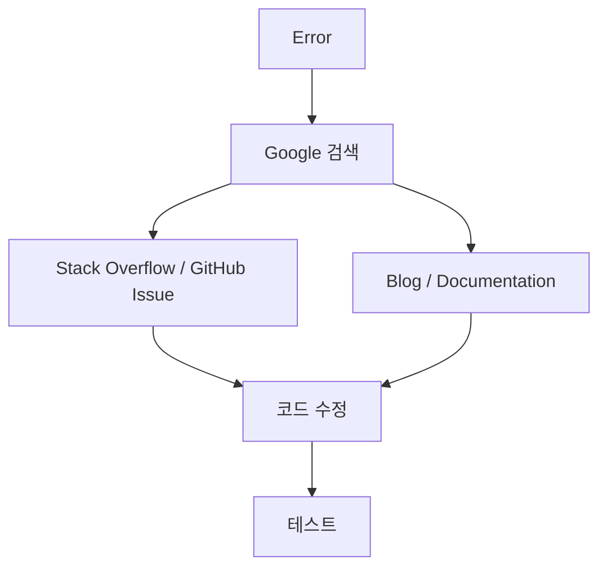
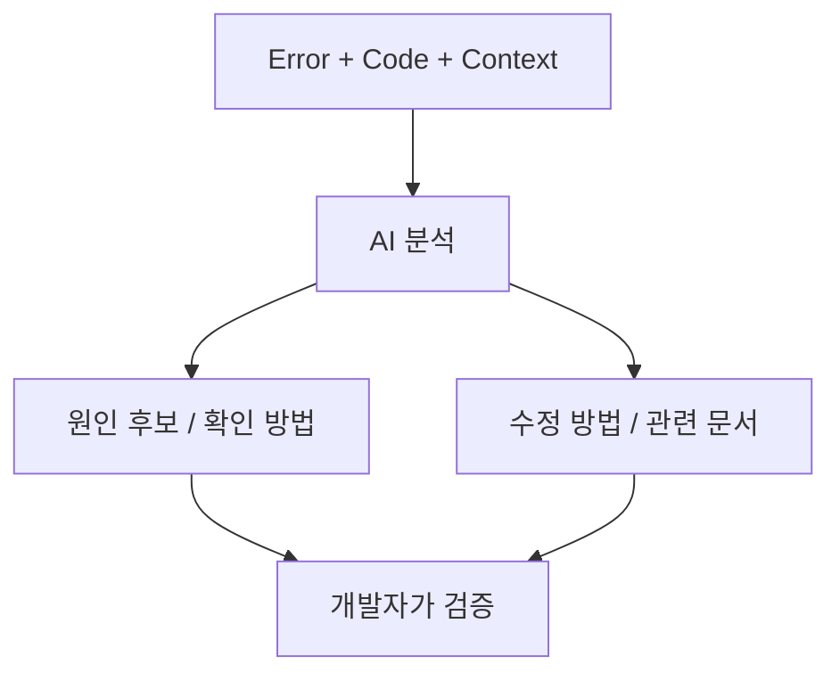
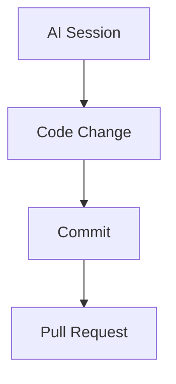

최근에 [ClaudeTuner](https://claudetuner.com/)를 써봤다.

Claude 사용량을 한눈에 볼 수 있게 해주는 도구인데, 생각보다 단순한 사용량 확인 이상의 효과가 있었다.

**내가 AI를 얼마나 쓰고 있는지가 보이기 시작하니까 오히려 AI를 더 자주 활용하게 됐다.**

예전에는 Claude나 ChatGPT를 쓰다가도

> 이건 그냥 내가 하는 게 빠르겠다.

라고 생각하고 직접 처리하는 일이 꽤 많았다.

그런데 사용량이 눈에 보이기 시작하니 생각이 조금 달라졌다.

> 아직 여유가 있는데 이 작업도 AI한테 맡겨볼까?

이런 식으로 AI를 사용할 수 있는 영역을 한 번 더 찾게 됐다.

그 과정에서 한 가지 궁금한 점이 생겼다.

**AI를 잘 사용하고 있다는 것은 어떻게 측정해야 할까?**

---

# AI 사용량과 AI 활용도는 다르다

처음에는 단순하게 사용량을 많이 쓰면 AI를 잘 활용하는 것이라고 생각할 수 있다.

예를 들어 이번 주 Claude 사용률이 90%라면 꽤 많이 사용한 것처럼 보인다.

하지만 많이 사용했다는 것과 잘 활용했다는 것은 조금 다르다.

| 도구 | 사용률 예시 |
|---|---:|
| Claude | 90% |
| ChatGPT | 60% |
| Gemini | 30% |

이 수치만 보면 얼마나 AI를 사용했는지는 알 수 있다.

하지만 이런 질문에는 답하기 어렵다.

- 어떤 작업에 사용했는가?
- 실제 결과물을 만들었는가?
- 시간을 얼마나 줄였는가?
- AI가 만든 결과를 실제로 사용했는가?
- 반복 작업을 AI에게 넘겼는가?

그래서 **AI Usage와 AI Utilization을 구분해서 보는 것이 필요하다**고 생각한다.

---

## 숫자를 기록할 때 먼저 정할 것

아래 사용률과 대시보드 숫자는 화면 구성을 설명하기 위한 예시이며 실측 통계가 아니다. 서비스별 사용률은 한도와 집계 기간이 다를 수 있으므로 서로 더하거나 생산성 순위로 비교하지 않는다.

시간 절감도 생성 시간만으로 계산하면 과대평가하기 쉽다. 예를 들어 **가상의 작업**에서 기존 예상 시간이 60분이고, AI 입력·생성 10분, 검토 15분, 수정·테스트 10분이었다면 순절감 추정치는 25분이다. 기존 예상 시간이 추정값이라는 사실도 함께 기록한다.

개인 회고용으로는 작업 유형, AI 사용 시간, 검토·재작업 시간, 채택 여부, 일주일 뒤 추가 수정 여부 정도부터 기록하면 된다. Coverage는 ‘AI를 사용한 업무 유형 수 / 정의한 업무 유형 수’처럼 분모를 명시하되, 모든 업무에 AI를 쓰는 것을 목표로 삼지는 않는다.

# 개발자에게 중요한 AI 활용 지표

개발자의 AI 사용을 측정한다면 단순 Token이나 Session보다 조금 더 많은 지표가 필요하다.

개인적으로는 다음 정도를 보면 재미있을 것 같다.

| 지표 | 예시 | 의미 |
|---|---|---|
| Usage | Token, Session, 사용률 | 얼마나 많이 사용하는가 |
| Coverage | Coding, Debugging, Docs, Infra | 얼마나 다양한 업무에 사용하는가 |
| Acceptance | AI 결과를 실제 사용한 비율 | 결과가 얼마나 쓸 만한가 |
| Time Saved | 60분 → 15분 | 실제 생산성 향상 |
| Output | PR, Commit, 문서, 테스트 | 실제 결과물 |
| Cost | 월 구독료, API 비용 | 비용 대비 가치 |
| Rework | 수정, 롤백 비율 | 결과물 품질 |

여기서 개인적으로 가장 재미있는 지표는 **Coverage**다.

---

# AI Coverage

개발자가 하는 업무를 몇 가지로 나눠보면 다음과 같다.

- Coding
- Debugging
- Code Review
- Documentation
- Research
- Architecture
- Infrastructure
- Automation

이번 주에 AI를 어떤 영역에서 사용했는지 보면 이런 식으로 표현할 수 있다.

| 업무 | 활용 정도 예시 (10칸 기준) |
|---|---:|
| Coding | 10 / 10 |
| Debugging | 8 / 10 |
| Terraform | 7 / 10 |
| Code Review | 4 / 10 |
| Documentation | 8 / 10 |
| Research | 9 / 10 |
| Architecture | 3 / 10 |
| Automation | 2 / 10 |

이렇게 보면 단순 사용량보다 훨씬 많은 정보를 얻을 수 있다.

예를 들어 `Automation`이 낮다면 다음 주에는 이런 질문을 조금 더 의식적으로 해볼 수 있다.

> 내가 반복해서 하고 있는 이 작업을 AI로 자동화할 수 없을까?

이 질문 하나만으로도 AI를 사용하는 방식이 꽤 달라질 수 있다.

---

# AI를 얼마나 많이 썼는가보다 무엇을 맡겼는가

개발하다 보면 에러를 만나는 일이 정말 많다.

예전에는 에러가 발생하면 보통 이런 흐름이었다.



AI를 적극적으로 사용하면 흐름이 조금 달라진다.



AI가 문제를 대신 해결한다기보다 **문제를 탐색하는 시간을 크게 줄여주는 도구**가 된다.

그래서 나는 AI 활용도를 측정할 때 이런 질문이 중요하다고 생각한다.

> 예전에는 내가 직접 하던 작업 중 얼마나 많은 부분을 AI와 함께 처리하고 있는가?

---

# ClaudeTuner가 재미있었던 이유

ClaudeTuner 자체는 사용량을 보여주는 도구다.

그런데 나에게 더 재미있었던 부분은 사용량보다 **행동 변화**였다.

사용량을 볼 수 있으니 AI를 사용할 수 있는 일을 더 찾게 됐다.

작업이 생기면 바로 직접 시작하기 전에 **AI에게 먼저 맡겨볼 수 있는지** 판단한다.

이 작은 변화가 생각보다 크다.

AI를 잘 사용하는 사람과 그렇지 않은 사람의 차이는 모델이나 프롬프트 기술보다도

**문제를 만났을 때 AI를 사용할 수 있는지 먼저 생각하는 습관**에서 생길 수도 있다.

---

# 사용량 100%가 목표는 아니다

그렇다고 AI 사용량을 100% 채우는 것을 목표로 삼는 것은 조금 이상하다.

```text
이번 주 Claude 100% 사용!
```

이 자체가 생산성을 의미하지는 않는다.

불필요한 질문을 많이 해도 사용량은 올라가기 때문이다.

그래서 목표를 이렇게 바꾸는 것이 더 좋다고 생각한다.

> 내가 하는 일 중 AI에게 맡길 수 있었는데 직접 반복해서 처리한 일은 얼마나 되는가?

이 질문은 단순 Usage보다 훨씬 생산성에 가깝다.

---

# 개인용 AI Dashboard를 만든다면

만약 내가 개인용 AI Usage Dashboard를 만든다면 이런 화면을 만들어보고 싶다.

**대시보드 구성 예시 — 실제 측정값이 아니다.**

| 도구 | 이번 주 사용률 예시 |
|---|---:|
| Claude | 78% |
| ChatGPT | 62% |
| Gemini | 31% |

| AI 지원 업무 | 건수 예시 |
|---|---:|
| Coding | 31 |
| Debugging | 14 |
| Research | 18 |
| Docs | 9 |
| Review | 7 |
| Infra | 6 |

| 결과물 | 건수 예시 |
|---|---:|
| PR | 8 |
| Commit | 27 |
| Docs | 6 |
| Scripts | 4 |

예시 요약 지표는 **절감 시간 약 11.5시간**, **AI Coverage 81%**다. 각 지표의 분모와 측정 기간은 별도로 정의해야 한다.

여기에 GitHub의 Commit이나 PR 데이터까지 연결하면 꽤 재미있는 데이터가 나올 것 같다.

예를 들어



같은 흐름을 볼 수 있다면 단순히 "AI를 많이 사용했다"가 아니라

**AI가 실제 개발 결과물에 얼마나 연결되었는지**도 볼 수 있다.

---

# 앞으로는 개발자의 AI 활용률도 지표가 되지 않을까?

예전에는 개발자의 생산성을 이야기할 때 Commit 수나 PR 수 같은 지표를 생각하는 경우가 많았다.

물론 이런 수치만으로 개발자의 생산성을 평가하는 것은 위험하다.

AI도 마찬가지다.

Token이나 Session만으로 AI 활용도를 판단할 수는 없다.

하지만 개인이 자신의 작업 방식을 돌아보기 위한 용도로는 꽤 의미 있는 데이터가 될 수 있다고 생각한다.

AI 활용도는 **Usage·Coverage·Acceptance·Time Saved·Real Output**을 함께 보고 판단한다.

결국 중요한 것은 AI를 얼마나 많이 사용했느냐가 아니라

**내가 하던 일을 얼마나 더 빠르고, 더 넓게, 더 좋은 품질로 처리할 수 있게 되었느냐**다.

ClaudeTuner를 사용하면서 단순히 Claude 사용량을 확인하려고 했는데, 오히려 내가 AI를 사용하는 방식 자체를 다시 생각하게 됐다.

앞으로는 AI 모델의 성능을 비교하는 것만큼이나

**내가 AI를 얼마나 잘 활용하고 있는지 측정하는 것도 재미있는 주제가 될 것 같다.**

그리고 가능하다면 직접 개인용 AI Usage Dashboard도 한번 만들어보고 싶다.

---

## 참고

- [ClaudeTuner](https://claudetuner.com/)

