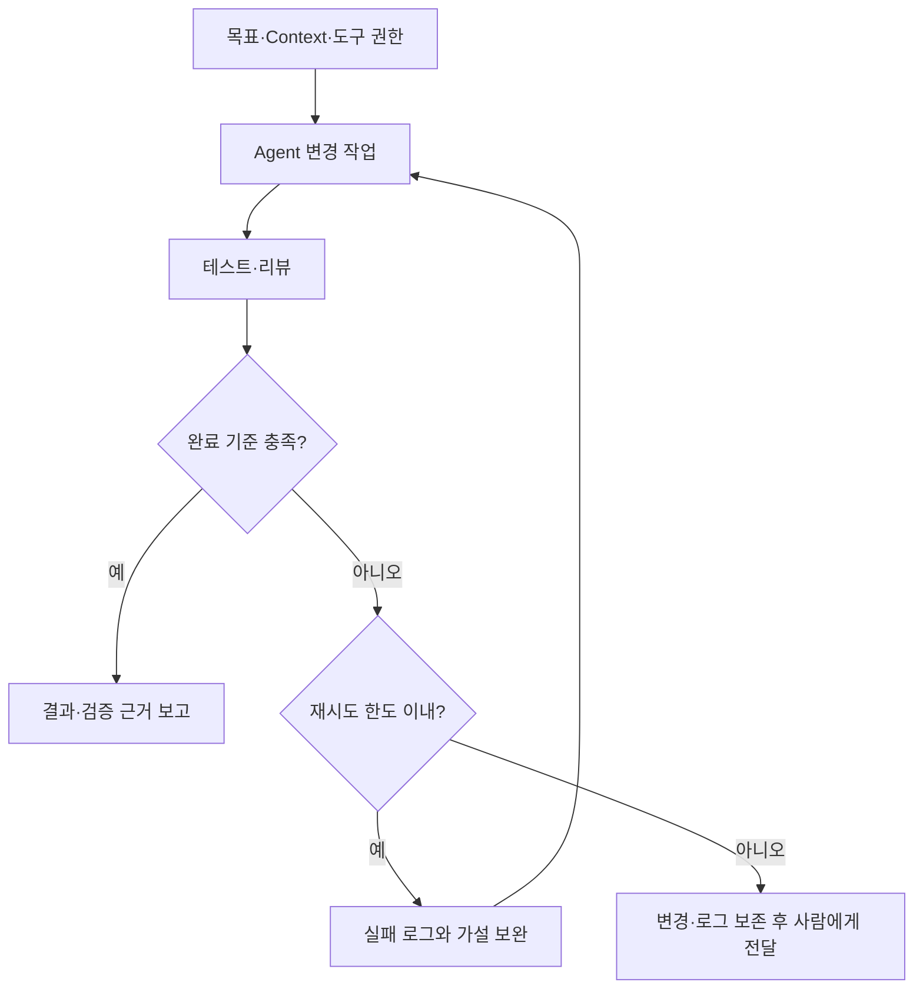

모델이 코드를 생성할 수 있어도 저장소 구조, 테스트 방법, 배포 규칙을 모르면 작업을 끝내기 어렵다. 개발 에이전트의 실패를 볼 때 모델 성능과 함께 **일할 환경과 피드백**을 살펴봐야 하는 이유다.

이 글에서 Agent Harness는 모델 주변의 도구, 실행 환경, 권한, 상태 관리와 검증 루프를 묶은 시스템을 뜻한다. 특정 모델의 성능 평가나 직접 구축한 시스템의 실험 보고서는 아니다.

## Prompt·Context·Harness의 역할

| 영역 | 질문 | 예 |
|---|---|---|
| Prompt | 무엇을 수행할까? | 로그인 오류를 수정해 달라는 요청 |
| Context | 판단에 필요한 정보는 무엇인가? | 관련 코드, 로그, 설계 문서 |
| Harness | 어떻게 실행하고 검증할까? | 격리 환경, 테스트 명령, 도구 권한, 종료 조건 |

세 영역은 대체 관계가 아니다. 지시를 명확히 하고 필요한 정보를 제공해도 도구가 없으면 실행할 수 없고, 도구가 있어도 검증이 약하면 잘못된 변경을 완료로 판단할 수 있다.

## 저장소에는 짧은 안내와 실행 가능한 검증을 둔다

다음은 **가상의 Node.js 저장소**에 넣을 수 있는 `AGENTS.md` 예시다. 실제 프로젝트의 명령과 디렉터리에 맞춰 바꿔야 한다.

```markdown
# 작업 안내
- 구조: src/는 서비스 코드, tests/는 테스트, docs/는 설계 문서다.
- 시작 전: package.json의 scripts와 docs/architecture.md를 읽는다.
- 설치: npm ci
- 검증: npm test, npm run lint, npm run build
- API 변경: 기존 호출자와 호환성을 확인하고 관련 테스트를 실행한다.
- DB migration: 롤백 가능 여부와 데이터 영향을 설명한다.
- 완료 보고: 변경 이유, 실행한 검사, 미검증 항목을 남긴다.
```

없는 명령을 문서에 적어두면 오히려 실패를 반복한다. 안내 문서와 CI가 같은 명령을 쓰도록 유지하고, 긴 설계 설명은 링크로 분리한다.

## 지침은 권한 제한을 대신하지 않는다

- **코드 변경:** 작업 브랜치, 변경 diff 검토
- **테스트:** 재생성 가능한 격리 환경과 테스트 데이터
- **로그 분석:** 필요한 범위의 조회 권한과 민감정보 처리
- **배포:** 대상 환경 분리, 필수 검사, 승인 정책
- **복구:** 실패 로그 보존, 재시도 한도, 사람에게 넘길 조건

‘운영 환경에 배포하지 말라’는 문장만으로 배포 통제가 완성되지는 않는다. credential과 배포 gate에서도 허용 범위를 제한해야 한다.

## 실패를 환경 개선으로 연결하는 예

다음은 실제 측정 결과가 아닌 설계 예시다.

1. 에이전트가 로그인 오류를 수정했지만 토큰 만료 케이스를 놓쳤다.
2. 기존 테스트에 만료 사례가 없음을 확인한다.
3. 정상·만료·변조 토큰에 대한 회귀 테스트와 테스트 데이터 준비법을 추가한다.
4. 같은 종류의 변경에서 해당 테스트가 CI 필수 검사로 실행되도록 한다.
5. 다음 작업에서 오류가 줄었는지 별도 평가한다.

테스트를 추가했다고 정확성이 보장되는 것은 아니다. 테스트의 의도까지 에이전트가 바꿔 통과시키지 않았는지, 실제 요구사항을 검증하는지도 리뷰해야 한다.

## 관측과 종료 조건



에이전트가 읽을 수 있는 로그·테스트 결과·배포 상태를 제공하면 실패 원인을 좁히기 쉽다. 동시에 실행 시간, 재시도 횟수, 외부 호출 비용의 한도를 정한다.

예를 들어 같은 테스트 실패가 정해진 횟수 이상 반복되면 수정 내용을 보존하고 사람에게 넘긴다. 이때 목표, 변경 diff, 재현 명령, 실패 로그와 남은 가설이 있어야 다음 사람이 이어받을 수 있다.

## 개선 효과는 작업 단위로 측정한다

완료한 커밋 수나 생성 코드량만으로 품질을 판단하지 않는다. 같은 유형의 작업에서 다음을 비교한다.

- 요구사항을 충족한 작업 비율
- 사람이 수정한 시간과 개입 횟수
- 완료까지 걸린 시간과 도구·모델 비용
- 리뷰에서 발견된 결함, 이후 롤백·재작업
- 권한 위반 시도와 중단 사유

쉬운 작업만 골라 성공률을 높이지 않도록 평가 작업 집합과 완료 기준을 고정한다. 모델 변경과 Harness 변경도 가능하면 나눠 평가한다.

## DevOps와 연결되는 지점

격리 환경, IAM, CI, 관측, 복구 절차는 기존 DevOps에서도 다루던 문제다. 에이전트가 이 시스템을 사용할 수 있도록 인터페이스와 피드백을 정리하는 것이 Harness Engineering의 실용적인 출발점이다.

처음부터 큰 플랫폼을 만들기보다는 **저장소 안내, 재현 가능한 테스트, 제한된 도구 권한, 실패 보고 형식**을 먼저 갖추겠다. 에이전트의 반복 실패를 관찰하고 필요한 부분을 개선하는 방식이 더 현실적이다.

## 참고 자료

- [OpenAI — Harness engineering](https://openai.com/index/harness-engineering/)
- [OpenAI — Codex](https://openai.com/codex/)

