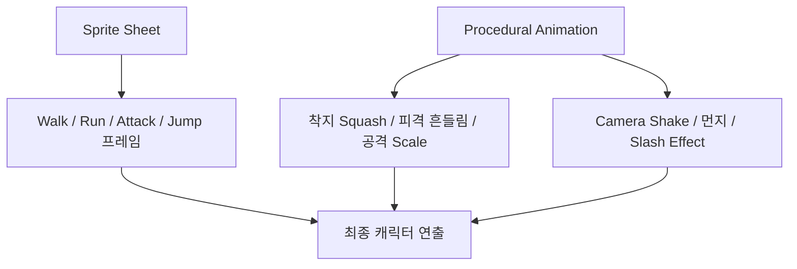
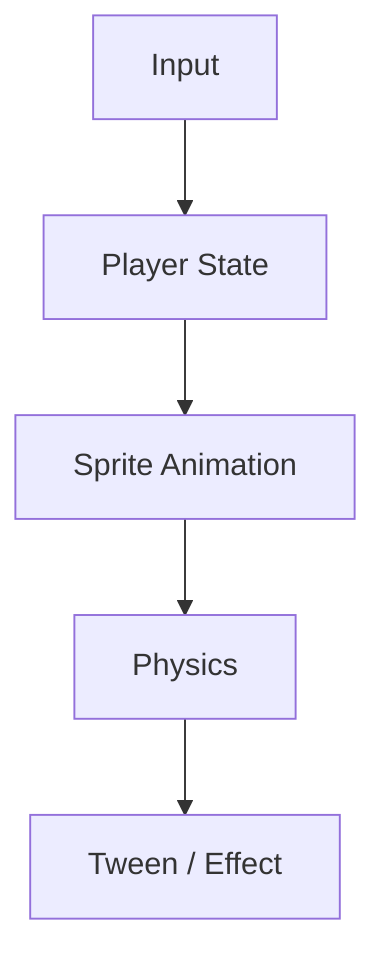

이 글에서는 2D 캐릭터 애니메이션을 시작할 때 비교하기 쉬운 두 방식, 프레임 교체와 간단한 코드 변형을 살펴본다. 모든 애니메이션 기법을 두 가지로 분류한다는 뜻은 아니다.

하나는 **여러 장의 그림을 빠르게 교체하는 Sprite Sheet 방식**이고,
다른 하나는 **코드로 움직임과 변형을 계산하는 Procedural Animation 방식**이다. 여기서는 한 장의 이미지에 적용하는 간단한 변형을 예로 든다.

둘 다 많이 쓰이고, 목적도 조금 다르다.

---

# 1. Sprite Sheet Animation

가장 전통적인 2D 캐릭터 애니메이션 방식이다.

걷기 동작이라면 캐릭터의 자세를 여러 장 준비한다.

걷기 애니메이션은 **1~6번 프레임을 순서대로 반복 재생**하는 방식이다.

이 프레임들을 일정한 속도로 반복하면 캐릭터가 걷는 것처럼 보인다.

보통 상태별로 이런 프레임을 만든다.

- Idle
- Walk
- Run
- Jump
- Attack
- Hit
- Dead

Phaser 같은 2D 게임 엔진은 이런 frame-based animation을 기본으로 지원한다.
공식 문서에서도 Sprite Sheet나 Texture Atlas의 프레임을 순서대로 재생하는 방식을 기본 애니메이션 방식으로 설명하고 있다.

예를 들어 Phaser에서는 다음처럼 애니메이션을 정의할 수 있다.

```javascript
this.anims.create({
  key: 'walk',
  frames: this.anims.generateFrameNumbers('player', {
    start: 0,
    end: 5
  }),
  frameRate: 10,
  repeat: -1
});
```

이후 캐릭터가 움직일 때:

```javascript
player.play('walk', true);
```

멈추면:

```javascript
player.play('idle', true);
```

처럼 상태에 따라 애니메이션을 바꿀 수 있다.

구조는 단순하다.

Player State에 맞는 프레임 묶음을 선택한다.

- **Idle:** idle frames
- **Walk:** walk frames
- **Jump:** jump frames
- **Attack:** attack frames

장점은 캐릭터의 팔, 다리, 표정까지 원하는 대로 표현할 수 있다는 점이다.
반대로 프레임을 직접 만들어야 하므로 아트 작업량이 늘어난다.

---

# 2. Procedural Animation

반대로 캐릭터 이미지 한 장만 있어도 어느 정도 움직임을 만들 수 있다.

예를 들어:

- Scale
- Rotate
- Flip
- Tween

같은 변형을 코드로 적용하는 방식이다.

왼쪽으로 이동할 때 캐릭터를 뒤집는다면:

```javascript
player.setFlipX(true);
```

걷는 느낌을 내기 위해 몸을 살짝 눌렀다 늘릴 수도 있다.

```javascript
const bounce = Math.sin(time * 0.02) * 0.04;
player.setScale(1 + bounce, 1 - bounce);
```

점프할 때는 세로로 늘리고:

```javascript
player.setScale(0.85, 1.15);
```

착지할 때는 반대로 눌러줄 수 있다.

```javascript
player.setScale(1.15, 0.85);
```

이런 표현은 애니메이션에서 흔히 말하는 **Squash & Stretch**와 비슷하다.

Phaser의 Tween을 이용하면 공격, 착지, 피격 같은 짧은 움직임도 쉽게 만들 수 있다.

```javascript
this.tweens.add({
  targets: player,
  scaleX: 1.2,
  scaleY: 0.85,
  duration: 80,
  yoyo: true
});
```

장점은 별도의 프레임 이미지가 없어도 빠르게 움직임을 만들 수 있다는 점이다.

특히 프로토타입이나 단순한 캐릭터에는 효과적이다.

---

# Sprite Sheet vs Procedural Animation

| 방식 | 장점 | 단점 |
|---|---|---|
| **Sprite Sheet** | 자세한 동작 표현, 자연스러운 걷기/공격 | 프레임 제작 필요 |
| **Procedural Animation** | 구현 빠름, 이미지 한 장으로 가능 | 세밀한 팔·다리 동작 표현이 어려움 |

둘 중 하나만 선택할 필요는 없다.

실제로는 둘을 같이 쓰는 것이 자연스럽다.



즉 캐릭터의 큰 움직임은 Sprite Sheet로 만들고,
게임의 타격감이나 생동감은 Procedural Animation으로 보완하는 방식이다.

---

# Phaser에서 같이 사용한다면

Phaser에서는 `Sprite`가 frame animation을 지원하고, 동시에 Tween, Scale, Rotation, Tint 같은 속성도 적용할 수 있다.

그래서 이런 구조를 만들기 좋다.



예를 들어 이동하면:

```javascript
player.play('walk', true);
```

점프하면:

```javascript
player.play('jump');
```

동시에 점프 순간에:

```javascript
this.tweens.add({
  targets: player,
  scaleX: 0.9,
  scaleY: 1.1,
  duration: 80,
  yoyo: true
});
```

같은 추가 효과를 줄 수 있다.

이렇게 하면 Sprite Sheet만 사용할 때보다 훨씬 생동감 있는 움직임을 만들 수 있다.

---

## 뼈대 애니메이션이라는 선택지도 있다

Spine 같은 도구는 몸통·팔·다리 이미지를 뼈대에 연결하고 관절을 움직인다. 프레임별 완성 그림을 모두 그리지 않아도 자세를 바꿀 수 있으며 Phaser용 runtime도 제공된다.

| 방식 | 준비할 자산 | 선택 기준 |
|---|---|---|
| 프레임 애니메이션 | 자세별 그림, sprite sheet 또는 atlas | 프레임마다 독특한 실루엣·표현이 중요할 때 |
| 뼈대 애니메이션 | 분리된 파츠, 리깅·애니메이션 데이터 | 관절 움직임과 파츠 교체를 재사용할 때 |
| 절차적 애니메이션 | 이미지/파츠/뼈대와 계산 로직 | 속도·지형·입력에 반응하는 움직임이 필요할 때 |

절차적 애니메이션은 scale tween에 한정되지 않는다. 뼈대나 IK와 조합할 수도 있다. Spine을 선택한다면 도구 라이선스와 runtime 버전 호환성을 먼저 확인한다.

## 예제를 연결할 때 주의할 점

위 코드는 독립 실행 게임이 아닌 핵심 API 예시다. 실제 프로젝트에는 sprite sheet 로딩 시 frame 크기, idle/jump 애니메이션 정의, 상태 전환 처리가 필요하다. update에서 매 프레임 scale을 쓰면서 같은 속성에 tween을 걸면 서로 덮어쓸 수 있으므로 상태별로 변형을 한 곳에서 관리한다. 원래 scale이 1이 아니라면 복귀 기준도 원래 값으로 둔다.

# 정리

2D 캐릭터 애니메이션을 시작할 때는 이렇게 생각하면 쉽다.

- **빠른 프로토타입:** Procedural Animation
- **프레임별 캐릭터 동작:** Sprite Sheet
- **동작에 타격감과 생동감 추가:** Sprite Sheet + Procedural Animation

처음에는 한 장짜리 캐릭터에 `Flip`, `Scale`, `Tween`만 적용해도 충분히 움직이는 느낌을 만들 수 있다.

걷기, 달리기, 공격처럼 팔다리의 자세가 바뀌는 동작은 프레임 애니메이션이나 뼈대 애니메이션으로 표현할 수 있다. Sprite Sheet가 반드시 필요한 것은 아니다.

결국 가장 실용적인 구조는:

프레임 동작은 **Sprite Sheet**, 보조 연출은 **Procedural Animation**, 이동과 충돌은 **2D Physics**가 담당한다.

조합이라고 생각한다.

---

## 참고

- [Phaser — Spine animations](https://docs.phaser.io/phaser-editor/scene-editor/spine-animations)

- [Phaser — Animations](https://docs.phaser.io/phaser/concepts/animations)
- [Phaser — Sprite](https://docs.phaser.io/phaser/concepts/gameobjects/sprite)
- [Phaser — Arcade Physics](https://docs.phaser.io/phaser/concepts/physics/arcade)

