SIEM을 직접 구성한다고 하면 처음에는 이런 구조를 생각하기 쉽다.

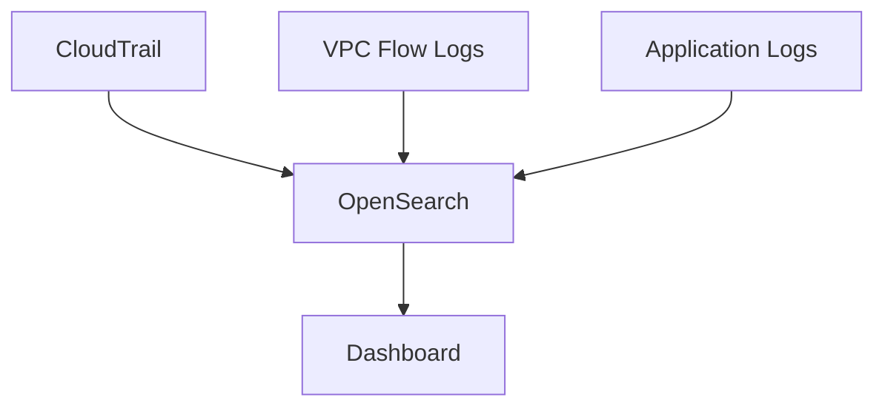

물론 이것도 가능하다.

하지만 보안 로그가 많아지고 장기 보관까지 필요해지면 OpenSearch 하나가 Storage, Search, Dashboard, Detection, Long-term Retention 역할을 모두 담당하게 된다.

운영 규모가 커질수록 이 구조는 비용과 관리 복잡도가 빠르게 증가한다.

그래서 AWS에서 SIEM을 구성할 때는 **저장, 분석, 탐지, 대응의 역할을 분리하는 구조**가 더 적합하다.

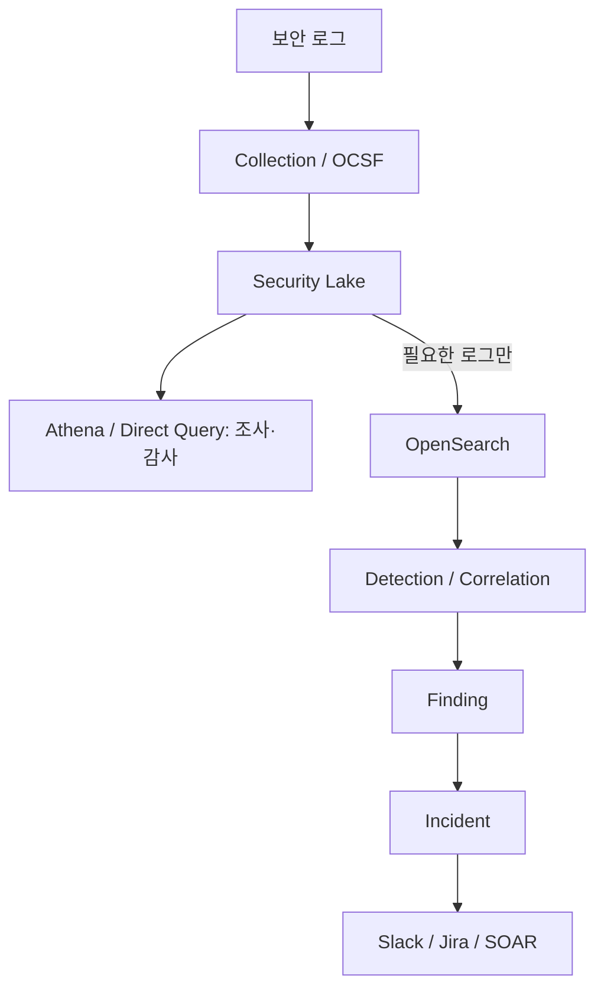

한 줄로 정리하면:

> **Security Lake는 저장, OpenSearch는 실시간 분석, OCSF는 표준화, Detection/Correlation은 탐지, Incident는 대응으로 역할을 분리하는 구조가 좋다.**

---

# 전체 Architecture

Production 환경을 기준으로 보면 다음처럼 구성할 수 있다.

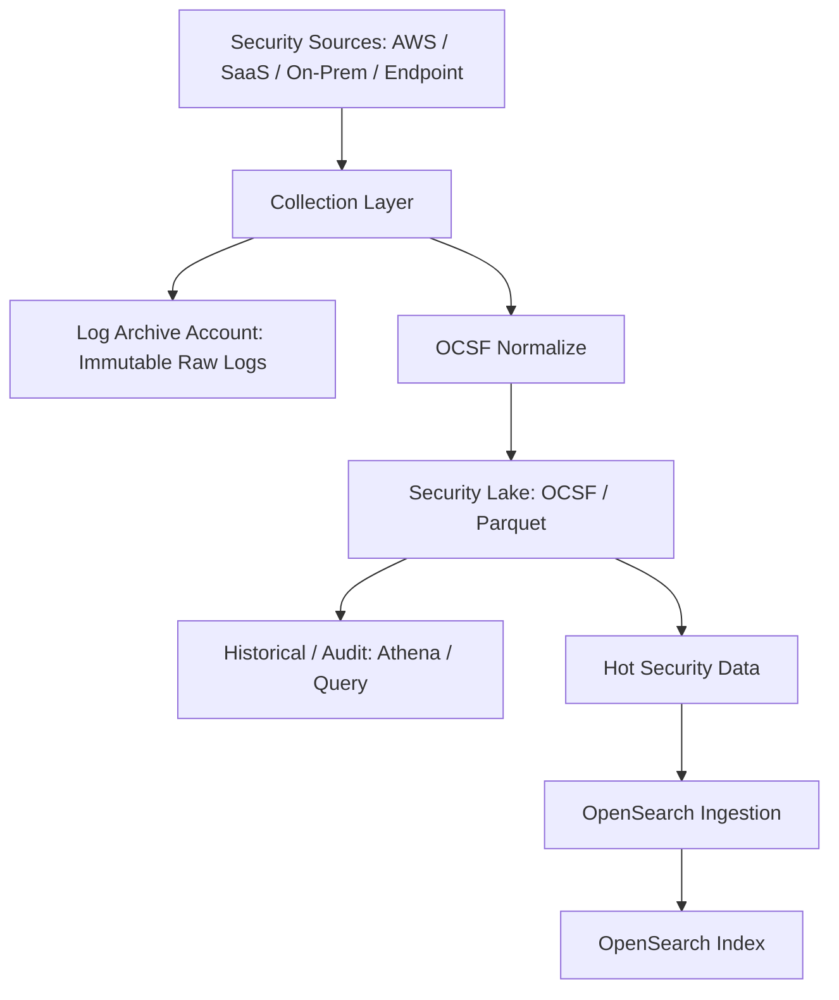

검색 인덱스 이후에는 탐지 결과를 대응 단위로 묶는다.

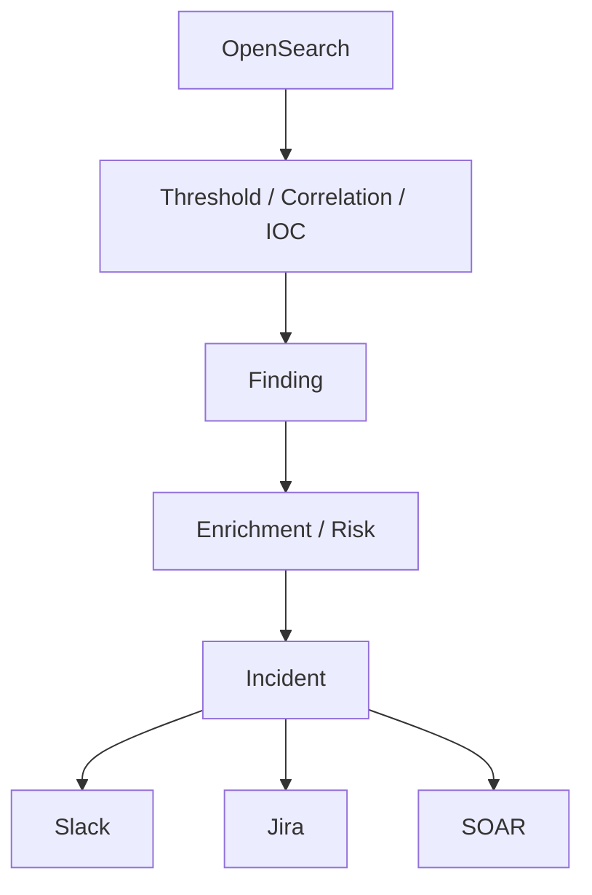

여기서 중요한 건 모든 데이터를 하나의 시스템에 넣지 않는 것이다.

---

# Security Lake와 Log Archive의 역할을 나눈다

Security Lake는 보안 분석에 사용할 Security Data Lake다.

하지만 모든 원본 로그 보관 책임까지 Security Lake 하나에 맡기기보다, 별도의 **Log Archive Account**를 두는 구조가 더 안전하다.

```text
Security Lake
= Security Analytics의 Source of Truth

Log Archive
= Immutable Audit / Raw Log Archive
```

즉 분석용 데이터와 변경이 어려운 감사용 원본 로그를 분리한다.

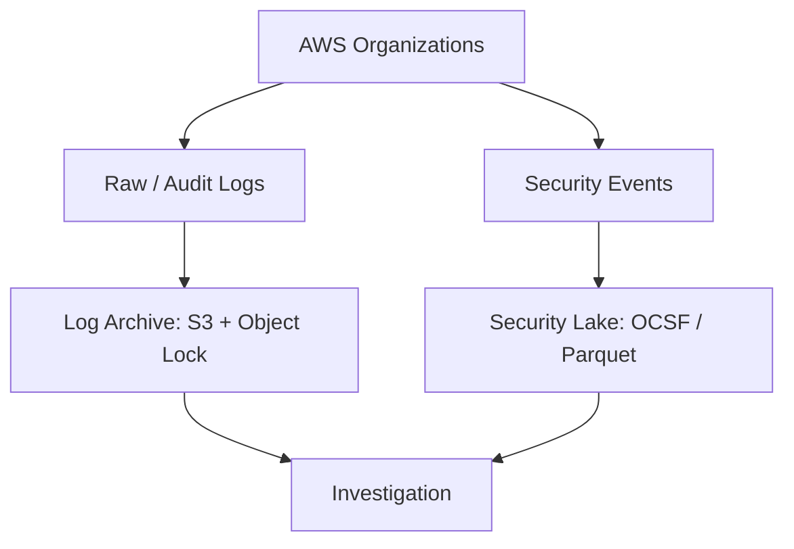

Log Archive에는 S3 Versioning, Object Lock, KMS, Lifecycle, SCP 같은 보호 정책을 적용해 로그 삭제나 임의 변경을 어렵게 만드는 것이 좋다.

---

## 원본 보관과 분석용 변환의 경계를 명확히 한다

위 구조는 논리적 책임을 나타낸 설계도다. 원본 감사 로그가 필요하면 정규화 이전 데이터가 별도 경로로 보존되어야 한다. OCSF 변환 결과를 저장하면서 원본과 동일하다고 부르지는 않는다. AWS native source의 관리형 수집과 별도 감사 로그 전달은 서비스별 설정을 확인한다.

이 글은 실제 부하·비용·탐지 지연을 측정한 구축 보고서가 아니다. 운영 설계에서는 source 발생 → 수집 → 변환 → 색인 → 규칙 실행 → 알림까지 구간별 지연을 측정한다. ‘실시간’이라는 표현만으로 초 단위 탐지를 보장하지 않는다.

# OCSF는 가능한 초기에 맞춘다

SIEM에서는 로그를 많이 모으는 것보다 **공통 Schema로 분석할 수 있게 만드는 것**이 중요하다.

AWS native source는 Security Lake가 OCSF(Open Cybersecurity Schema Framework)와 Apache Parquet 형태로 변환한다.

CloudTrail, VPC Flow Logs, Route 53, EKS, WAF, Security Hub 등의 지원 소스를 Security Lake에 연결해 OCSF 형식으로 다룬다. 실제 지원 범위는 소스별로 확인한다.

반면 SaaS, On-Premise, Endpoint 같은 Custom Source는 수집 단계에서 OCSF에 맞추는 편이 좋다.

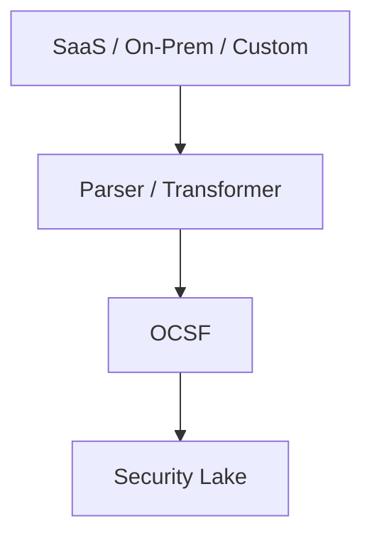

이렇게 하면 Detection Rule이 특정 Vendor Schema에 과도하게 종속되는 문제를 줄일 수 있다.

---

# 모든 로그를 OpenSearch에 넣지 않는다

가장 중요한 개선점이다.

OpenSearch는 검색과 실시간 분석에는 강하지만 모든 보안 로그의 장기 저장소로 사용하면 비용이 커질 수 있다.

그래서 로그 중요도와 사용 목적에 따라 Tier를 나눈다.

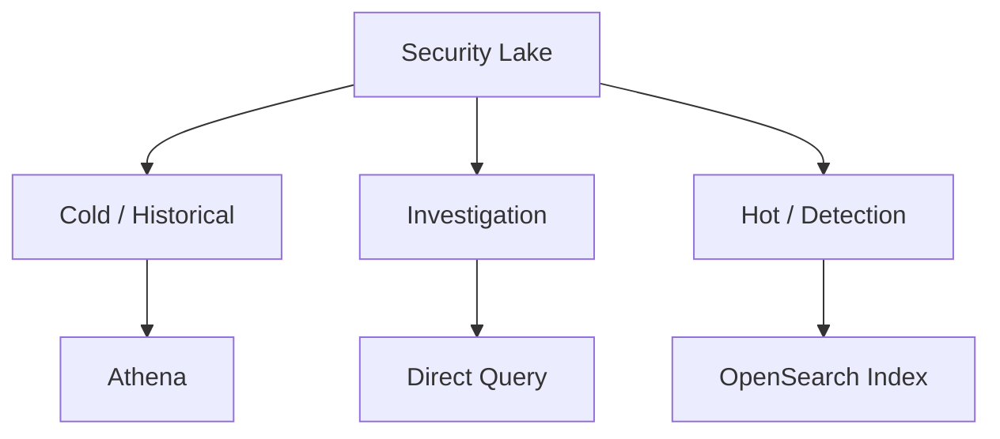

예를 들어:

| Tier | 예시 | 저장/조회 |
|---|---|---|
| Hot | 인증, IAM 변경, WAF 공격 | OpenSearch |
| Warm | 최근 Investigation 대상 | Security Lake + 필요 시 Index |
| Cold | 장기 감사, 과거 분석 | Security Lake / S3 + Athena |

**실시간 Detection이 필요한 데이터만 OpenSearch에 넣고, 나머지는 Data Lake에서 보관하는 구조**가 비용 측면에서 유리하다.

---

# Athena와 Zero-ETL Direct Query

Security Lake는 S3 기반이기 때문에 Athena를 이용해 과거 로그를 조회할 수 있다.

**Security Lake** → **Athena** → **Historical Investigation**

OpenSearch의 Security Lake Direct Query를 사용할 수 있는 Region이라면 데이터를 별도 Index로 복제하지 않고 SQL/PPL로 조회하는 방식도 사용할 수 있다.

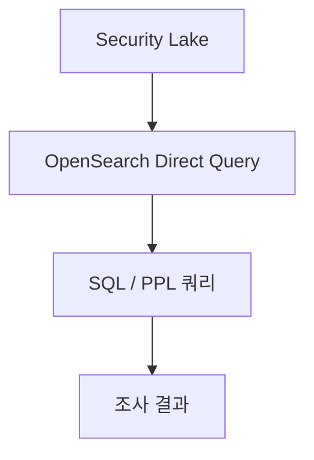

이 방식은 평소에는 데이터를 S3에 두고, Investigation이 필요할 때 조회하는 구조에 잘 맞는다.

> **주의:** 2026년 9월 기준 AWS 문서의 Security Lake Direct Query 지원 Region 목록에는 서울(`ap-northeast-2`)이 포함되어 있지 않다. 실제 구축 전에는 반드시 최신 Region 지원 여부를 확인해야 한다.

---

# Lambda보다 관리형 Ingestion Pipeline을 우선한다

예전에는 다음 같은 구조를 직접 구성하는 경우가 많았다.

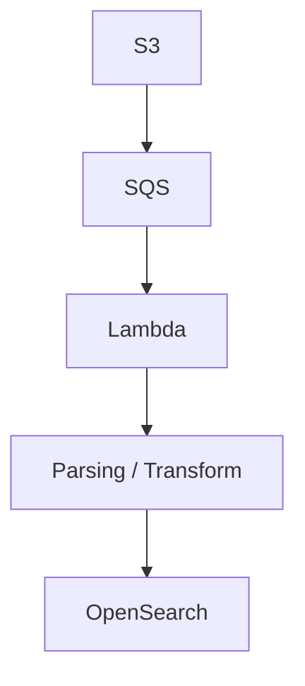

표준적인 수집과 변환은 가능하면 **OpenSearch Ingestion** 같은 관리형 Pipeline을 우선 사용하는 편이 운영 부담을 줄일 수 있다.

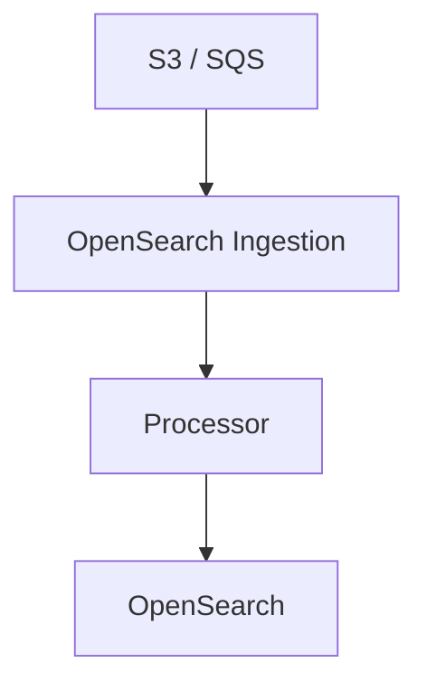

Lambda를 없애야 한다는 뜻은 아니다.

외부 API 호출, 특수한 enrichment, 복잡한 Custom Transform처럼 관리형 Pipeline에서 처리하기 어려운 부분에만 Lambda를 쓰는 방식이 좋다.

---

# DLQ와 Replay는 필수에 가깝다

Security Log Pipeline에서는 데이터 유실을 단순 Application Log보다 더 심각하게 봐야 한다.

Schema 오류나 OpenSearch Mapping 오류가 발생했을 때 Event를 그냥 버리면 Incident Investigation에서 중요한 증거가 사라질 수 있다.

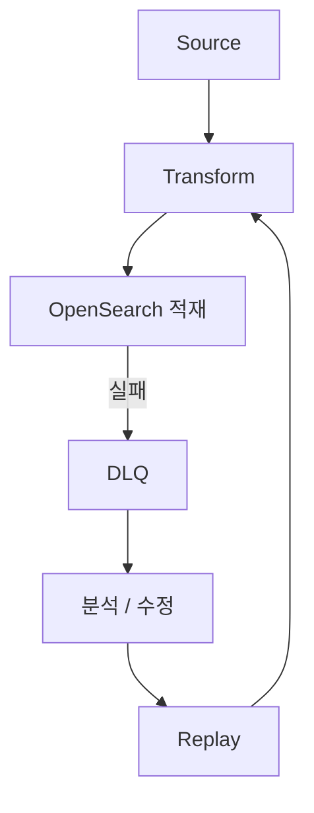

그래서 Pipeline에는 최소한:

- DLQ
- Replay
- Retry
- Pipeline Lag Monitoring
- Failure Metrics

를 같이 설계하는 것이 좋다.

---

# Detection은 Sigma 하나로 끝나지 않는다

Sigma Rule은 좋은 Detection Rule 포맷이지만 실제 SIEM Detection은 여러 방식이 필요하다.

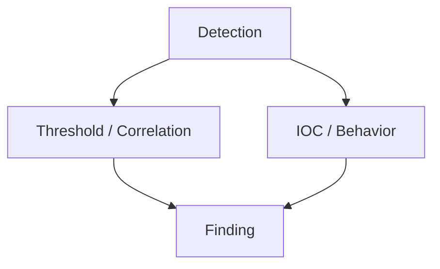

각 방식은 역할이 다르다.

- **Threshold**: 일정 시간 동안 실패 로그인 급증 같은 단순 이상 탐지
- **Correlation**: 로그인 → IAM 변경 → 데이터 접근처럼 여러 Event 연결
- **IOC**: 알려진 악성 IP, Domain, Hash와 비교
- **Behavior**: 평소와 다른 User/Entity 행동 탐지

실제 Detection 품질은 여러 Rule Type을 조합할 때 좋아진다.

---

# Event, Finding, Incident를 분리한다

여기서 중요한 개념이 하나 있다.

**Finding 하나가 Incident 하나는 아니다.**

예를 들어:

- **Finding A:** Suspicious Login
- **Finding B:** IAM Policy Change
- **Finding C:** S3 Mass Download

가 각각 발생했더라도:

```text
User = 동일
IP = 동일
Time = 10분 이내
```

라면 하나의 Incident로 묶을 수 있다.

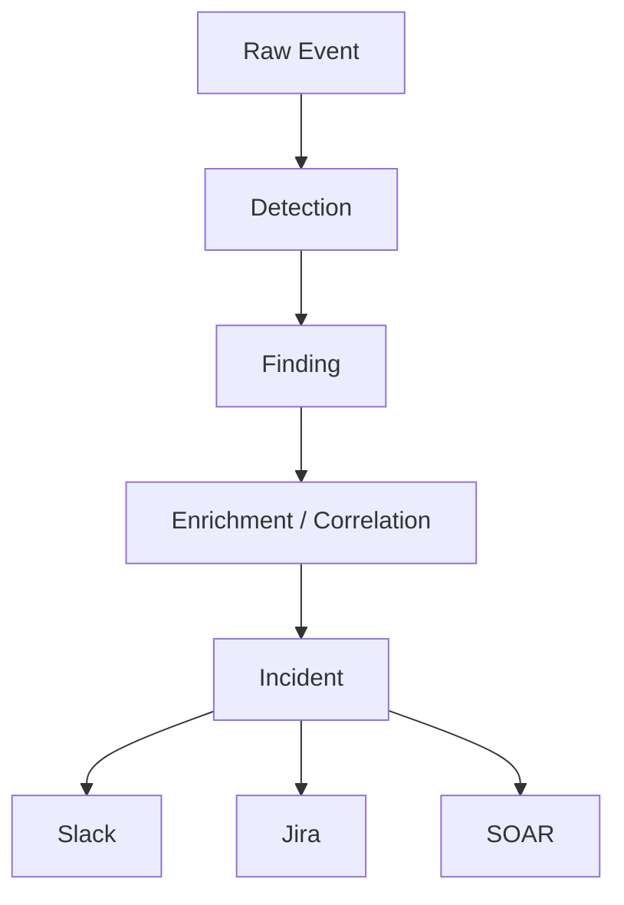

이렇게 하면 Detection과 Incident Response의 책임도 명확하게 나눌 수 있다.

---

# Detection Rule도 GitOps로 관리한다

Detection Rule을 OpenSearch Console에서 직접 수정하기 시작하면 변경 이력을 관리하기 어렵다.

운영 규모가 커질수록 Rule도 코드처럼 관리하는 것이 좋다.

- `detections/aws/suspicious-login.yml`
- `detections/aws/iam-policy-change.yml`
- `detections/aws/cloudtrail-disabled.yml`
- `detections/network/`
- `detections/saas/`

변경 과정도 일반 Application Code와 비슷하게 가져갈 수 있다.

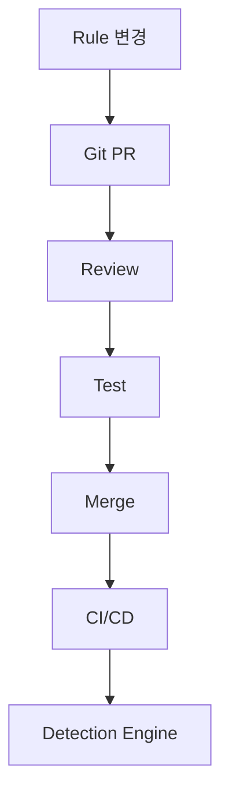

이렇게 하면 누가, 언제, 왜 Detection Rule을 변경했는지 추적할 수 있고 Rollback도 쉬워진다.

---

# Multi-Account에서는 Security와 Log Archive 계정을 분리한다

AWS Organizations 환경이라면 Production Account 안에 SIEM 전체를 같이 두기보다 Security 관련 Account를 분리하는 것이 좋다.

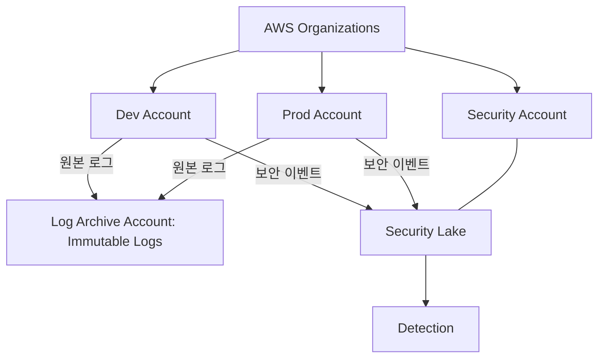

여기에 Delegated Administrator, IAM, KMS, Lake Formation, SCP를 같이 설계해야 한다.

SIEM은 공격자가 가장 먼저 흔적을 지우려고 할 수 있는 시스템이기 때문에 **로그를 생성하는 Account와 보관하는 Account를 분리하는 것**이 중요하다.

---

# 운영 관점의 횡단 관심사

Architecture Diagram에는 잘 보이지 않지만 운영에서는 다음 항목도 중요하다.

- **GitOps:** Detection Rules / Config / IaC
- **Observability:** Pipeline Health / Lag / DLQ
- **Resilience:** DLQ / Replay / Retry
- **Governance:** IAM / KMS / SCP / Retention

SIEM의 품질은 Detection Rule뿐 아니라 **수집 Pipeline이 정상적으로 동작하고 있는지**를 얼마나 잘 관찰하는지에도 크게 좌우된다.

---

# 정리

AWS에서 SIEM을 구성할 때 핵심은 OpenSearch Cluster 하나를 만드는 것이 아니다.

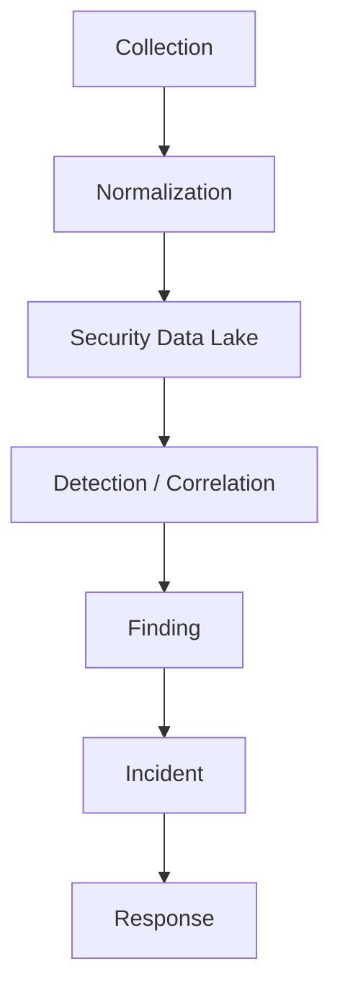

역할을 AWS 서비스와 운영 구조에 대응시키면:

```text
Log Archive
= 삭제 방지와 감사용 원본

Security Lake
= OCSF 기반 Security Data Lake

Athena / Direct Query
= Historical Investigation

OpenSearch
= Hot Data Search / Detection

Detection Engine
= Threshold / Correlation / IOC / Behavior

Finding / Incident
= 탐지 결과와 실제 대응 단위 분리

Slack / Jira / SOAR
= Response
```

가 된다.

결국 Production SIEM에서는 **모든 로그를 한곳에 넣는 것보다 저장, 분석, 탐지, 대응의 책임을 분리하는 것이 더 중요하다.**

SIEM 자체의 개념부터 보고 싶다면 이전 글에서 정리했다.

← [SIEM이란 무엇인가: 로그 수집부터 탐지와 대응까지](/posts/what-is-siem/)

## 참고 자료

- [Amazon Security Lake — User Guide](https://docs.aws.amazon.com/security-lake/latest/userguide/what-is-security-lake.html)
- [AWS — Security Lake에서 OpenSearch로 수집하기](https://aws.amazon.com/blogs/big-data/ingest-transform-and-deliver-events-published-by-amazon-security-lake-to-amazon-opensearch-service/)
- [OCSF schema](https://schema.ocsf.io/)

