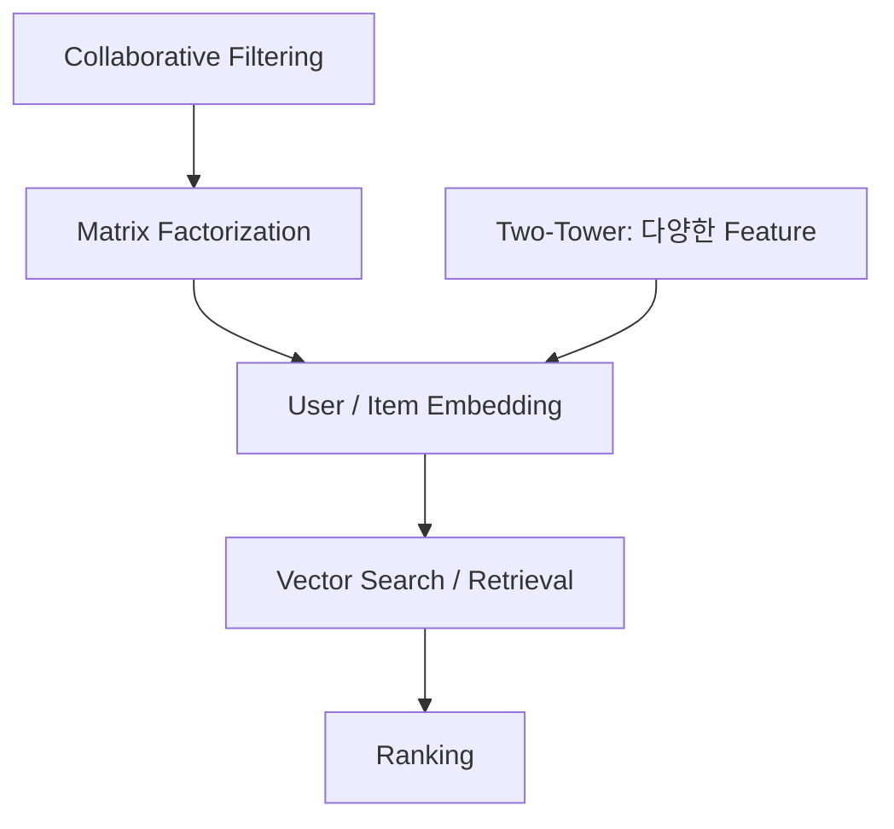
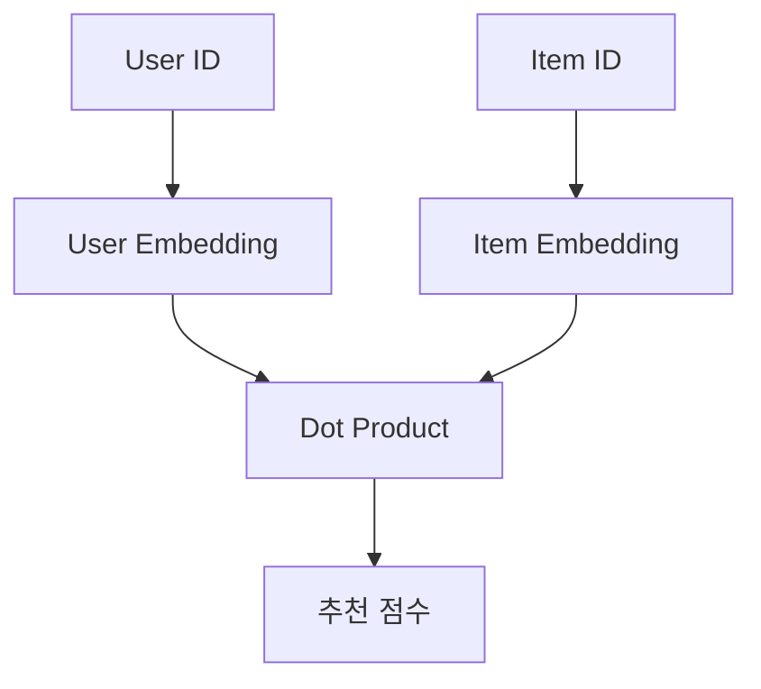
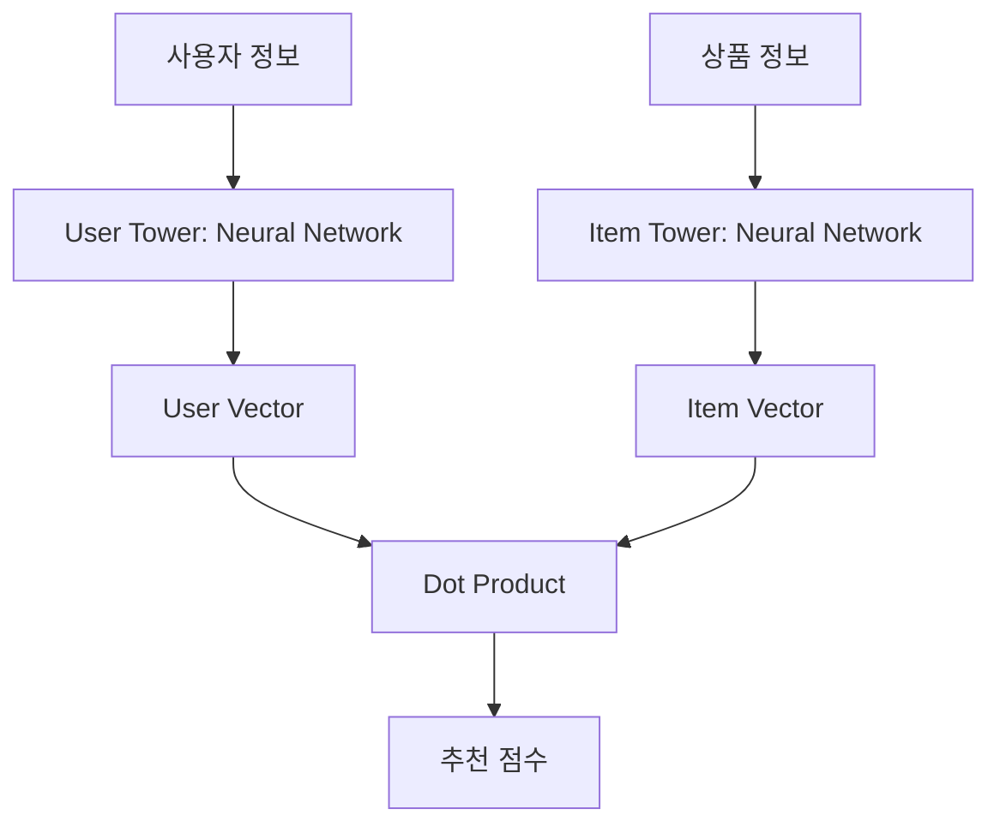
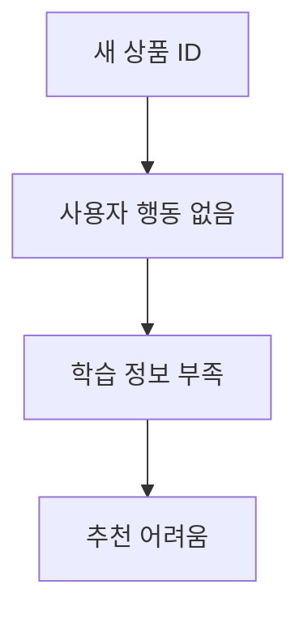
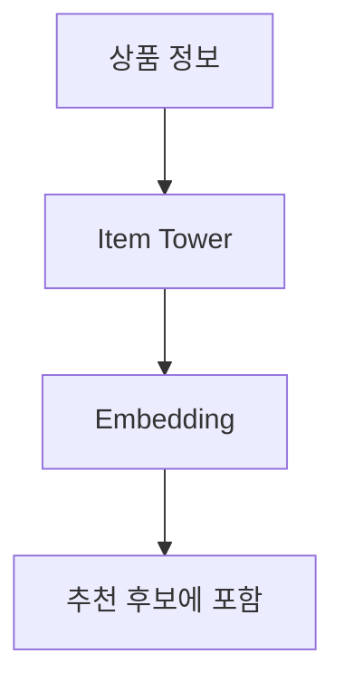
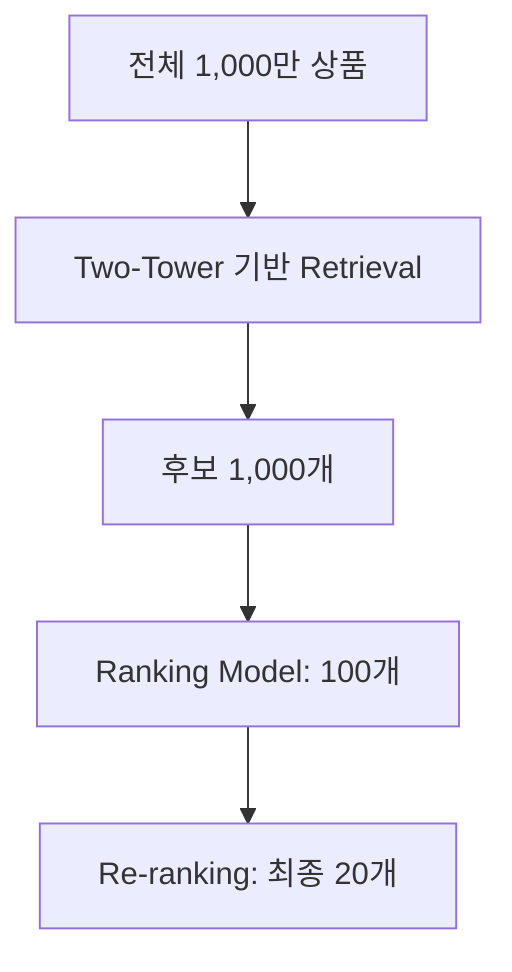
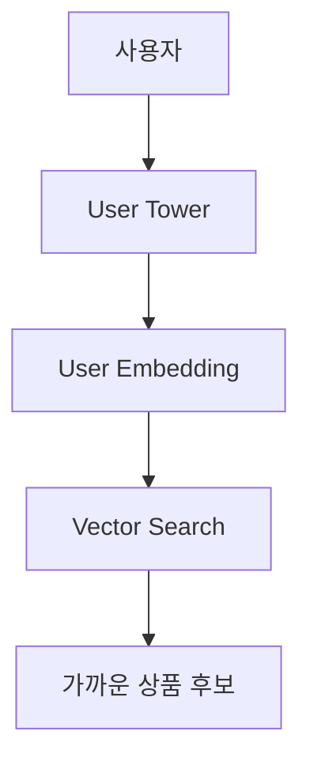
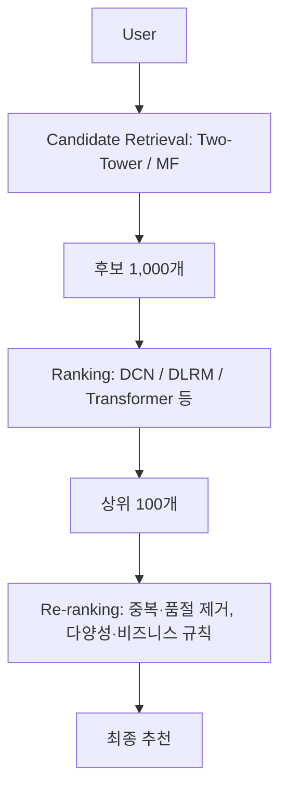

추천 시스템을 공부하다 보면 보통 **CF(Collaborative Filtering)**, **MF(Matrix Factorization)**부터 접하게 된다.

그런데 최근 대규모 추천 시스템은 여기서 한 단계 더 나아가 **Two-Tower + Retrieval + Ranking** 구조를 많이 사용한다.

아래는 학습 순서의 예이며, 모든 시스템이 거치는 필수 진화 단계는 아니다. MF도 embedding을 만들고 후보 검색에 활용할 수 있다.



이번 글에서는 MF와 Two-Tower가 어떻게 다른지 중심으로 정리해봤다.

---

# MF는 어떻게 추천할까?

MF는 사용자와 상품을 각각 작은 벡터로 표현한다.

예를 들어:

```text
User A = [0.8, 0.2]
신발   = [0.9, 0.1]
```

두 벡터의 내적을 계산해서 추천 점수를 만든다.

```text
0.8 × 0.9 + 0.2 × 0.1
= 0.74
```

구조는 단순하다.



MF는 빠르고 구현이 단순해서 여전히 좋은 baseline이다.

하지만 기본적으로 **User ID와 Item ID의 상호작용**에 크게 의존한다.

그래서 신규 사용자나 신규 상품처럼 행동 데이터가 부족한 경우에는 약하다.

---

# Two-Tower는 뭐가 다를까?

Two-Tower는 이름 그대로 사용자와 상품을 각각 별도의 모델로 처리한다.



여기서 비교하는 기본 ID 기반 MF와 달리, Two-Tower는 **각 tower에서 여러 feature를 조합해 embedding을 생성하도록 설계할 수 있다.** 다만 Two-Tower도 ID만 입력받을 수 있고, MF 계열에도 부가 정보를 사용하는 확장 모델이 있다.

User Tower에는 예를 들어:

- User ID
- 최근 본 상품
- 최근 검색어
- 클릭 카테고리
- 시간대
- 지역

같은 정보를 넣을 수 있다.

Item Tower에는:

- Item ID
- 카테고리
- 브랜드
- 가격
- 상품명
- 설명
- 이미지 Embedding

같은 정보를 넣을 수 있다.

결과적으로 각 Tower는 사용자와 상품을 같은 embedding 공간에 배치한다.

---

# Cold Start에서 차이가 난다

신상품이 하나 등록됐다고 해보자.

MF에서는:



이 될 수 있다.

반면 Two-Tower에서는:

```text
새 상품
- 러닝화
- Nike
- 남성
- 129,000원
```

같은 feature만 있어도 Item Tower가 embedding을 만들 수 있다.



그래서 신규 상품이 계속 들어오는 서비스에서는 콘텐츠 feature를 학습한 Two-Tower가 유리할 수 있다. 단, 학습 때 사용한 feature가 서빙에서도 있어야 하고, 처음 보는 ID·범주를 처리할 수 있어야 한다. 새 상품의 벡터를 계산하고 검색 인덱스에 반영하는 과정도 필요하다. 구조만 Two-Tower로 바꾼다고 cold start가 자동 해결되지는 않는다.

---

# Two-Tower의 진짜 역할은 Retrieval

Two-Tower가 최종 추천 순위를 모두 결정하는 경우보다는, **후보를 빠르게 줄이는 Retrieval 단계**에서 많이 사용한다.

예를 들어 상품이 1,000만 개라고 하자.

모든 상품을 무거운 Ranking 모델로 계산하기는 어렵다.

그래서 먼저:



처럼 후보를 줄인다.

Item embedding은 미리 계산해둘 수 있다.

상품 A·B·C 등 각 상품을 벡터로 변환해 검색 인덱스에 저장한다.

그리고 사용자가 들어오면 User Tower에서 사용자 embedding을 하나 만든 뒤, 가장 가까운 상품 벡터를 찾는다.



이 단계에서 FAISS, ScaNN, Milvus, OpenSearch k-NN 같은 ANN(Vector Search) 기술을 함께 사용할 수 있다.

---

# MF와 Two-Tower 비교

| 비교 항목 | MF | Two-Tower |
|---|---|---|
| 입력 | 주로 User ID / Item ID | 다양한 Feature |
| 표현 | User/Item Embedding | Tower가 Embedding 생성 |
| 신규 상품 | 약함 | 상대적으로 유리 |
| 신규 사용자 | 약함 | Feature가 있으면 대응 가능 |
| 구조 | 단순 | 상대적으로 복잡 |
| 주요 용도 | Baseline / 추천 점수 | Candidate Retrieval |

한 줄로 줄이면:

- **MF:** 주로 User ID × Item ID
- **Two-Tower:** User의 여러 정보 × Item의 여러 정보

이라고 볼 수 있다.

---

# 실제 추천 시스템은 Retrieval + Ranking

최근 추천 시스템을 이해할 때 중요한 건 **한 모델로 모든 것을 해결하려 하지 않는다는 점**이다.

보통은 여러 단계를 거친다.



Two-Tower는 빠르게 좋은 후보를 찾는 역할이고, Ranking 모델은 후보들의 순서를 더 정교하게 결정한다.

---

# 정리

추천 시스템을 공부한다면 다음 순서로 보면 이해하기 쉽다.


MF는 추천 시스템의 기본 원리를 이해하기 좋은 모델이고, Two-Tower는 그 개념을 실제 대규모 서비스에 맞게 확장한 형태로 볼 수 있다.

특히 상품 수가 많고, 사용자와 상품에 사용할 수 있는 feature가 다양하다면 **Two-Tower + Vector Search + Ranking** 구조가 중요한 패턴이 된다.

## 구현 전에 확인할 조건

학습 목표, positive/negative 구성, 평가 시점의 feature를 먼저 정한다. 사용자·상품 tower의 출력 차원과 점수 함수가 맞아야 하고, 모델을 바꾸면 미리 계산한 상품 벡터와 검색 인덱스도 같은 버전으로 맞춰야 한다. 서빙 중 두 버전이 섞이면 점수의 의미가 달라질 수 있다.

후보 검색 구현은 [ANN과 Vector Search 글](/posts/two-tower-ann-vector-search/)에서, 평가는 [Recall@K·Precision@K·NDCG 글]()에서 이어서 다룬다.

## 참고 자료

- [TensorFlow Recommenders — Basic retrieval](https://www.tensorflow.org/recommenders/examples/basic_retrieval)
- [TensorFlow Recommenders — Context features](https://www.tensorflow.org/recommenders/examples/context_features)

