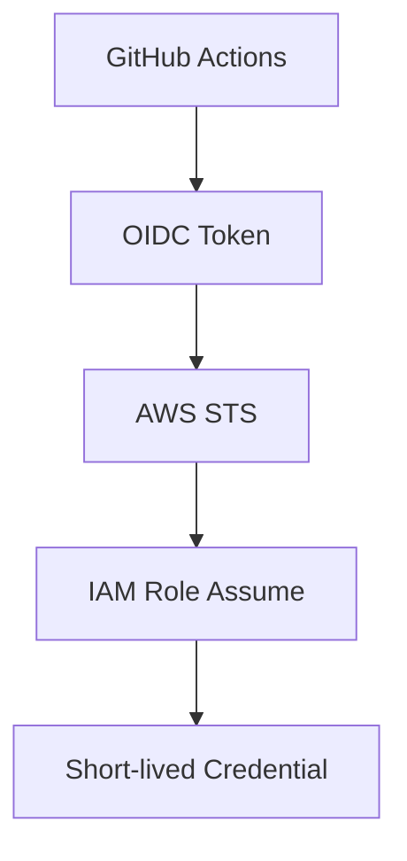
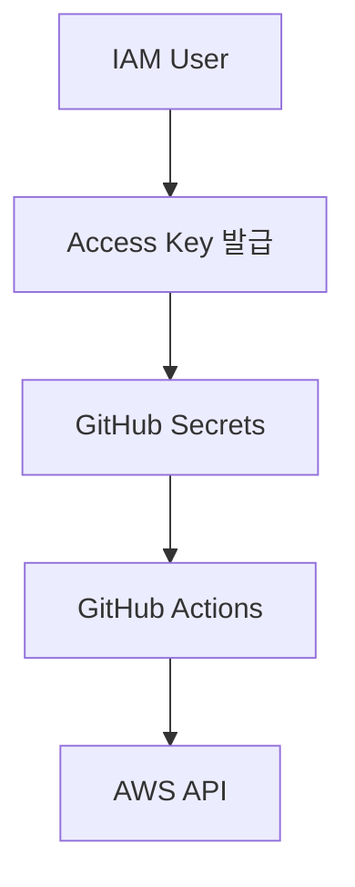
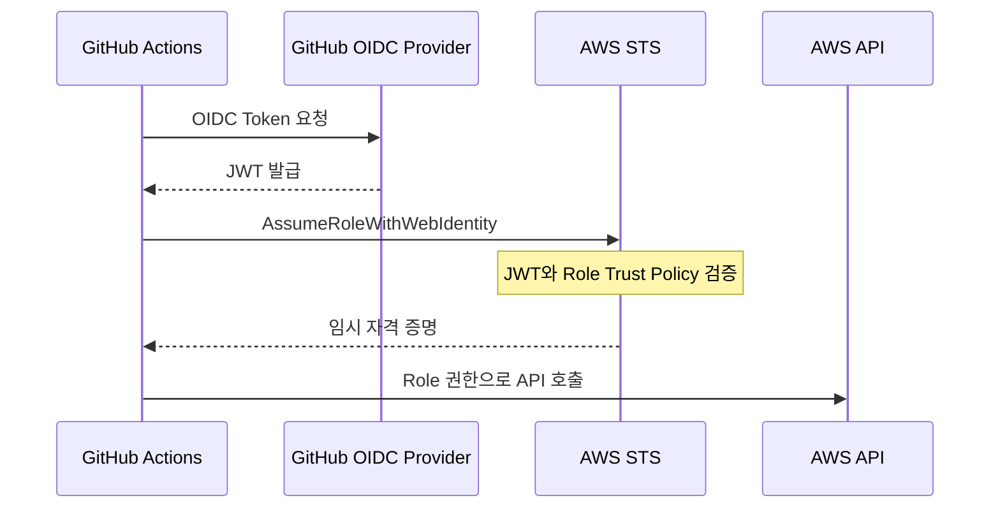
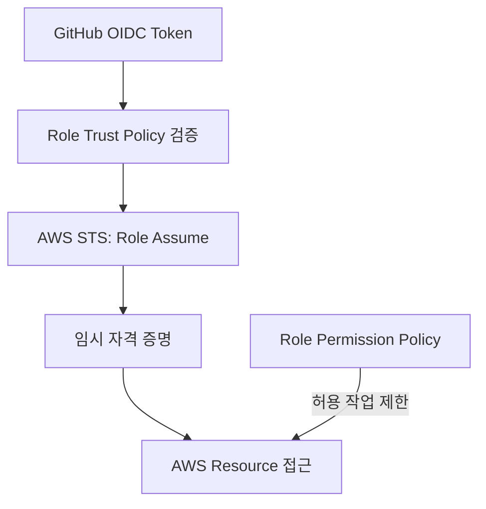
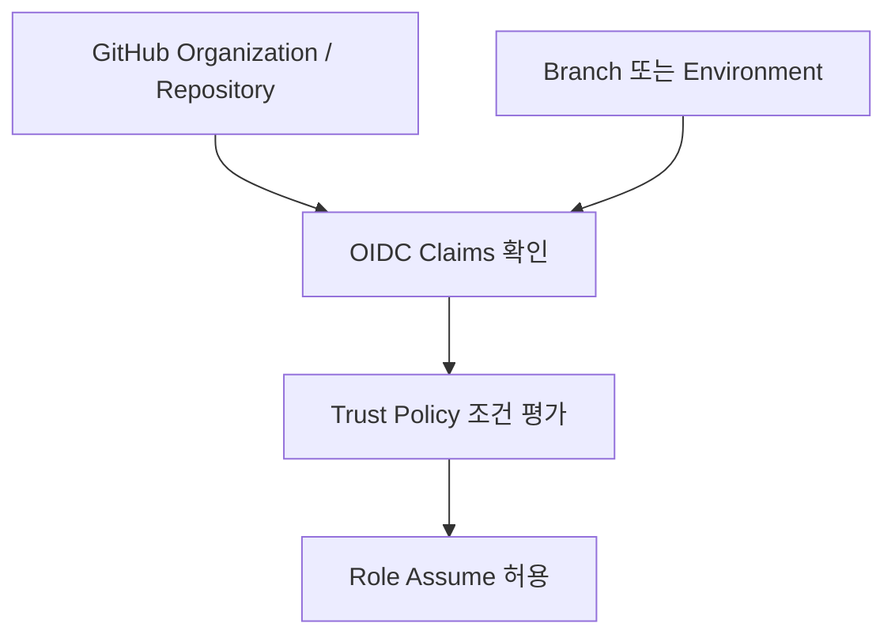
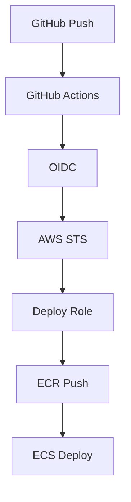
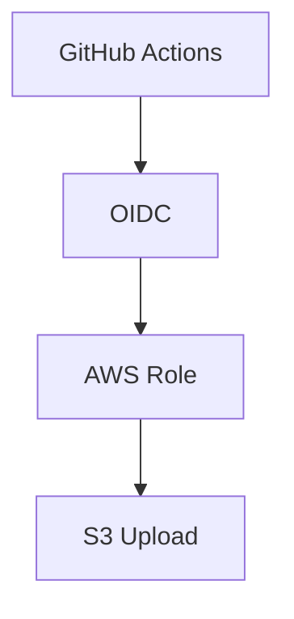
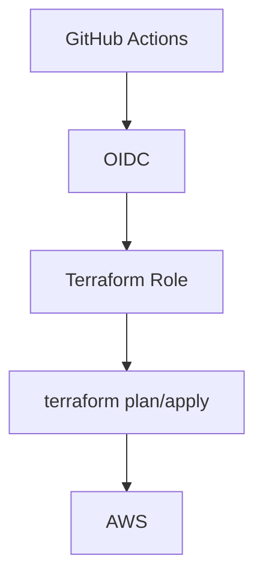
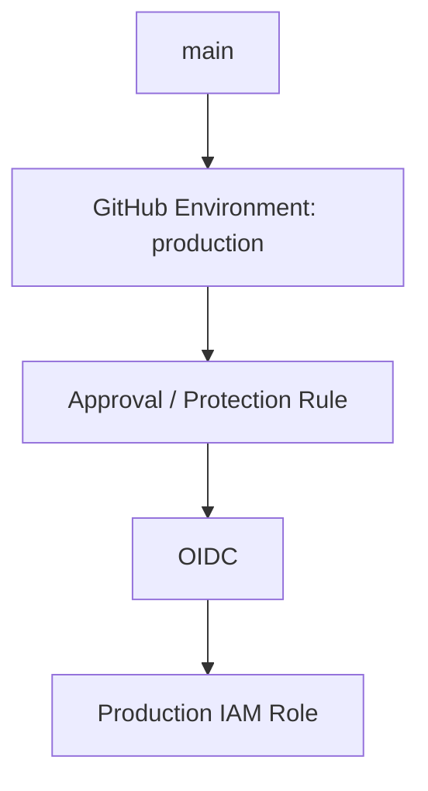
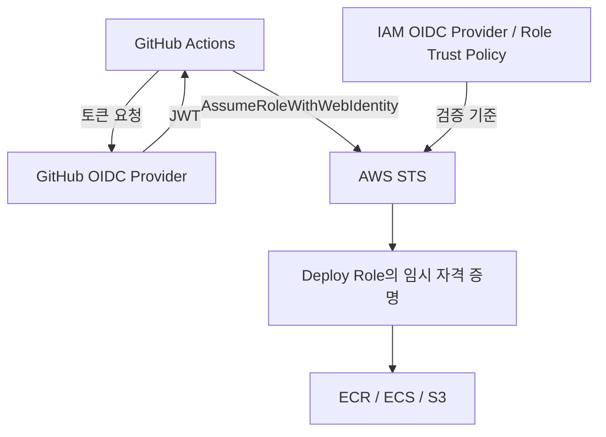

GitHub Actions에서 AWS에 배포하려고 하면 가장 먼저 떠올리기 쉬운 방법이 있다.

- AWS_ACCESS_KEY_ID
- AWS_SECRET_ACCESS_KEY

를 GitHub Actions Secret에 저장하는 방식이다.

동작은 잘 하지만 이 Credential은 **장기간 유지되는 Long-lived Credential**이다.

CI/CD 환경에서는 가능하면:

구조를 사용하는 편이 더 안전하다.

---

# 기존 Access Key 방식

기존에는 보통 이런 흐름이었다.

Workflow에서는 Secret에 저장한 Key를 가져와 사용한다.

문제는 Secret이 노출되지 않더라도 Credential 자체가 계속 살아 있다는 점이다.

장기 Access Key는 발급 후 30일, 90일, 1년이 지나도 **폐기하거나 비활성화하지 않으면 남아 있을 수 있다.**

Rotation을 제대로 하지 않으면 더 오래 유지될 수도 있다.

---

# OIDC를 사용하면 무엇이 달라질까?

OIDC는 **OpenID Connect**다.

GitHub Actions가 AWS Access Key를 가지고 있는 대신, GitHub가 해당 Workflow의 Identity를 증명하는 Token을 발급한다.

AWS는 이 Token을 검증하고 Trust Policy 조건에 맞으면 IAM Role을 잠시 Assume할 수 있게 한다.

가장 큰 차이는 **AWS Access Key를 GitHub에 장기 보관하지 않아도 된다는 점**이다.

---

# 인증 과정

실제로는 다음 순서로 동작한다.

~~~text
1. GitHub Actions 실행

2. Workflow가 OIDC Token 요청

3. GitHub가 JWT 발급

4. AWS STS가 Token 검증

5. IAM Trust Policy 확인

6. Role Assume

7. Temporary Credential 발급

8. Workflow가 AWS API 호출
~~~

Temporary Credential은 Workflow가 실행되는 시점에 발급된다.

그래서 CI/CD에서 관리해야 할 Long-lived Credential 자체를 줄일 수 있다.

---

# AWS에 GitHub OIDC Provider 등록

AWS IAM에 GitHub를 Identity Provider로 등록한다.

Provider URL:

~~~text
https://token.actions.githubusercontent.com
~~~

공식 configure-aws-credentials Action을 사용할 때 Audience:

~~~text
sts.amazonaws.com
~~~

구조는 단순하다.

AWS IAM에 OIDC Provider로 `token.actions.githubusercontent.com`을 등록한다.

---

# IAM Role을 만든다

그 다음 GitHub Actions가 Assume할 Role을 만든다.

예를 들어 S3 배포만 한다면 Role에 AdministratorAccess를 줄 이유가 없다.

- s3:PutObject
- s3:GetObject
- s3:ListBucket

처럼 실제 Deployment에 필요한 권한만 주는 것이 좋다.

---

# Trust Policy가 가장 중요하다

OIDC를 쓴다고 자동으로 안전해지는 것은 아니다.

AWS가 **어떤 GitHub Workflow를 신뢰할지** 제한해야 한다.

예를 들어 특정 Repository의 main branch만 허용할 수 있다. 다음 JSON은 전체 Trust Policy가 아니라 `Statement` 배열 안에 넣는 한 항목이다.

~~~json
{
  "Effect": "Allow",
  "Principal": {
    "Federated": "arn:aws:iam::<ACCOUNT_ID>:oidc-provider/token.actions.githubusercontent.com"
  },
  "Action": "sts:AssumeRoleWithWebIdentity",
  "Condition": {
    "StringEquals": {
      "token.actions.githubusercontent.com:aud": "sts.amazonaws.com"
    },
    "StringLike": {
      "token.actions.githubusercontent.com:sub": "repo:ORG/REPO:ref:refs/heads/main"
    }
  }
}
~~~

핵심은 repo:*처럼 너무 넓은 조건을 쓰지 않는 것이다.

AWS 문서도 GitHub OIDC Role의 sub 조건을 Organization / Repository / Branch 수준으로 제한할 것을 강조한다.

> GitHub의 OIDC sub claim 형식은 Repository 생성 시점, opt-in 여부, GitHub Environment 사용 여부에 따라 달라질 수 있다. 실제 적용 전에는 현재 GitHub 문서의 claim 형식을 확인하는 것이 좋다.

---

# GitHub Actions Workflow

Workflow에는 OIDC Token을 요청할 권한이 필요하다.

~~~yaml
permissions:
  id-token: write
  contents: read
~~~

id-token: write는 AWS Resource에 Write 권한을 준다는 뜻이 아니다.

GitHub Workflow가 **OIDC Token을 요청할 수 있게 하는 권한**이다.

그 다음 AWS Credential Action을 사용한다.

~~~yaml
name: deploy

on:
  push:
    branches:
      - main

permissions:
  id-token: write
  contents: read

jobs:
  deploy:
    runs-on: ubuntu-latest

    steps:
      - uses: actions/checkout@v6

      - name: Configure AWS credentials
        uses: aws-actions/configure-aws-credentials@v6
        with:
          role-to-assume: arn:aws:iam::<ACCOUNT_ID>:role/github-actions-deploy
          aws-region: ap-northeast-2

      - name: Check identity
        run: aws sts get-caller-identity
~~~

2026년 10월 기준 aws-actions/configure-aws-credentials의 최신 major는 v6다.

예제에서는 읽기 쉽게 @v6를 사용했지만, Supply Chain 보안을 더 엄격하게 가져가려면 Production Workflow에서 특정 commit SHA에 pin하는 것도 고려할 수 있다.

---

# 실제 배포에서는 이렇게 연결된다

ECS 배포라면:

S3 Static Site라면:

Terraform이라면:

인증 구조는 같고 Role에 부여되는 Permission만 달라진다.

---

# Environment까지 나누면 더 안전하다

Production 배포라면 GitHub Environment도 같이 사용할 수 있다.

예를 들어:

환경별 Role을 분리한다.

- **development:** Development Role
- **staging:** Staging Role
- **production:** Production Role

처럼 역할을 분리할 수 있다.

---

## production Environment를 사용하는 완성 예제

브랜치 기반 Trust Policy에 `environment: production`만 추가하면 기존 `sub` 조건과 맞지 않을 수 있다. 다음 정책은 이름 기반 subject를 사용하는 저장소의 예시다. immutable subject를 사용하는 저장소는 owner/repository ID가 포함된 실제 형식에 맞춰야 한다.

~~~json
{
  "Version": "2012-10-17",
  "Statement": [
    {
      "Effect": "Allow",
      "Principal": {
        "Federated": "arn:aws:iam::<ACCOUNT_ID>:oidc-provider/token.actions.githubusercontent.com"
      },
      "Action": "sts:AssumeRoleWithWebIdentity",
      "Condition": {
        "StringEquals": {
          "token.actions.githubusercontent.com:aud": "sts.amazonaws.com",
          "token.actions.githubusercontent.com:sub": "repo:ORG/REPO:environment:production"
        }
      }
    }
  ]
}
~~~

이에 대응하는 workflow는 다음과 같다. 앞의 브랜치 기반 예제와는 대안 관계다.

~~~yaml
name: production-identity-check
on:
  push:
    branches: [main]
permissions:
  contents: read
jobs:
  deploy:
    environment: production
    runs-on: ubuntu-latest
    permissions:
      id-token: write
      contents: read
    steps:
      - name: Configure AWS credentials
        uses: aws-actions/configure-aws-credentials@v6
        with:
          role-to-assume: arn:aws:iam::<ACCOUNT_ID>:role/github-actions-production
          aws-region: ap-northeast-2
      - name: Check identity
        run: aws sts get-caller-identity
~~~

이 예제는 Role 인수 확인까지 수행한다. 실제 배포 명령과 리소스별 Permission Policy는 별도로 추가한다. GitHub의 production Environment에는 허용 배포 브랜치와 필요한 승인 규칙을 설정한다. Environment 기반 `sub`만으로 main 브랜치까지 제한된다고 생각하면 안 된다.

## AccessDenied가 나면 확인할 순서

1. job에 `id-token: write`가 있는지 확인한다.
2. OIDC Provider URL과 audience가 정책에 맞는지 확인한다.
3. 브랜치/Environment/immutable subject 중 실제 `sub` 형식과 Trust Policy를 비교한다.
4. 대상 계정과 Role ARN을 확인한다.
5. Role 인수는 성공하고 AWS API만 실패한다면 리소스 권한·SCP·리소스 정책을 별도로 점검한다.

OIDC 토큰 원문이나 임시 credential을 CI 로그에 출력하지 않는다. `get-caller-identity`로 실행 주체를 확인하고, 실패한 단계가 인증인지 리소스 접근인지 먼저 구분한다.

# 하나의 Role에 모든 권한을 넣지 않는다

OIDC를 적용했는데 Role이:

~~~text
AdministratorAccess
~~~

라면 Blast Radius는 여전히 크다.

그래서 필요하면:

GitHub Actions의 작업별로 **ECR Push Role, ECS Deploy Role, Terraform Plan Role, Terraform Apply Role**을 분리할 수 있다.

처럼 역할을 나눌 수 있다.

모든 프로젝트에서 Role을 세분화할 필요는 없지만 최소한 **CI/CD가 실제로 필요한 권한만 갖도록 설계**해야 한다.

---

# Access Key 방식과 비교

| 비교 항목 | Access Key | OIDC |
|---|---|---|
| Credential | Long-lived | Short-lived |
| GitHub Secret | Access Key 저장 필요 | AWS Key 불필요 |
| Rotation | 직접 관리 | Temporary Credential |
| 권한 제어 | IAM User/Role Policy | IAM Role + Trust Condition |
| Repository 제한 | 별도 관리 | OIDC Claim으로 제한 가능 |
| CI/CD 운영 | 가능하지만 관리 필요 | 일반적으로 더 적합 |

OIDC가 모든 문제를 해결하는 것은 아니다.

잘못된 Trust Policy를 만들거나 IAM Role에 과도한 권한을 주면 여전히 위험하다.

핵심은:

OIDC에 **엄격한 Trust Policy, 최소 권한 IAM, Environment Protection**을 함께 적용한다.

이다.

---

# 내가 권장하는 구조

GitHub에 장기 AWS Key를 저장하지 않고 Role ARN, Region, Deployment Config 정도만 관리하면 된다.

Role ARN 자체는 Secret이 아니다.

---

# 정리

GitHub Actions에서 AWS OIDC를 사용하는 이유는 단순히 Secret 개수를 줄이기 위해서가 아니다.

장기 자격 증명에는 **Rotation, 유출 위험 관리, Secret 관리**가 계속 필요하다.

문제를:

**OIDC Identity** → **AWS STS** → **Short-lived Credential**

구조로 바꾸는 것이다.

새 CI/CD Pipeline을 만든다면 **GitHub Actions + OIDC + IAM Role + Strict Trust Policy + Least Privilege**를 기본 구조로 보는 것이 좋다.

---

## References

- [GitHub Docs - Configuring OpenID Connect in Amazon Web Services](https://docs.github.com/en/actions/how-tos/secure-your-work/security-harden-deployments/oidc-in-aws)
- [AWS IAM - Create a role for OIDC federation](https://docs.aws.amazon.com/IAM/latest/UserGuide/id_roles_create_for-idp_oidc.html)
- [aws-actions/configure-aws-credentials](https://github.com/aws-actions/configure-aws-credentials)

