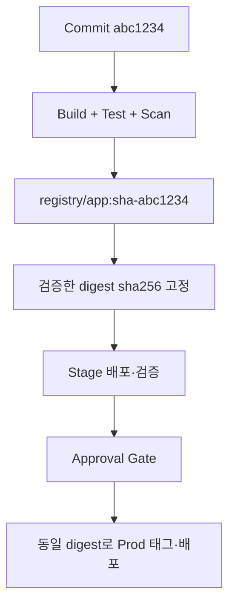

## 왜 stage와 prod에서 각각 Build하면 안 될까?

예전에는 환경별 pipeline에서 같은 Git commit을 다시 `docker build`하면 같은 결과라고 생각했다. 하지만 base image의 mutable tag, package repository, build timestamp, dependency resolution이 바뀌면 **같은 소스라도 다른 image**가 만들어질 수 있다. stage에서 검증한 것이 prod에 배포된다는 보장이 사라진다.

내가 지키려는 원칙은 간단하다. **Build는 한 번, 검증은 여러 번, 배포는 검증된 digest로.**



## Tag는 이름, digest는 내용 식별자

`app:latest`, `app:stage`, `app:prod`는 사람이 이해하기 쉽지만 이동할 수 있는 **mutable pointer**다. 반면 `app@sha256:...`는 manifest content를 가리킨다. `sha-<full-commit-sha>`처럼 source commit을 담은 tag를 만들면 추적하기 좋다. 다만 **commit-SHA tag도 registry에서 overwrite를 허용하면 immutable하지 않다.** ECR의 tag immutability 등 registry 정책으로 재지정을 막아야 한다.

또한 commit SHA와 image digest는 서로 다르다. 전자는 source revision, 후자는 배포 artifact의 identity다. CI 로그와 release record에 **둘 다** 남긴다.

## 같은 repository에서 promote: crane tag

아래는 registry 인증이 완료됐다는 전제의 두 단계 예시다. Build 단계에서 만든 `image-digest.txt`는 해당 CI 실행의 artifact로 보관하고, 승격 단계는 **stage에서 검증한 실행의 파일**을 가져온다.

Build 단계:

```bash
set -euo pipefail
IMAGE="registry.example.com/team/api"
COMMIT_SHA="$(git rev-parse HEAD)"
SOURCE="${IMAGE}:sha-${COMMIT_SHA}"

docker build -t "$SOURCE" .
docker push "$SOURCE"
crane digest "$SOURCE" > image-digest.txt
```

검증·승격 단계:

```bash
set -euo pipefail
IMAGE="registry.example.com/team/api"
EXPECTED="$(cat image-digest.txt)"
[[ "$EXPECTED" =~ ^sha256:[0-9a-f]{64}$ ]]
VERIFIED_SOURCE="${IMAGE}@${EXPECTED}"

# stage 배포 명세에도 VERIFIED_SOURCE를 사용한다.
crane tag "$VERIFIED_SOURCE" stage
test "$(crane digest "${IMAGE}:stage")" = "$EXPECTED"

# 이 위치에서 stage 배포·smoke/integration test·승인 gate를
# CI job으로 연결한다. 이 주석 자체는 배포나 승인을 실행하지 않는다.

crane tag "$VERIFIED_SOURCE" prod
test "$(crane digest "${IMAGE}:prod")" = "$EXPECTED"
# prod 배포 명세 역시 VERIFIED_SOURCE를 사용한다.
```

`crane tag IMAGE TAG`는 같은 repository에 태그를 추가한다. 이후 원본 commit 태그가 바뀌어도 승격이 영향을 받지 않도록 기록된 digest reference를 사용한다. 다만 digest 파일을 다른 실행의 파일로 바꿔치기할 수 있다면 검증 연결이 깨지므로 commit·CI run·검증 결과를 함께 기록한다.

ECR에서 commit 태그는 덮어쓰기를 막고 `stage`·`prod`는 이동 가능한 별칭으로 운영하려면 태그 정책을 구분해야 한다. 전체 태그가 immutable인 repository에서는 기존 환경 별칭의 재지정도 실패할 수 있다. 환경 태그를 사용하지 않고 배포 명세의 digest만 갱신하는 방법도 있다.

동시 승격은 환경별 CI concurrency로 직렬화하고 실제 배포 digest를 확인한다. 태그 비교만 통과했다고 애플리케이션 배포까지 완료된 것은 아니다.

## Repository나 registry가 다르면 crane copy

stage/prod 계정이나 repository를 분리했다면 `crane copy`가 더 자연스럽다.

```bash
SOURCE="registry.example.com/team/api@sha256:<verified-digest>"
TARGET="prod-registry.example.com/team/api:sha-<commit-sha>"

crane copy "$SOURCE" "$TARGET"
test "$(crane digest "$TARGET")" = "sha256:<verified-digest>"
```

공식 문서상 `crane copy`는 원격 image를 효율적으로 복사하고 digest 유지를 목표로 한다. 다만 registry 구현, manifest 변환, multi-platform index 처리 조건에 따라 **실제 target digest를 반드시 검증**한다. `--platform`을 지정하면 전체 multi-platform index가 아닌 선택한 platform image만 복사할 수 있으므로 의도하지 않았다면 사용하지 않는다.

## CI/CD에서 지킬 체크리스트

1. CI는 commit SHA로 image를 **한 번만** Build하고 unit test, vulnerability scan, SBOM 등 필요한 검증을 수행한다.
2. registry에 push한 뒤 digest를 캡처하고 pipeline artifact 또는 release metadata로 보존한다.
3. stage는 그 digest를 배포하고 integration/smoke test를 통과해야 한다.
4. prod 승격에는 approval 및 권한 분리 정책을 적용한다. **prod에서 다시 Build하지 않는다.**
5. 승격 후 source/target digest를 비교하고 deployment가 실제 사용한 digest를 확인한다.
6. rollback은 과거에 검증된 digest를 재배포한다. `latest`나 재빌드에 의존하지 않는다.

환경별 설정이 필요하면 image를 새로 만들기보다 환경 변수, Secret, ConfigMap 등 runtime configuration으로 분리한다. 단, compile-time에 달라져야 하는 artifact는 동일 image promotion 원칙을 그대로 적용할 수 없으므로 설계를 먼저 바꿔야 한다.

결국 중요한 것은 `prod`라는 tag 자체가 아니다. **stage에서 통과한 바로 그 bytes가 prod에 올라갔다는 증거**다.

## References

- [go-containerregistry: crane tag](https://github.com/google/go-containerregistry/blob/main/cmd/crane/doc/crane_tag.md)
- [go-containerregistry: crane copy](https://github.com/google/go-containerregistry/blob/main/cmd/crane/doc/crane_copy.md)
- [go-containerregistry: crane digest](https://github.com/google/go-containerregistry/blob/main/cmd/crane/doc/crane_digest.md)
- [Amazon ECR: Image tag mutability](https://docs.aws.amazon.com/AmazonECR/latest/userguide/image-tag-mutability.html)
- [OCI Image Specification](https://github.com/opencontainers/image-spec)

