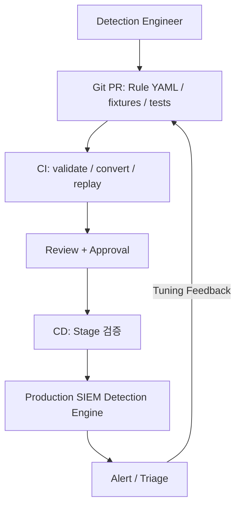
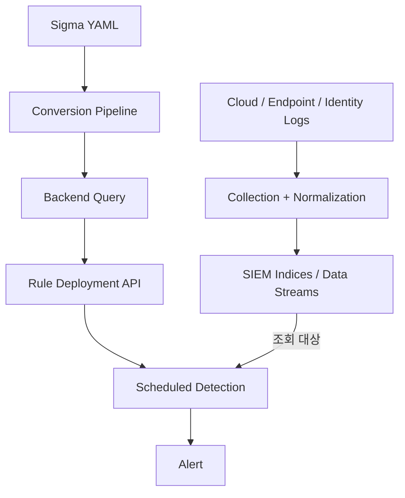

SIEM 운영에서 탐지 Rule을 UI에서만 수정하면 처음에는 편하다. 하지만 어느 순간 이런 질문이 생긴다.

- 누가 왜 탐지 조건을 바꿨는가?
- False Positive를 줄이려고 제외한 조건이 실제 공격도 놓치게 만들지는 않는가?
- 장애가 나면 이전 Rule로 어떻게 돌아가는가?

[SIEM의 수집·정규화·탐지 흐름]()을 정리하면서, 탐지 로직도 애플리케이션 코드처럼 다뤄야 한다고 느꼈다. 이것이 **Detection as Code**의 출발점이다.

## UI 설정이 아니라 변경 가능한 코드로 본다



핵심은 Git에 파일만 보관하는 것이 아니다. **Rule의 의도, 변경 이유, 테스트 결과, 배포 버전**을 함께 추적하는 것이다. Git은 source of truth로 삼되, 실제 SIEM에 적용된 상태와 drift가 없는지도 확인해야 한다.

## Sigma를 쓰면 무엇이 좋아질까?

Sigma는 SIEM 탐지 로직을 YAML로 표현하는 범용 규칙 형식이다. `logsource`, `detection`, `condition` 등을 기술하고, 적절한 backend와 processing pipeline으로 대상 SIEM query로 변환한다.

아래는 **Windows process creation 로그에 CommandLine이 수집된다는 전제**의 교육용 예시다.

```yaml
title: Suspicious Encoded PowerShell Invocation
id: 3b6df681-55fb-4a21-90aa-1f6ecbb71e73
status: experimental
description: Detects PowerShell invocations with an encoded command argument.
logsource:
  product: windows
  category: process_creation
detection:
  selection_image:
    Image|endswith:
      - '\\powershell.exe'
      - '\\pwsh.exe'
  selection_command:
    CommandLine|contains:
      - ' -EncodedCommand '
      - ' -enc '
  condition: selection_image and selection_command
falsepositives:
  - Legitimate administrative automation
level: medium
```

이는 완성된 보안 정책이 아니다. 공격자는 인자 표기를 변형할 수 있고 정상 관리 도구도 encoded command를 사용한다. 실제 필드명, 대소문자 처리, 문자열 매칭 및 로그 수집 범위는 대상 환경에서 테스트해야 한다.

Sigma Rule을 SIEM에 그대로 업로드하면 항상 실행되는 것은 아니다. **Sigma → backend query 변환 → SIEM의 saved search / detection rule API 등에 등록 → schedule 및 alert action 설정**이라는 연결 단계가 필요하다. 플랫폼마다 배포 API와 실행 모델이 다르다.

## Repository 구조를 어떻게 잡을까?

`detection-rules/` 저장소의 구성 예시:

- **규칙:** `rules/windows/encoded-powershell.yml`
- **변환 설정:** `pipelines/production.yml`
- **탐지 fixture:** `tests/positive/encoded-powershell.json`
- **정상 fixture:** `tests/negative/admin-automation.json`
- **배포:** `deploy/deploy_rules.py`
- **CI:** `.github/workflows/detection-ci.yml`

Rule 옆에 positive/negative fixture를 두는 이유는 명확하다. 탐지를 넓히면 False Positive가 늘 수 있고, 탐지를 좁히면 True Positive를 잃을 수 있다. 둘 다 regression test가 필요하다.

## CI/CD는 최소 네 단계를 통과해야 한다

1. **Static validation**: YAML 파싱, Sigma schema 및 필수 metadata, 중복 ID, 허용된 logsource 확인
2. **Conversion test**: 대상 backend와 processing pipeline으로 query 생성; field mapping·index routing 확인
3. **Behavior test**: positive event는 탐지하고 negative event는 제외하는지 검증; 가능한 경우 실제 engine에서 replay
4. **Deployment gate**: 리뷰 승인 후 staging에 적용하고 실행 오류·alert volume 확인 뒤 production 반영

예시로 GitHub Actions의 기본 골격은 다음과 같다.

```yaml
name: detection-ci
on:
  pull_request:
    paths: ['rules/**', 'pipelines/**', 'tests/**']
jobs:
  validate:
    runs-on: ubuntu-latest
    steps:
      - uses: actions/checkout@v4
      - uses: actions/setup-python@v5
        with:
          python-version: '3.12'
      - name: Test rule intent
        run: python tests/test_rule_intent.py
      # 아래 Python 예제를 tests/test_rule_intent.py로 저장한다.
      # 필수 gate에는 별도 Sigma validation/conversion과
      # 실제 backend fixture replay를 추가해야 한다.
```

위 예시는 아래 Python을 `tests/test_rule_intent.py`에 저장했을 때 논리 의도 테스트를 실행하는 최소 workflow다. 이 테스트만으로 Sigma Rule 검증이 완료되는 것은 아니므로, 선택한 backend 변환·실행 검사를 연결하기 전에는 운영 배포 gate로 충분하지 않다. 실행 전 사용 중인 sigma-cli 버전에서 명령과 plugin 호환성을 검증하고 dependency를 pinning해야 한다. 운영 배포 credential은 Git에 넣지 않고 최소 권한의 secret 관리 방식을 사용한다.

## Fixture와 기대 결과를 먼저 구체화한다

아래 데이터는 실제 보안 로그가 아닌 교육용 fixture다. 세 번째 사례처럼 정상 행위라도 현재 규칙이 탐지하는 경우를 숨기지 않는 것이 중요하다.

| 사례 | Image | CommandLine | 현재 규칙의 기대 |
|---|---|---|---|
| encoded 인자 | powershell.exe | powershell.exe -enc AAAA | 탐지 |
| 일반 명령 | powershell.exe | powershell.exe -Command Get-Date | 미탐지 |
| 정상 관리 자동화의 encoded 인자 | powershell.exe | powershell.exe -enc BBBB | 탐지 후 조사 |
| 다른 실행 파일 | cmd.exe | cmd.exe /c echo -enc AAAA | 미탐지 |

‘정상 자동화’라는 파일명만으로 negative fixture가 되지는 않는다. 예외 조건을 규칙에 실제 반영한 뒤에만 미탐지를 기대해야 한다.

다음 Python은 **예제의 논리 의도만 확인하는 테스트**다. Sigma 파서나 변환된 SIEM query를 실행하지 않으므로 backend 호환성 검사를 대체하지 않는다.

```python
def matches_intent(event):
    image = event["Image"].lower()
    command = event["CommandLine"].lower()
    return (
        image.endswith(("\\powershell.exe", "\\pwsh.exe"))
        and any(arg in command for arg in (" -encodedcommand ", " -enc "))
    )

fixtures = [
    ({"Image": r"C:\Windows\powershell.exe",
      "CommandLine": "powershell.exe -enc AAAA"}, True),
    ({"Image": r"C:\Windows\powershell.exe",
      "CommandLine": "powershell.exe -Command Get-Date"}, False),
    ({"Image": r"C:\Windows\powershell.exe",
      "CommandLine": "powershell.exe -enc BBBB"}, True),
    ({"Image": r"C:\Windows\cmd.exe",
      "CommandLine": "cmd.exe /c echo -enc AAAA"}, False),
]
for event, expected in fixtures:
    assert matches_intent(event) == expected
print("4 intent fixtures passed")
```

실제 gate에서는 고정된 sigma-cli·backend plugin·processing pipeline으로 query를 생성하고, staging index에 같은 fixture를 넣어 각 사례의 결과를 비교한다. 생성 query와 Rule ID, 도구 버전을 artifact로 남긴다. 이 글에서는 대상 SIEM과 필드 mapping을 특정하지 않았으므로 변환 결과를 실제 실행 결과처럼 제시하지 않는다.

## False Positive 튜닝은 PR로 남긴다

예를 들어 특정 관리 서버의 정기 작업이 매일 경보를 발생시킨다고 하자. 단순히 Rule을 끄기보다 다음을 남긴다.

- 어떤 alert와 raw event가 반복되는가?
- 제외 범위를 host, account, process 중 어디까지 좁힐 것인가?
- 예외가 공격자의 우회 경로가 되지 않는가?
- tuning 전후 alert volume, true-positive 사례, 놓친 사례는 무엇인가?

가능하면 **좁은 범위의 예외와 만료일**을 사용하고, 예외 케이스를 negative fixture로 추가한다. 정상 행위와 공격 행위가 같은 패턴을 공유한다면 단순 문자열 필터 대신 부모 프로세스, 사용자, 실행 위치 등 추가 context를 고려한다.

## Rollback과 Change History

Rule 배포 시 `rule_id → Git commit SHA → generated query → SIEM object ID` 매핑을 기록해 둔다. 변경 직후 경보 폭증이나 탐지 누락이 발생하면 이전 검증 버전의 산출물을 재배포한다.

Git revert만으로 운영 SIEM이 자동 복구되는 것은 아니다. **CD가 revert commit을 감지해 재배포하는지**, 삭제·비활성화된 Rule의 상태까지 reconcile하는지 확인해야 한다. 배포 후 rule count, enabled state, query checksum 같은 항목으로 drift를 점검한다.

## 실제 Detection Engine으로 연결하기

예를 들어 AWS 환경의 로그를 SIEM으로 분석한다면, 로그 수집·정규화와 탐지 Rule 배포는 별도 파이프라인으로 운영할 수 있다. 관련 구성은 [AWS Security Lake와 OpenSearch 기반 SIEM 글]()에서 다뤘다.



Rule이 정확해도 필드가 비어 있거나 ingest가 지연되면 탐지가 실패한다. 따라서 **Rule test뿐 아니라 telemetry coverage, ingest latency, alert delivery**까지 운영 지표로 확인해야 한다.

내가 처음 도입한다면 모든 Rule을 한꺼번에 이관하지 않는다. 변경 빈도가 높고 False Positive가 많은 Rule 몇 개를 골라 **Git PR → fixture test → staging → production → rollback drill**까지 한 사이클을 먼저 완성하겠다.

## 참고 자료

- [Sigma Rules Specification](https://sigmahq.io/sigma-specification/specification/sigma-rules-specification.html)
- [Sigma — Rules](https://sigmahq.io/docs/basics/rules.html)
- [Sigma — Processing Pipelines](https://sigmahq.io/docs/digging-deeper/pipelines.html)
- [Sigma CLI](https://sigmahq.io/docs/guide/getting-started.html)
- [GitHub Actions documentation](https://docs.github.com/en/actions)

