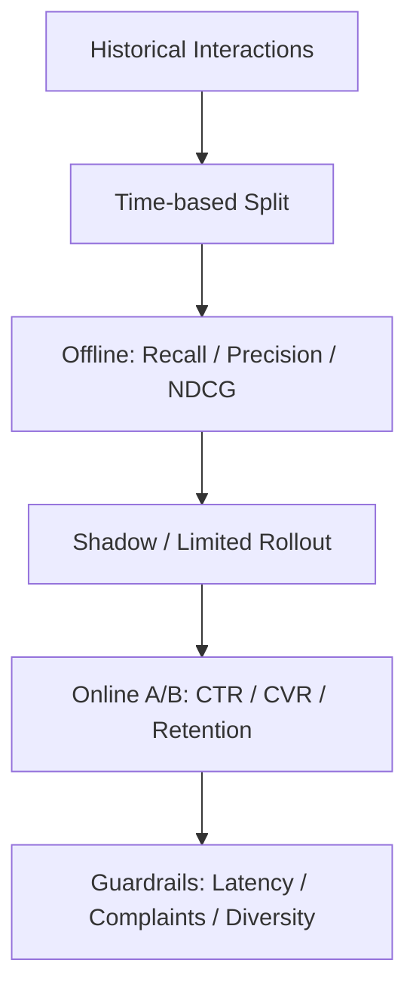

추천 시스템을 구현하고 나면 다음 질문이 남는다. **추천이 잘되고 있다는 것을 어떻게 증명할까?**

모델의 loss가 내려간다고 사용자가 좋아할 상품을 상단에 보여준다는 뜻은 아니다. 추천에서는 **무엇을 후보로 가져왔는지**와 **어떤 순서로 보여줬는지**를 따로 확인해야 한다.

앞서 [MF와 Two-Tower를 비교한 글]()에서 Retrieval과 Ranking의 구조를 살펴봤다. 이번에는 그 결과를 평가하는 방법을 정리한다.

## 평가 데이터부터 정의하자

예를 들어 사용자 A에게 실제로 관련 있는 아이템이 `{B, D, F}`이고 모델이 추천한 상위 5개가 `[B, C, D, E, F]`라고 하자.

- Ground truth: 평가 기간에 사용자가 긍정적으로 반응한 아이템 등으로 정의한 집합
- Top-K: 모델이 높은 점수순으로 반환한 K개
- Hit: Top-K에 포함된 관련 아이템

여기서 중요한 전제가 있다. **클릭하지 않았다는 이유만으로 싫어하는 아이템이라고 단정할 수 없다.** 노출되지 않은 아이템은 반응할 기회조차 없었다. 노출 편향과 시간 누수(time leakage)를 고려해 학습 시점 이후의 데이터를 검증용으로 분리하는 편이 안전하다.

## Precision@K: 추천 슬롯을 얼마나 정확하게 썼는가

`Precision@K = |TopK ∩ Relevant| / K`

위 사례에서 Precision@5는 `3 / 5 = 0.6`이다.

홈 화면처럼 노출 슬롯이 제한된 곳에서 유용하다. 다만 관련 아이템이 매우 많은 사용자와 적은 사용자를 비교할 때, K가 고정된 분모라는 점을 기억해야 한다.

## Recall@K: 찾아야 할 것을 얼마나 찾았는가

`Recall@K = |TopK ∩ Relevant| / |Relevant|`

위 사례의 Recall@5는 `3 / 3 = 1.0`이다.

Retrieval 단계에서 후보 누락을 줄이고 싶을 때 특히 중요하다. 관련 아이템 100개 중 10개를 가져왔다면 Recall@10의 최대치는 0.1이다. 그래서 **Recall@K는 K와 관련 아이템 수를 함께 해석**해야 한다.

K를 키우면 일반적으로 Recall은 낮아지지 않지만, 추천 슬롯과 계산 비용은 늘어난다.

## NDCG@K: 맞혔더라도 상단에 배치했는가

Precision과 Recall은 관련 아이템의 **위치**를 구분하지 않는다. 하지만 1위 클릭과 10위 클릭의 기대 가치는 같지 않다.

Binary relevance 기준으로:

`DCG@K = Σ(i=1..K) rel_i / log2(i+1)`

`NDCG@K = DCG@K / IDCG@K`

`IDCG`는 같은 관련도를 가장 좋은 순서로 정렬했을 때의 DCG다. 따라서 NDCG는 이상적인 순서 대비 현재 순서의 품질을 나타내며, 통상 0~1 범위다(정의와 데이터 조건에 따름).

예를 들어 두 모델이 관련 아이템을 2개씩 찾았더라도:

```text
Model A: [✓, ✓, ×, ×, ×]
Model B: [×, ×, ×, ✓, ✓]
```

Precision@5와 Recall@5는 같지만 NDCG@5는 A가 높다. 실무에서 클릭·구매 등 반응에 서로 다른 gain을 줄 수 있지만, gain 정의를 바꾸면 점수도 달라진다.

## Python으로 계산해 보기

```python
import math

relevant = {"B", "D", "F"}
ranked = ["B", "C", "D", "E", "F"]
k = 5

if k <= 0:
    raise ValueError("k must be positive")
if len(ranked) != len(set(ranked)):
    raise ValueError("ranked must contain unique items")

topk = ranked[:k]
hits = sum(item in relevant for item in topk)
precision = hits / k
recall = hits / len(relevant) if relevant else 0.0

def dcg(items):
    return sum(
        int(item in relevant) / math.log2(rank + 1)
        for rank, item in enumerate(items, start=1)
    )

ideal = [1] * min(len(relevant), k) + [0] * max(0, k - len(relevant))
idcg = sum(gain / math.log2(rank + 1)
           for rank, gain in enumerate(ideal, start=1))
ndcg = dcg(topk) / idcg if idcg else 0.0

print(f"P@{k}={precision:.3f}, R@{k}={recall:.3f}, NDCG@{k}={ndcg:.3f}")
```

위 입력의 예상 출력은 다음과 같다.

```text
P@5=0.600, R@5=1.000, NDCG@5=0.885
```

이 예제는 중복 추천을 오류로 처리하며 K개보다 적게 반환해도 Precision의 분모를 K로 유지한다. 관련 아이템이 없는 경우는 코드에서 0으로 처리한다. 실제 집계에서도 이 정책을 일관되게 적용해야 한다.

이 코드는 **한 사용자에 대한 binary relevance 예시**다. 운영 지표는 사용자별 값을 계산한 뒤 macro average를 내거나, 비즈니스 목적에 맞는 weighting을 정한다. 관련 아이템이 없는 사용자는 Recall과 NDCG가 정의되지 않을 수 있으므로 제외할지 0으로 처리할지 명시해야 한다.

## 어떤 지표를 선택할까?

| 목표 | 우선 볼 지표 | 함께 볼 것 |
|---|---|---|
| Retrieval 후보 누락 최소화 | Recall@100, Recall@500 | latency, 후보 수 |
| 제한된 슬롯의 적중률 | Precision@5, Precision@10 | coverage, diversity |
| 상위 노출 순서 최적화 | NDCG@10 | CTR, conversion |
| 여러 사용자군의 품질 점검 | 사용자군별 지표 | cold-start, 인기 편향 |

**Metric 하나만 최대화하지 않는다.** 인기 상품만 추천하면 일부 Offline 지표는 좋아져도 다양성과 발견 가능성이 떨어질 수 있다. 또한 후보 생성기의 Recall@K가 낮으면 Ranking 모델을 개선해도 누락된 상품은 복구할 수 없다.

## 후보 집합도 평가 조건이다

전체 상품 중 상위 K개를 고르는 평가와 일부 negative를 샘플링한 평가의 점수를 같은 기준으로 비교하지 않는다. 후보 수·샘플링 방식·평가 시점의 판매 가능 상품을 기록한다. 과거 평가에 미래 상품 정보나 이후 행동으로 만든 feature가 들어가지 않도록 feature 시점도 맞춘다.

평가 보고서에는 K, 관련도 정의, 사용자 수, 후보 집합, 사용자별 평균 방식, 빈 정답 처리와 사용자군별 결과를 함께 남긴다.

## Offline 평가와 Online 평가는 다르다



Offline은 빠르고 재현 가능하지만 과거 노출 정책의 영향을 받는다. Online A/B test는 실제 사용자 행동을 측정하지만 비용·실험 기간·안전장치가 필요하다. CTR이 올라가도 구매 전환이나 장기 만족도가 악화될 수 있으므로 primary metric과 guardrail을 분리해야 한다.

내가 평가 파이프라인을 만든다면 **time-based holdout → Recall@K로 Retrieval 검증 → NDCG@K로 Ranking 비교 → 제한된 A/B test** 순서로 진행하겠다. 학습·평가 데이터의 중복, 추천 대상의 availability, user/item cold-start도 별도 체크한다.

## 참고 자료

- [Google Developers — Recommendation systems](https://developers.google.com/machine-learning/recommendation)
- [scikit-learn — ndcg_score](https://scikit-learn.org/stable/modules/generated/sklearn.metrics.ndcg_score.html)
- [TensorFlow Recommenders — Basic retrieval](https://www.tensorflow.org/recommenders/examples/basic_retrieval)
- [TensorFlow Recommenders — Basic ranking](https://www.tensorflow.org/recommenders/examples/basic_ranking)

