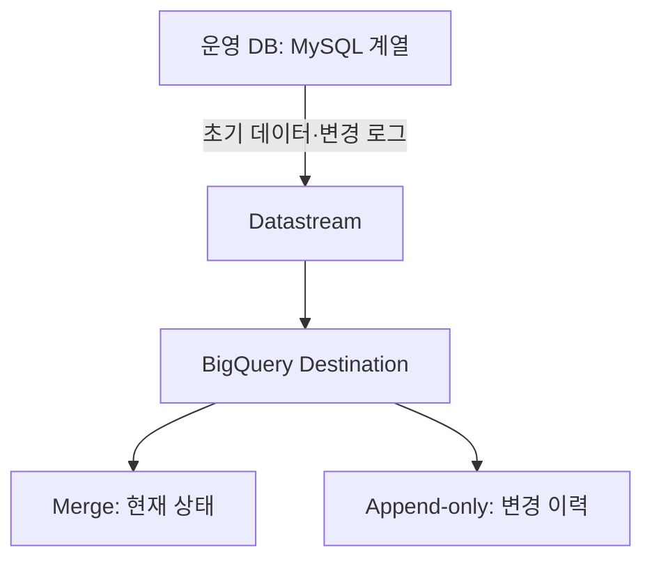
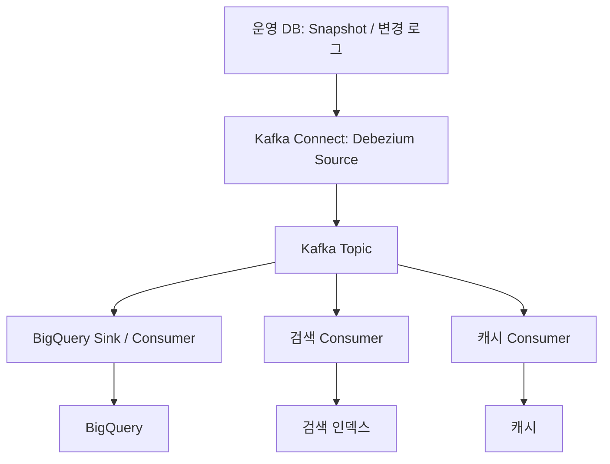

운영 DB의 변경을 분석계에 전달할 때 도구 이름부터 고르면 비교가 흐려진다. **최신 테이블을 복제하려는지, 변경 이벤트를 여러 시스템이 소비하려는지**부터 정해야 한다.

이번 글은 CDC 시리즈의 1편으로, Datastream과 Debezium의 아키텍처와 운영 책임을 비교하는 설계 노트다. 직접 구축해 성능이나 비용을 측정한 후기는 아니다.

- **1편:** Datastream과 Debezium의 아키텍처 비교
- **2편:** 데이터 정합성과 장애 복구
- **3편:** Kafka Connect 운영과 Schema Evolution

이 글에서는 2·3편의 상세 절차 대신 아키텍처 선택에 필요한 경계만 짚는다.

## 비교할 구성을 먼저 고정한다

비교 대상은 **Datastream의 BigQuery destination**과 **Kafka Connect에서 실행하는 Debezium + Kafka + BigQuery sink**다. 소스는 MySQL 계열의 변경 로그를 예로 든다. PostgreSQL 등 다른 DB에서는 권한·로그 보존·snapshot 조건이 달라지며, 실제 PoC에는 정확한 DB·커넥터 버전을 기록해야 한다.

Debezium이 반드시 Kafka를 요구하는 것은 아니다. Debezium Server나 애플리케이션에 내장하는 Engine 방식도 있다. 여기서는 여러 consumer가 변경 이벤트를 공유하는 대표적인 Kafka Connect 구성을 비교한다.

## Datastream: 관리형 복제 경로

- **운영 DB:** 대상 테이블·PK·권한·로그 보존을 준비한다.
- **Datastream:** 네트워크·연결 프로필·stream 설정을 관리한다.
- **BigQuery:** dataset·write mode·데이터 신선도 요구를 결정한다.
- **분석 테이블:** 접근 제어·정합성 검증·분석 SQL을 운영한다.

이 경로에서는 사용자가 별도 Kafka broker나 BigQuery sink connector를 배치하지 않는다. 다만 소스 DB 준비, 네트워크, 대상 제약, 데이터 검증과 비용 관리는 남는다. 관리형이라는 말이 운영 책임이 없다는 뜻은 아니다.

BigQuery write mode는 분석 목적에 따라 선택한다.

- **Merge:** PK가 있는 테이블의 현재 상태 복제에 사용한다. 과거 변경 이력을 보존하는 용도가 아니다.
- **Append-only:** 변경 이벤트를 쌓아 이력 분석에 활용한다. 이력에서 최신 상태를 만드는 요구는 별도로 설계한다.

PK가 없는 테이블은 Merge 설정에서도 append-only로 취급된다. 따라서 테이블 목록뿐 아니라 PK 유무와 변경 이력 필요 여부까지 먼저 정리해야 한다.

## Debezium + Kafka: 수집과 소비를 분리한다

- **운영 DB:** 소스 권한·로그 보존·부하를 관리한다.
- **Debezium Source:** connector 설정·상태·버전을 관리한다.
- **Kafka:** partition·retention·접근 제어를 관리한다.
- **BigQuery Sink / Consumer:** 이벤트 형식·삭제·upsert 처리를 구현하거나 설정한다.
- **추가 Consumer:** 검색·캐시 등 목적지별 지연·실패를 처리한다.

Kafka Connect는 Kafka broker와 별도 역할을 수행한다. Debezium source가 Kafka에 이벤트를 보냈다는 것만으로 BigQuery 반영이 끝난 것은 아니다. 선택한 sink가 이벤트 형식과 삭제 처리를 어떻게 지원하는지 확인해야 한다.

이 구조는 같은 변경을 여러 목적지에서 소비할 때 유연하다. 그 대신 source·broker·sink를 나눠 관찰하고 호환성을 관리해야 한다. Kafka의 보관 설정만으로 소스 로그와 최종 테이블 복구까지 모두 해결되지는 않는다.

## 같은 주문 변경을 어떻게 읽을까?

다음은 실제 측정 데이터가 아닌 요구사항 예시다. 주문 42의 상태가 CREATED → PAID → CANCELLED로 바뀌었다고 하자.

| 요구 | Datastream → BigQuery | Debezium → Kafka → consumer |
|---|---|---|
| 현재 주문 상태 조회 | PK와 Merge 동작을 확인 | sink의 key별 최신 상태 적용을 설계 |
| 상태 변경 이력 분석 | Append-only와 대상 제약 검토 | 이벤트 보존·변환 정책 검토 |
| 검색·캐시에도 변경 전달 | 별도 전달 경로와 요구사항 검토 | 목적별 consumer를 추가 |
| 잘못된 최신 상태 조사 | 소스·stream·대상 상태 대조 | 소스 위치·topic·consumer·대상 상태 대조 |

최신 상태를 보는 대시보드와 주문 전환 시간을 분석하는 이력 테이블은 서로 다른 산출물이다. 이 구분 없이 ‘CDC를 넣었다’는 이유만으로 두 요구가 모두 충족된다고 보면 안 된다.

## 선택 기준은 운영 책임과 목적지다

| 질문 | Datastream을 먼저 검토할 조건 | Debezium + Kafka를 검토할 조건 |
|---|---|---|
| 핵심 목적은? | 지원되는 DB를 BigQuery로 복제 | 변경 이벤트를 여러 목적에 활용 |
| 운영 역량은? | 관리형 복제 경로를 선호 | Connect·Kafka·sink를 운영 가능 |
| 변환 요구는? | destination 동작이 요구에 맞음 | consumer별 변환·처리가 필요 |
| 제약을 감당할 수 있나? | 지원 DB·타입·write mode 수용 | 커넥터·sink 조합의 책임 수용 |
| 복구 책임은? | 관리형 기능과 사용자 검증의 경계 정의 | 각 단계의 상태와 재처리 경계 정의 |

비용도 서비스 단가 하나로 비교하지 않는다. Datastream 쪽은 수집과 BigQuery 처리·저장을, Kafka 쪽은 broker·Connect·sink·저장·네트워크와 운영 시간을 함께 견적 내야 한다. 이미 Kafka가 있다는 이유만으로 추가 파이프라인 비용이 0이 되는 것은 아니다.

## PoC에서 남길 결정 기록

1. 대상 DB·테이블·PK·타입과 예상 변경량을 기록한다.
2. 목적지가 최신 상태를 원하는지 변경 이력을 원하는지 구분한다.
3. 허용 지연과 데이터 불일치를 판정할 기준을 정한다.
4. 정상 복제뿐 아니라 재시작·삭제·변경 순서 역전·DDL 변경을 검증 항목으로 잡는다.
5. 소스에서 최종 테이블까지 담당자와 관측 지점을 정한다.

4번의 정합성과 장애 복구 절차는 2편의 범위이고, Connect 설정과 Schema Evolution의 상세 운영은 3편의 범위다. 1편에서 내릴 결정은 **어느 구성을 선택하고 그 구성에서 어떤 책임을 맡을 것인가**다.

내가 운영 DB → BigQuery 복제를 주목적으로 시작한다면 Datastream의 지원 조건부터 검토하겠다. 변경 이벤트를 검색·캐시·다른 서비스가 함께 사용해야 한다면 Debezium + Kafka를 후보에 올리되, sink 운영과 복구 책임까지 포함해 판단하겠다.

## 참고 자료

- [Google Cloud — Configure a BigQuery destination](https://cloud.google.com/datastream/docs/configure-bigquery-destination)
- [Google Cloud — BigQuery destination](https://cloud.google.com/datastream/docs/destination-bigquery)
- [Debezium — Architecture](https://debezium.io/documentation/reference/stable/architecture.html)
- [Debezium — MySQL connector](https://debezium.io/documentation/reference/stable/connectors/mysql.html)

> 문서 확인: 2026-10-12. 버전별 지원 조건은 도입 시 다시 확인한다.

