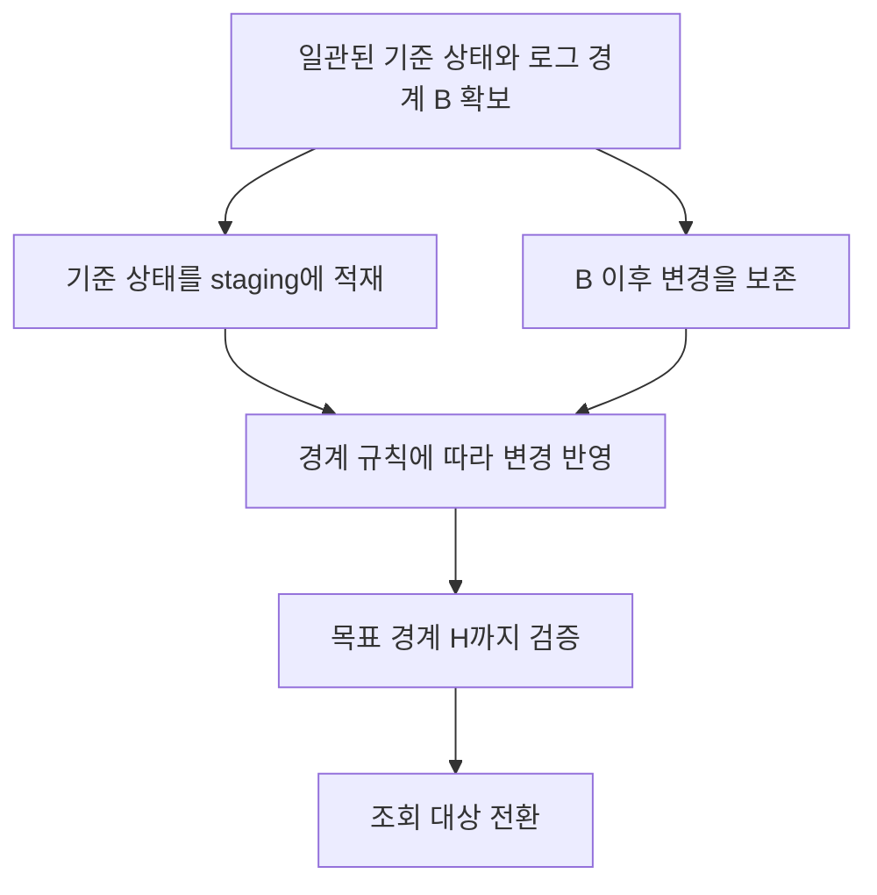
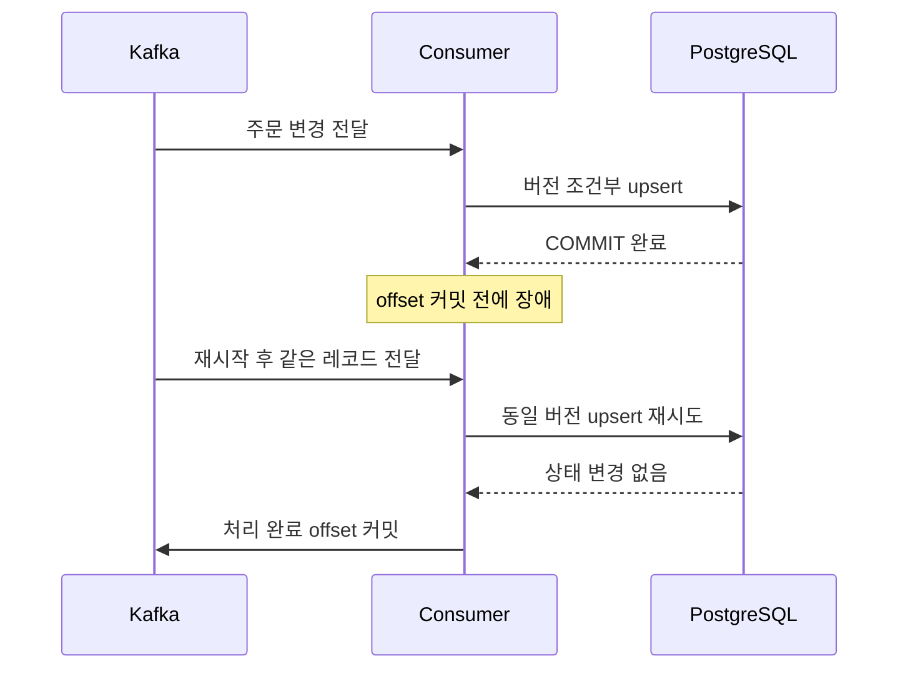
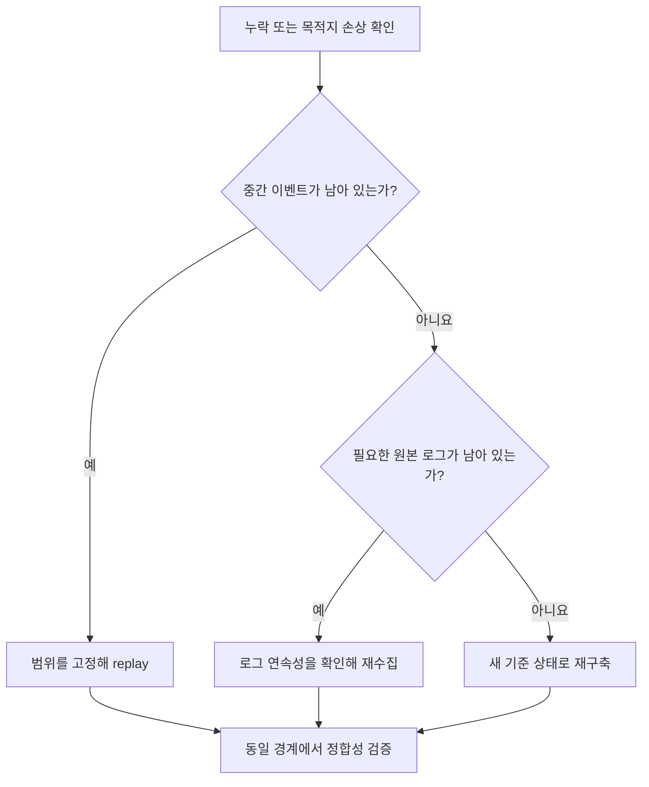

주문이 결제 완료 상태로 바뀌었다. CDC 이벤트도 목적지에 도착했다. 그런데 잠시 뒤 주문 상태가 다시 결제 대기로 돌아간다. 삭제한 주문이 장애 복구 후 다시 나타나는 경우도 있다.

이런 문제는 이벤트가 누락됐을 때만 생기지 않는다. **모든 이벤트를 받았어도 중복과 순서를 잘못 처리하면 목적지의 상태가 틀릴 수 있다.**

[1편: CDC 아키텍처 비교](/posts/cdc-datastream-vs-debezium/)에서는 Datastream과 Debezium의 아키텍처, 운영 책임, 선택 기준을 비교했다. 이번 글에서는 도구를 선택한 다음에 마주치는 문제를 다룬다. 초기 적재를 변경 스트림에 연결하고, 장애 후 재처리하면서도 `orders`의 최신 상태를 유지하려면 무엇을 설계해야 할까?

> 문서 확인일: 2026년 10월 15일. 아래 SQL과 장애 시나리오는 설계를 설명하기 위한 예제이며, 실제 서비스에서 실행한 실습이나 측정 결과가 아니다. 예상 결과와 운영 환경의 검증 결과는 구분한다. 조건부 upsert와 삭제 버전 보존 SQL은 PostgreSQL 18.6 기반 PGlite 0.5.10에서 이벤트 순서 6가지와 중복 재처리를 확인했다. 이는 PostgreSQL 16과 전체 CDC 파이프라인의 통합 검증을 대신하지 않는다.

## 예제의 범위와 전제

원본은 **MySQL 8.0, InnoDB, 단일 primary**다. row-based binlog와 `binlog_row_image=FULL`을 사용하고, `order_id`는 변경하거나 재사용하지 않는 기본 키로 둔다. 이번 예제에서는 DDL, `TRUNCATE`, primary 전환을 수행하지 않는다. 이들은 일반적인 행 변경과 별도의 복구 검토가 필요하다.

두 가지 복제 경로를 구분한다.

- **Datastream 경로:** MySQL → Datastream → BigQuery. 최신 상태 복제는 기본 키가 있는 테이블의 merge 쓰기 모드를 전제로 한다. Cloud Storage를 목적지로 선택하면 이후 상태 구성 로직은 별도 파이프라인의 책임이다.
- **Debezium 경로:** MySQL → Kafka Connect에서 실행하는 Debezium MySQL source connector → Kafka → 사용자 consumer → PostgreSQL 16. PostgreSQL은 조건부 upsert를 설명하기 위한 목적지이며, Datastream의 직접 목적지라는 뜻이 아니다.

Debezium은 3.7 문서, Kafka Connect 설정은 4.1 문서를 참고했다. 이 글은 해당 조합의 설치·호환성 검증을 대신하지 않으며, 배포할 때는 실제 connector·worker·JDK 버전을 고정하고 지원 조합을 확인해야 한다.

공통 사례는 다음과 같다. 각 DML은 독립적으로 커밋한다고 가정한다.

```sql
-- MySQL 8.0: 원본 테이블과 변경 예제
CREATE TABLE orders (
    order_id BIGINT NOT NULL PRIMARY KEY,
    status VARCHAR(20) NOT NULL,
    amount DECIMAL(12, 2) NOT NULL,
    updated_at DATETIME(6) NOT NULL
) ENGINE=InnoDB;

INSERT INTO orders VALUES
    (1001, 'CREATED', 25000.00, '2026-10-13 09:00:00.000000');

UPDATE orders
SET status = 'PAID', updated_at = '2026-10-13 09:01:00.000000'
WHERE order_id = 1001;

DELETE FROM orders WHERE order_id = 1001;
```

설명의 마지막 상태는 **주문 1001이 조회되지 않는 것**이다. 실제 주문 시스템의 데이터 보존 정책을 권장하는 예제는 아니며, 물리 삭제의 복제 동작을 보여주기 위해 삭제를 사용한다.

## 1. 전달 보장과 최종 정합성은 서로 다른 질문이다

전달 보장은 이벤트가 어느 구간까지 어떻게 전달되는지에 관한 약속이다. 최종 정합성은 목적지에 구성한 상태가 원본의 상태와 일치하는지에 관한 조건이다.

예를 들어 `PAID` 이벤트를 두 번 받아도 동일한 주문을 `PAID`로 두 번 덮어쓰면 결과는 같을 수 있다. 반면 매번 매출에 25,000원을 더하면 집계가 중복된다. 같은 전달 보장이라도 처리 로직에 따라 결과가 달라진다.

Datastream은 at-least-once 전달을 설명하며 중복 가능성을 명시한다. 이벤트 도착 순서도 보장하지 않는다. 공식 문서는 중복 식별에 UUID를, 순서 판단에 소스별 메타데이터를 사용하도록 설명한다. BigQuery 직접 복제에서는 내부 CSN과 이벤트 메타데이터로 순서를 처리한다. [1]

Kafka Connect에는 source record와 source offset을 트랜잭션으로 함께 기록하는 exactly-once source 지원이 있다. 그러나 worker 설정, connector 지원 및 소비 방식의 조건이 따른다. **이 기능이 외부 PostgreSQL에 대한 쓰기까지 하나의 트랜잭션으로 묶어주는 것은 아니다.** 이번 예제는 Kafka 이후 구간에서 재전달이 가능하다는 전제로 설계한다. [5]

따라서 정합성 목표는 다음처럼 범위까지 적는 편이 좋다.

> 동일한 원본 경계 H까지의 모든 필요한 변경이 반영되면, 목적지의 활성 주문 집합과 각 주문의 값이 원본의 H 시점 상태와 일치한다. 이벤트가 다시 전달되거나 늦게 도착해도 더 오래된 상태로 돌아가지 않는다.

이 목표는 주문 한 건의 최신 상태에 관한 것이다. 여러 테이블에 걸친 원본 트랜잭션이 목적지에서도 동시에 보인다는 보장은 포함하지 않는다. `orders`와 `payments`를 함께 읽는 일관성은 별도 설계가 필요하다.

## 2. 초기 적재는 CDC와 같은 경계를 공유해야 한다

기존 데이터를 먼저 복사하고 CDC를 켜는 방식은 간단해 보인다. 하지만 복사가 끝난 시점과 CDC가 시작하는 시점 사이의 변경은 빠질 수 있다. 반대로 CDC와 초기 적재가 겹치면 오래된 초기 적재 행이 최신 변경을 덮어쓸 수 있다.

Debezium MySQL의 initial snapshot은 일관된 초기 상태와 binlog 위치를 연결한다. snapshot의 읽기 이벤트는 `op=r`로 표현되고, 이후 해당 경계에서 변경 스트림으로 이어진다. 세부 잠금 절차는 snapshot 설정과 권한에 따라 달라진다. [4]

다음은 자체 적재기를 설계할 때 필요한 경계의 개념이다. 특정 제품 내부 절차를 그대로 그린 도식은 아니다.



주문 1001이 기준 상태에서는 `CREATED`이고, 복사 도중 `PAID`가 됐다고 하자. 결과는 `PAID`여야 한다. 파일이나 이벤트가 도착한 순서로 마지막 값을 선택하면 이 조건을 보장할 수 없다.

Datastream의 backfill과 CDC 역시 도착 순서로 구분해서는 안 된다. Cloud Storage 경로를 자체 소비한다면 `read_method`, 소스 위치 등 메타데이터와 초기 적재의 완료 경계를 함께 다뤄야 한다. 서로 다른 backfill을 모두 “가장 오래된 데이터”로 취급해 섞는 것도 위험하다. [1]

초기 적재 때 특히 피해야 할 방식은 다음 두 가지다.

- 전체 테이블을 일반 `SELECT`로 복사한 뒤, 그 이후 시점부터 CDC를 시작한다.
- 기존 목적지 위에 새 snapshot을 무조건 upsert하면서, 과거 CDC와 신규 CDC를 함께 흘린다.

첫 번째는 경계 사이 변경이 빠지고, 두 번째는 삭제 누락과 버전 충돌을 만들 수 있다. 재구축할 때는 새 staging 테이블에 기준 상태를 만들고, 경계 이후 변경을 따라잡은 뒤 전환하는 접근이 이해하고 검증하기 쉽다.

## 3. 이벤트 ID와 순서 정보는 역할이 다르다

중복 판별에는 “같은 변경인가”를 알아야 하고, 역순 방어에는 “어느 변경이 더 최신인가”를 알아야 한다.

| 정보 | 답하는 질문 | 예제에서의 용도 |
|---|---|---|
| 기본 키 | 어떤 주문인가? | `order_id=1001` |
| 이벤트 ID | 같은 변경이 재전달됐는가? | 이력 중복 제거, 부수 효과 중복 방지 |
| 소스 순서 | 어느 변경이 더 최신인가? | 오래된 upsert와 delete 거부 |
| 처리 위치 | 어디부터 다시 읽는가? | 재시작과 replay |

이벤트 ID만 저장하면 서로 다른 과거 이벤트가 늦게 도착하는 문제는 막지 못한다. Kafka offset만 저장하면 같은 원본 변경이 다른 Kafka offset으로 재발행된 경우를 동일 변경으로 인식하지 못할 수 있다.

`updated_at`도 단독 순서 키로 쓰기 어렵다. 애플리케이션이 값을 갱신하지 않을 수 있고, 같은 시각 값이 반복될 수 있으며, 삭제 후에는 비교할 원본 행 자체가 없다. 원본 변경 순서와 애플리케이션의 시간 값은 목적이 다르다.

아래 예제의 `seq=10, 20, 30`은 이해를 돕기 위한 가상 순서다.

| 원본 순서 | 변경 | 도착 순서 예시 |
|---|---|---|
| 10 | 1001 생성, `CREATED` | 세 번째 |
| 20 | 1001 수정, `PAID` | 첫 번째와 네 번째 |
| 30 | 1001 삭제 | 두 번째 |

목적지에 `20 → 30 → 10 → 20` 순서로 들어와도 결과는 삭제 상태여야 한다.

실제 구현에서는 소스별 순서 정보를 정규화해야 한다. 단일 MySQL 로그 계보의 CDC 이벤트라면 binlog 파일 번호, 위치, 필요한 행 순번 등으로 비교 키를 구성할 수 있다. 파일명 전체를 단순 문자열 비교하거나 GTID를 모든 서버에 걸친 전역 증가 숫자로 취급해서는 안 된다. snapshot은 별도 경계 규칙이 필요하고, failover나 재구축으로 로그 계보가 달라지면 이전 좌표와 직접 비교할 수 없다.

이번 글의 SQL은 **이 정규화가 끝난 이후**의 상태 반영을 설명한다. `seq`를 수신 순서로 새로 매기면 역순 방어가 무효화된다.

## 4. 멱등 upsert에는 최신 버전 조건이 필요하다

`INSERT ... ON CONFLICT DO UPDATE`를 쓴다고 정합성이 자동으로 확보되는 것은 아니다. 기본 키 중복은 막더라도, 오래된 값이 최신 값을 덮어쓸 수 있기 때문이다.

아래는 PostgreSQL 16 목적지에서 사용할 수 있는 최소 예제다. 실제 소스 순서를 비교 가능한 `source_seq`로 변환한 이벤트만 전달한다고 가정한다. [7]

```sql
CREATE TABLE order_projection (
    order_id BIGINT PRIMARY KEY,
    status TEXT,
    amount NUMERIC(12, 2),
    source_seq BIGINT NOT NULL,
    is_deleted BOOLEAN NOT NULL
);

-- 애플리케이션에서는 $1~$5에 정규화한 이벤트 값을 바인딩한다.
PREPARE apply_order (BIGINT, TEXT, NUMERIC, BIGINT, BOOLEAN) AS
INSERT INTO order_projection AS current_row
    (order_id, status, amount, source_seq, is_deleted)
VALUES ($1, $2, $3, $4, $5)
ON CONFLICT (order_id) DO UPDATE
SET status     = EXCLUDED.status,
    amount     = EXCLUDED.amount,
    source_seq = EXCLUDED.source_seq,
    is_deleted = EXCLUDED.is_deleted
WHERE current_row.source_seq < EXCLUDED.source_seq;

-- 의도적으로 순서를 뒤집고 중복을 포함한다.
EXECUTE apply_order(1001, 'PAID', 25000.00, 20, false);
EXECUTE apply_order(1001, NULL, NULL, 30, true);
EXECUTE apply_order(1001, 'CREATED', 25000.00, 10, false);
EXECUTE apply_order(1001, 'PAID', 25000.00, 20, false);

SELECT order_id, source_seq, is_deleted FROM order_projection;
-- 예상: 1001 | 30 | true

CREATE VIEW orders_current AS
SELECT order_id, status, amount
FROM order_projection
WHERE NOT is_deleted;

SELECT * FROM orders_current WHERE order_id = 1001;
-- 예상: 0행
```

현재 버전보다 큰 이벤트만 반영하므로 같은 버전의 재전달과 더 작은 버전의 지연 도착은 상태를 바꾸지 않는다. 비교 조건이 upsert 안에 있어 애플리케이션에서 먼저 조회하고 나중에 갱신하는 경쟁 조건도 피한다.

이 예제의 전제는 같은 주문에서 같은 `source_seq`가 같은 변경을 뜻한다는 것이다. 같은 버전인데 payload가 다르면 정상적인 중복으로 무시하지 말고 정규화 오류로 기록해야 한다. 전체 이벤트 이력이 필요한 경우에는 별도 이력 테이블의 이벤트 ID에도 고유 제약을 둔다.

또한 이 방식은 **전체 최신 행 상태를 반영하는 projection**에 적합하다. 중간의 모든 변경으로 매출 증감, 알림, 결제를 처리하는 로직에 그대로 적용하면 안 된다. 그런 부수 효과는 이벤트별 처리 기록과 원자성, 또는 별도 outbox 같은 전달 설계가 필요하다.

## 5. 삭제는 행만 지우면 끝나지 않는다

삭제 이벤트를 받고 목적지 행을 물리적으로 지웠다고 하자. 나중에 예전 `PAID` 이벤트가 도착하면 충돌할 행이 없어 새로 INSERT된다. 삭제됐던 주문이 되살아난다.

이를 막기 위해 위 예제는 삭제 버전 30을 남긴다. 조회에서는 숨기지만 이전 버전의 쓰기를 거절할 근거를 유지하는 것이다. 삭제된 payload를 보관할 필요는 없으므로 예제에서는 상태와 금액을 `NULL`로 비운다.

삭제 표식을 언제 지울지도 replay 정책과 연결해야 한다. 과거 이벤트가 다시 들어올 수 있는 기간보다 먼저 표식을 제거하면 같은 문제가 생긴다. 표식을 정리하려면 이전 세대 replay를 차단하거나, 별도 버전 저장소를 유지하거나, 전체 projection을 새로 만드는 절차가 필요하다.

Debezium에서는 `op=d`인 delete 이벤트와 value가 `null`인 Kafka tombstone을 구분한다. 전자는 원본 행 삭제를 나타내고, 후자는 compacted topic에서 해당 키의 레코드를 정리하는 데 사용된다. 기본 설정에서는 delete 뒤에 tombstone이 이어진다. 목적지 삭제가 실제로 수행되는지는 consumer나 sink 설정에 달려 있다. [4]

여기서 예제의 `is_deleted=true`는 목적지의 버전 보존 방식이다. Kafka tombstone과 같은 자료 구조가 아니다. SMT나 consumer가 null value를 제거하더라도 원본 delete를 따로 처리하는지 확인해야 한다.

## 6. Datastream은 목적지에 따라 책임이 달라진다

BigQuery 직접 복제와 Cloud Storage 경유를 같은 방식으로 설명하면, 어디에서 중복 제거와 삭제 처리를 해야 하는지 혼란이 생긴다.

| 경로 | 저장·반영 방식 | 운영자가 확인할 부분 |
|---|---|---|
| Datastream → BigQuery, merge | 기본 키를 기준으로 최신 상태에 변경 반영 | PK, 쓰기 모드, 반영 지연, 결과 정합성 |
| Datastream → BigQuery, append-only | 변경을 행으로 추가 | 조회 시 최신 상태 구성과 삭제 해석 |
| Datastream → Cloud Storage → 별도 처리기 | 파일의 이벤트를 후속 처리기가 소비 | 중복 제거, 소스 순서, 삭제, checkpoint |
| Debezium → Kafka → consumer | Kafka 레코드에서 목적지 상태 구성 | source offset과 consumer offset, 목적지 트랜잭션 |

BigQuery의 merge 모드라도 원본에 기본 키가 없는 테이블은 append-only로 처리된다. append-only 모드에서는 `CHANGE_TYPE`, `CHANGE_SEQUENCE_NUMBER`, `SORT_KEYS` 등 메타데이터가 제공된다. 최신 상태를 만들 때는 해당 필드의 의미와 비교 규칙을 사용해야 한다. [2][3]

Cloud Storage에서는 파일 생성 시간이나 파일 목록 순서를 원본 변경 순서로 취급하지 않는다. 한 시점의 이벤트도 여러 파일에 나뉠 수 있다. 객체를 모두 읽었다는 사실과 그 안의 모든 변경이 목적지에 반영됐다는 사실도 별도로 기록해야 한다. [1]

BigQuery 직접 복제의 쓰기 모드를 설명하면서 Kafka Connect의 offset topic을 끌어오는 것은 맞지 않는다. 반대로 Cloud Storage에 이벤트 파일이 있다는 이유로 BigQuery 직접 복제의 최신 상태 관리가 자동으로 적용된다고 가정해서도 안 된다.

## 7. offset은 한 종류가 아니다

Debezium 경로에서는 최소한 세 위치를 구분해야 한다.

1. **Source offset:** Debezium이 원본 로그의 어디까지 처리했는가.
2. **Consumer offset:** 특정 consumer group이 Kafka의 각 partition을 어디까지 처리했는가.
3. **목적지 반영 상태:** 실제로 어떤 이벤트까지 목적지에 커밋됐는가.

Kafka Connect distributed worker의 source offset은 설정된 offset storage topic에서 관리한다. 이것은 downstream consumer group의 offset과 다르다. MySQL connector는 로그를 해석하는 데 필요한 schema history도 사용하므로, offset만 보존하면 충분하다고 생각해서는 안 된다. [4][5]

외부 DB에 쓰는 consumer의 핵심 장애 구간은 다음과 같다.



목적지 커밋 후 offset 커밋 전에 죽으면 같은 이벤트가 다시 처리될 수 있다. 이것은 멱등 반영으로 견딜 수 있다. 반대로 offset을 먼저 커밋한 뒤 DB 쓰기가 실패하면, 정상 재시작만으로는 해당 이벤트를 다시 읽지 않아 누락될 수 있다.

consumer 구현에서는 다음 원칙을 지킨다.

- 자동 offset 커밋에 의존하지 않고, 목적지 트랜잭션 성공 뒤 처리 완료 위치를 커밋한다.
- partition 안에서 병렬 처리한다면 완료된 가장 큰 offset이 아니라 **그 이전까지 모두 처리됐다는 연속 경계**를 커밋한다.
- 실패 이벤트를 DLQ로 옮겼다면 원본 데이터 반영은 아직 완료되지 않은 것으로 관리한다.
- 목적지에서 버전 비교와 필요한 처리 기록을 하나의 트랜잭션으로 묶는다.

Kafka에서 순서를 고려할 때도 동일 키의 partition 배치와 consumer 내부 병렬 처리를 함께 본다. 서로 다른 partition의 offset 숫자를 비교해 주문 간 전역 순서를 만드는 방식은 사용할 수 없다.

## 8. 재시작과 재처리는 복구 출발점이 다르다

재시작은 저장된 위치에서 정상 처리를 이어가는 것이다. 재처리는 과거 범위를 의도적으로 다시 읽는 것이다. 문제가 목적지에만 있다면 원본 connector를 초기화하기 전에 Kafka나 보관된 이벤트에서 복구할 수 있는지 먼저 확인한다.



다음 시나리오는 실제 장애 실험 결과가 아니라, 앞에서 설계한 처리기의 기대 동작이다.

| 장애 시나리오 | 복구 방식 | 예상 결과와 검증점 |
|---|---|---|
| DB 반영 후 consumer offset 커밋 전 종료 | 저장된 offset에서 재시작 | 재전달돼도 목적지 상태는 같음 |
| 삭제 뒤 오래된 수정 도착 | 삭제 버전과 비교 | 주문이 다시 나타나지 않음 |
| 목적지 일부 손상, Kafka 기록은 보존 | 대상 범위를 staging으로 replay | 손상된 행의 최신 값 복구 |
| Source connector 장기 중단, binlog는 보존 | 저장 위치와 로그 연속성 확인 후 재개 | 쌓인 변경을 따라잡음 |
| 필요한 binlog와 중간 기록 모두 소실 | 새 snapshot과 CDC 경계로 재구축 | 현재 상태는 복구 가능하지만 과거 변경 이력은 복원 불가 |
| 오류 이벤트를 DLQ로 이동 | 원인 수정 후 해당 범위 재반영 | DLQ 미해결 건이 있으면 완료로 보지 않음 |

특히 데이터가 손상됐는데 `source_seq`만 정상적으로 남아 있는 경우를 조심해야 한다. 같은 버전을 replay하면 위 SQL은 이를 중복으로 보고 수정하지 않는다. **멱등 replay는 이미 손상된 저장 값을 자동 교정하는 수단이 아니다.** 새 staging에 재구축하거나, 확인된 키를 별도의 수리 절차로 교정해야 한다.

기존 topic에 서로 다른 snapshot 세대와 로그 계보를 무작정 섞는 대신, 재구축용 topic·consumer group·staging을 분리하고 전환 경계를 남기면 복구 과정을 추적하기 쉽다.

## 9. 복구 가능 시간은 보존 정책이 결정한다

offset은 다시 읽을 위치를 가리킬 뿐, 그 위치의 데이터를 보관하지 않는다. MySQL에서 해당 binlog가 삭제되면 저장된 위치가 있어도 그대로 이어 읽을 수 없다.

MySQL 8.0의 `binlog_expire_logs_seconds`는 binlog 만료를 제어한다. 운영에서는 설정값뿐 아니라 실제 남아 있는 가장 오래된 로그, 디스크 여유, 수동 삭제와 백업 정책을 함께 확인해야 한다. [6]

보존 기간을 정할 때는 다음 항목을 합산해 예산을 잡을 수 있다.

> 필요한 보존 여유 ≈ 장애 전 누적 지연 + 장애 감지 시간 + 조치·중단 시간 + 따라잡기 시간 + 안전 여유

이는 보수적인 계획식이며 제품 보장 공식이 아니다. 가장 정확한 운영 지표는 **아직 읽지 못한 가장 오래된 로그가 삭제되기까지 남은 시간**이다.

가령 backlog가 1,200만 건이고 신규 유입이 초당 2,000건, 복구 중 처리량이 초당 5,000건이라고 가정하면, 순수하게 backlog를 줄이는 속도는 초당 3,000건이다. 단순 계산상 약 4,000초, 즉 67분이 필요하다. 이 숫자는 가정에 따른 계산이며 측정값이 아니다. 처리량이 유입량 이하라면 기다려도 지연은 해소되지 않는다.

보존 구간도 서로 다르다.

- **원본 로그 보존:** source connector가 멈췄을 때 다시 수집할 수 있는 범위.
- **Kafka 또는 이벤트 파일 보존:** downstream 장애에서 원본을 다시 읽지 않고 replay할 수 있는 범위.
- **목적지 삭제 버전·중복 식별 기록 보존:** 오래된 replay를 받아도 상태와 부수 효과가 망가지지 않는 범위.

Kafka log compaction을 사용하는 topic은 모든 중간 변경을 영구 보존하는 감사 로그로 취급하지 않는다. 최신 상태를 재구성하는 요구와 모든 변경 이력을 재현하는 요구는 다른 보존 정책을 필요로 한다.

Datastream의 stream recovery는 다른 복제 위치에서 읽기를 재개하는 방법도 제공한다. 그러나 필요한 로그를 건너뛰면 해당 구간의 변경이 빠질 수 있다. 상태가 다시 `RUNNING`이 됐다는 이유만으로 데이터 복구가 끝났다고 판단하면 안 된다. [8]

### 새 snapshot으로도 되살릴 수 없는 정보

로그가 사라진 동안 주문 1001이 생성됐다가 삭제됐다면, 현재 원본에는 그 주문이 없다. 새 snapshot으로 현재 상태를 맞출 수는 있지만 생성과 삭제가 있었다는 이력은 재현할 수 없다.

더 흔한 함정은 목적지에 오래된 주문이 남아 있는 경우다. 현재 원본을 다시 읽어 upsert만 하면, 원본에 없는 주문은 아무 이벤트도 만들지 않아서 목적지에 그대로 남는다.

따라서 현재 상태를 재구축할 때는 빈 staging에 전체 상태를 만들거나, 동일한 기준 경계에서 원본에 없는 키를 식별해 정리해야 한다. 수집 중인 live 원본과 목적지를 즉시 비교해 없는 키를 지우는 방식은 동시 변경 때문에 잘못된 삭제를 만들 수 있다.

## 10. 복구 완료는 누락·중복·최신 상태로 검증한다

행 수만 같다고 정합성이 맞는 것은 아니다. 한 주문이 빠지고 다른 주문이 남아 있어도 행 수는 같다. CDC lag가 줄어드는 것은 진행 신호지만, 과거에 건너뛴 변경이 복구됐다는 증거는 아니다.

먼저 **비교 기준 경계 H**를 고정한다. 작은 점검에서는 잠시 쓰기를 멈추고 원본의 최종 경계를 확인한 뒤 목적지가 따라잡도록 할 수 있다. 무중단 환경이라면 원본의 일관된 snapshot과 목적지의 대응 상태를 별도로 확보해야 한다. 단순히 같은 시각에 두 DB를 조회하는 것만으로 같은 경계가 되지는 않는다.

BigQuery 직접 복제도 수집 완료와 조회에 보이는 반영 완료를 구분한다. 쓰기 모드와 staleness 설정을 고려해 검증 시점의 데이터가 어느 경계를 반영하는지 확인한다. [2]

### 현재 상태를 비교하는 SQL

아래는 H 시점의 원본 주문을 PostgreSQL의 `expected_orders`에 검증용으로 가져왔다고 가정한 SQL이다. 이 테이블에는 원본과 동일한 `order_id`, `status`, `amount` 열과 PK가 있어야 한다. 목적지도 H까지 반영한 상태에서 비교한다.

```sql
-- 1. 목적지에서 빠진 키
SELECT e.order_id
FROM expected_orders e
LEFT JOIN orders_current a USING (order_id)
WHERE a.order_id IS NULL;

-- 2. 원본에는 없는데 목적지에 남은 키: 삭제 누락 등
SELECT a.order_id
FROM orders_current a
LEFT JOIN expected_orders e USING (order_id)
WHERE e.order_id IS NULL;

-- 3. 같은 키의 최신 값 불일치
SELECT e.order_id,
       e.status AS expected_status, a.status AS actual_status,
       e.amount AS expected_amount, a.amount AS actual_amount
FROM expected_orders e
JOIN orders_current a USING (order_id)
WHERE ROW(e.status, e.amount)
      IS DISTINCT FROM ROW(a.status, a.amount);

-- 4. 조회 결과의 키 중복
SELECT order_id, COUNT(*)
FROM orders_current
GROUP BY order_id
HAVING COUNT(*) > 1;
```

이 예제에서는 PK가 있으므로 마지막 쿼리는 구조상 0행이어야 한다. PK가 강제되지 않는 목적지나 여러 데이터를 합친 조회 결과에서는 별도로 확인할 가치가 있다. raw 이벤트 테이블의 중복은 정상 재전달일 수 있으므로, 현재 상태의 중복과 같은 오류로 세지 않는다.

검증할 때는 금액의 정밀도, 시간대, `NULL`, 문자 정규화 규칙도 맞춘다. 대규모 테이블은 PK 범위별 건수와 정규화된 행 hash로 차이 구간을 좁힐 수 있지만, hash가 같다는 사실만으로 절대적인 무결성을 증명한다고 표현하지 않는다. 차이가 있는 구간은 실제 행 비교로 내려간다.

완료 판정에 남길 기록은 길지 않아도 된다.

- 검증 경계 H와 대상 테이블·키 범위
- 누락 키, 불필요하게 남은 키, 최신 값 불일치, 활성 키 중복 건수
- 미처리 오류와 DLQ 잔여 건수
- 같은 범위를 다시 처리해도 결과가 변하지 않는지
- replay 시작·종료 위치와 실제 사용한 로그·이벤트 보존 범위

현재 상태가 일치해도 중간 이벤트 이력의 완전성이 증명되지는 않는다. 이력까지 요구한다면 원본 감사 기록이나 보관된 로그와 이벤트 ID를 대조하는 별도 검증이 필요하다.

## 다음 편: 복구 가능한 상태를 Kafka Connect에서 유지하기

CDC 복구 설계는 정상 동작 중보다, 같은 이벤트를 다시 받았을 때와 과거 위치를 더 이상 읽을 수 없을 때 드러난다. 최신 상태를 지키는 조건부 반영, 삭제 버전 보존, 초기 적재 경계, 재처리 가능한 기록이 함께 있어야 한다.

다음 편 [**「Debezium CDC 운영 — Kafka Connect와 Schema Evolution」**](/posts/debezium-kafka-connect-schema-evolution/)에서는 이 설계를 유지하기 위한 Connect 운영과 schema 변경 대응을 다룬다. source offset과 schema history를 어떻게 관리하고, 재시작 가능한 구성과 스키마 호환성을 어떻게 점검할지 이어서 살펴본다.

## 공식 문서

아래 자료는 2026년 10월 15일 확인했다. `stable` 문서는 이후 다른 버전을 가리킬 수 있으므로 실제 배포 버전의 문서와 함께 확인한다.

1. [Datastream — Events and streams](https://docs.cloud.google.com/datastream/docs/events-and-streams): 전달 보장, 이벤트 순서, UUID와 소스별 메타데이터.
2. [Datastream — BigQuery destination](https://docs.cloud.google.com/datastream/docs/destination-bigquery): PK 유무와 쓰기 동작, 메타데이터, staleness.
3. [Datastream — Configure a BigQuery destination](https://docs.cloud.google.com/datastream/docs/configure-bigquery-destination): merge와 append-only 쓰기 모드.
4. [Debezium — MySQL connector](https://debezium.io/documentation/reference/stable/connectors/mysql.html): initial snapshot, source 위치, schema history, delete와 tombstone. 확인 당시 문서 표기는 3.7.
5. [Apache Kafka 4.1 — Kafka Connect configs](https://kafka.apache.org/41/configuration/kafka-connect-configs/): offset storage와 exactly-once source 설정.
6. [MySQL 8.0 — Binary Logging Options and Variables](https://dev.mysql.com/doc/refman/8.0/en/replication-options-binary-log.html): binlog 설정과 보존 기간.
7. [PostgreSQL 16 — INSERT](https://www.postgresql.org/docs/16/sql-insert.html): `ON CONFLICT DO UPDATE`와 조건식.
8. [Datastream — Recover a stream](https://docs.cloud.google.com/datastream/docs/recover-a-stream): 복제 위치에서 재개하는 방법과 로그 누락 시 복구 범위.
