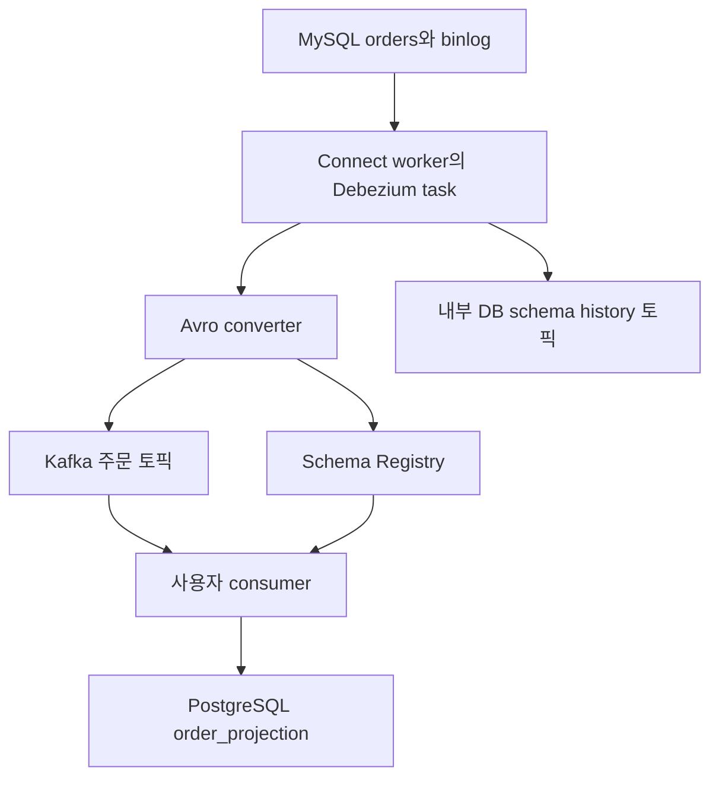
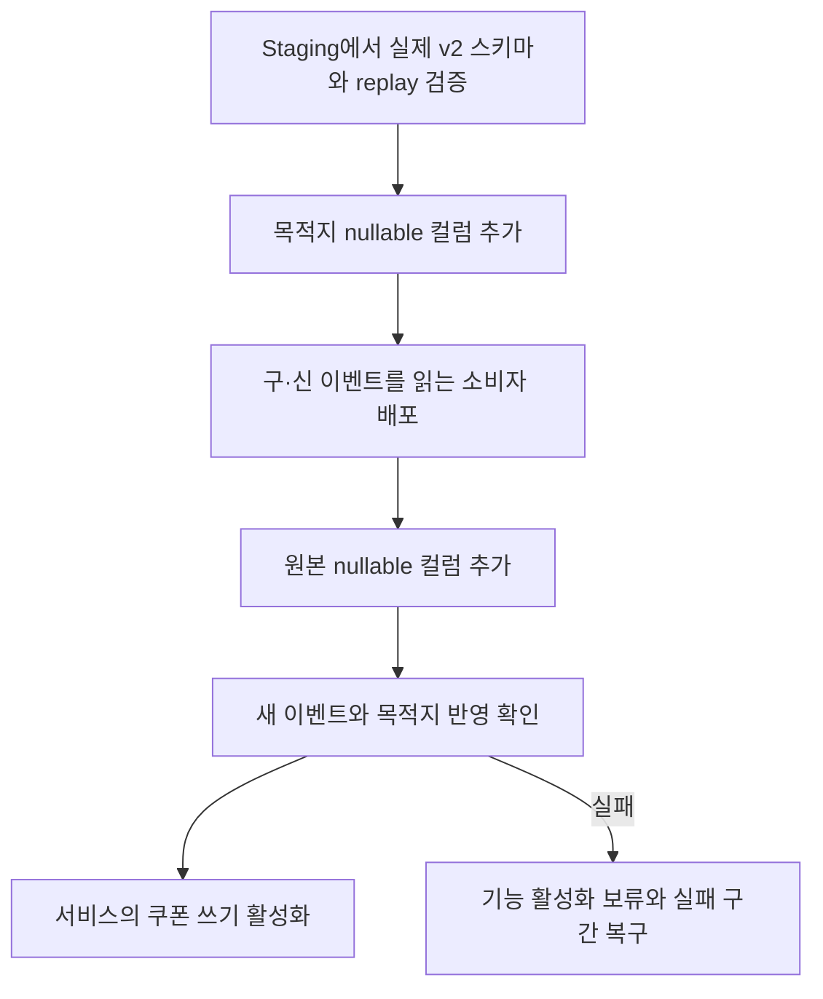

다음과 같은 변경 상황을 가정해 보자. 주문 테이블에 `coupon_code` 컬럼 하나를 추가했다. 서비스에서는 정상적으로 저장되는데, CDC 소비자는 새 이벤트를 읽다가 멈춘다. 다른 소비자는 멀쩡하지만 목적지 테이블에 컬럼이 없어 쓰기에 실패한다. DB migration은 성공했어도 데이터 파이프라인의 변경은 아직 끝나지 않은 셈이다.

[1편](/posts/cdc-datastream-vs-debezium/)에서는 Datastream과 Debezium의 아키텍처·운영 책임·선택 기준을 비교했다. [2편](/posts/cdc-consistency-and-recovery/)에서는 중복·역순·재처리와 복구 완료 검증을 다뤘다. 이번에는 **Debezium을 실행하는 Kafka Connect의 운영과, DB 스키마 변경을 소비자와 목적지까지 연결하는 방법**에 집중한다.

> 초안의 공식 문서 확인일: 2026년 10월 14일. 10월 15일 게시 전 MySQL connector, Connect 운영·REST API, schema history 보존과 Registry 호환성 API를 다시 확인했다. 아래 설정·코드·예상 결과는 설계 설명용이며 실제 환경에서 실행하거나 측정한 결과가 아니다. 공식 문서의 동작 설명과 이 글에서 제안하는 배포 절차를 구분한다.

## 1. 실행 기반과 예제의 전제

이 글의 경로는 MySQL → Debezium MySQL source connector → Kafka → 사용자 consumer → PostgreSQL이다. **Kafka Connect는 이 구성에서 Debezium connector를 이미 실행하고 있는 기반이다.** CDC 구축 후 새로 붙여야 하는 필수 확장 단계가 아니다. Debezium에는 Server와 Embedded Engine 등 다른 실행 방식도 있지만, 여기서는 Kafka Connect 기반 구성만 다룬다. [1][2]



예제의 범위는 다음과 같다.

- **원본 DB:** MySQL 8.0 계열, InnoDB, 단일 primary. row-based binlog와 `binlog_row_image=FULL` 사용. `order_id`는 변경하거나 재사용하지 않는다.
- **Debezium:** 3.7 문서 기준. 확인일의 stable 문서가 3.7을 가리킨다. Kafka Connect 운영 설명은 Apache Kafka 4.1 문서 기준이다.
- **직렬화:** `io.confluent.connect.avro.AvroConverter`, Confluent Schema Registry와 기본 `TopicNameStrategy`. Registry·converter 설정은 Confluent의 current 문서를 참고한다. 특정 바이너리 조합의 호환성 검증을 수행한 예제는 아니므로 배포 시 Debezium·Kafka·JDK·converter·Registry의 실제 patch 버전과 의존성을 고정해야 한다.
- **이벤트:** SMT로 envelope를 펼치지 않는다. `before`, `after`, `op`, `source`를 유지한다. 토픽은 `commerce.shop.orders`, key는 `order_id`다. 기존 파이프라인도 Avro라는 전제다. JSON 토픽을 같은 이름으로 Avro로 바꾸는 마이그레이션은 포함하지 않는다.
- **목적지:** PostgreSQL 16의 `order_projection`. Java consumer가 쓰는 사용자 정의 sink이며 Kafka Connect JDBC sink connector를 사용하는 예제가 아니다. 목적지 DDL은 migration으로 관리하고 자동 컬럼 생성은 하지 않는다.
- **운영 가정:** Kafka broker 3대와 Connect worker 2대 이상. 인증·TLS·ACL·비밀값 제공은 별도 설정한다. 예제의 HTTP 주소는 내부 개발 환경용이다.

2편과 같은 주문 테이블을 사용한다.

```sql
-- MySQL: 변경 전 원본
CREATE TABLE shop.orders (
    order_id BIGINT NOT NULL PRIMARY KEY,
    status VARCHAR(20) NOT NULL,
    amount DECIMAL(12, 2) NOT NULL,
    updated_at DATETIME(6) NOT NULL
) ENGINE=InnoDB;
```

## 2. Worker, connector, task는 서로 다른 단위다

| 단위 | 책임 | 이 예제에서의 의미 |
|---|---|---|
| Worker | 플러그인을 로드하고 connector·task를 실행하는 프로세스 | Connect JVM과 그 실행 환경 |
| Connector | 연결 설정을 받아 task 설정과 생명주기를 관리 | `orders-mysql`이라는 논리적 연결 |
| Task | 데이터를 실제로 읽거나 쓰는 실행 단위 | MySQL binlog를 읽는 source task |

분산 모드에서는 여러 worker가 작업을 나눠 실행하고, worker가 사라지면 작업을 재할당한다. 모든 worker에 같은 connector·converter 플러그인을 설치해야 한다. 특정 worker에만 JAR가 있으면 재할당 이후 실패할 수 있다. [3]

**MySQL connector는 하나의 task를 사용한다.** `tasks.max`를 늘려도 binlog streaming이 여러 task로 분산되지 않는다. Worker 증설은 여러 connector의 배치와 장애 대응에 도움이 되지만, 단일 MySQL connector의 처리량을 같은 비율로 늘린다는 뜻은 아니다. [1]

### 분산 worker가 공유하는 상태

아래는 `connect-distributed.properties`의 발췌다. 실제 배포 설정 전체가 아니다.

```properties
bootstrap.servers=kafka-1:9092,kafka-2:9092,kafka-3:9092
group.id=commerce-connect
config.storage.topic=commerce-connect-configs
offset.storage.topic=commerce-connect-offsets
status.storage.topic=commerce-connect-status
config.storage.replication.factor=3
offset.storage.replication.factor=3
status.storage.replication.factor=3
offset.storage.partitions=25
status.storage.partitions=5
plugin.path=/opt/connect/plugins

# source connector의 파일 기반 비밀값 참조에 사용
config.providers=file
config.providers.file.class=org.apache.kafka.common.config.provider.FileConfigProvider

key.converter=io.confluent.connect.avro.AvroConverter
key.converter.schema.registry.url=http://schema-registry:8081
value.converter=io.confluent.connect.avro.AvroConverter
value.converter.schema.registry.url=http://schema-registry:8081
value.converter.auto.register.schemas=true
```

같은 Connect 클러스터의 worker는 `group.id`와 내부 토픽을 공유한다. 서로 독립적인 클러스터는 이를 분리한다. Config 토픽은 1 partition, 세 내부 토픽은 compaction 정책으로 유지한다. Offset·status 토픽은 여러 partition을 둘 수 있다. 위 replication factor 3은 broker 3대 이상을 전제로 한다. 이미 존재하는 토픽의 복제 수나 partition 수를 이 설정만으로 변경할 수는 없다. [3]

모든 worker에서 접근 가능한 REST advertised 주소도 설정해야 한다. 재할당을 견디려면 같은 플러그인뿐 아니라 동일한 비밀값 제공 경로와 DB·Kafka·Registry 접근 권한이 필요하다.

## 3. Converter와 Schema Registry는 무엇을 하는가

Debezium은 Connect 내부의 schema와 record를 만든다. Source 측 converter는 이를 Kafka에 기록할 바이트로 바꾼다. 이 글의 Avro converter는 이벤트 스키마를 Schema Registry에 등록하고 스키마 식별 정보를 포함해 직렬화한다. 소비자는 대응하는 Avro deserializer로 writer schema를 찾아 읽는다. Connect sink를 사용한다면 그쪽 converter는 바이트를 다시 Connect schema와 record로 바꾼다. [2][4]

**Converter가 목적지 DB를 변경하지는 않는다.** Registry에 스키마가 등록돼도 PostgreSQL 컬럼, consumer의 필드 매핑, 비즈니스 검증 규칙은 별도로 준비해야 한다.

Confluent converter는 Debezium 컨테이너에 기본 포함된다고 가정하면 안 된다. 공식 문서는 별도 JAR와 의존성 설치를 안내한다. 모든 worker에 동일한 의존성을 배포한다. 기본 `JsonConverter`의 `schemas.enable=true` 역시 Schema Registry 사용을 의미하지 않는다. [2][4]

### Source connector 설정 예제

다음은 최초 등록용 JSON이다. 이미 운영 중인 connector에 같은 이름으로 다시 `POST`하지 않는다. 변경할 때는 현재 설정을 보존한 전체 config를 검토해 `PUT /connectors/orders-mysql/config`로 적용한다.

```json
{
  "name": "orders-mysql",
  "config": {
    "connector.class": "io.debezium.connector.mysql.MySqlConnector",
    "tasks.max": "1",
    "database.hostname": "mysql",
    "database.port": "3306",
    "database.user": "debezium",
    "database.password": "${file:/run/secrets/mysql.properties:password}",
    "database.server.id": "5401",
    "topic.prefix": "commerce",
    "database.include.list": "shop",
    "table.include.list": "shop\\.orders",
    "snapshot.mode": "initial",
    "schema.history.internal.kafka.bootstrap.servers": "kafka-1:9092,kafka-2:9092,kafka-3:9092",
    "schema.history.internal.kafka.topic": "schema-history.commerce",
    "include.schema.changes": "false",
    "schema.name.adjustment.mode": "avro",
    "decimal.handling.mode": "precise",
    "key.converter": "io.confluent.connect.avro.AvroConverter",
    "key.converter.schema.registry.url": "http://schema-registry:8081",
    "key.converter.auto.register.schemas": "true",
    "value.converter": "io.confluent.connect.avro.AvroConverter",
    "value.converter.schema.registry.url": "http://schema-registry:8081",
    "value.converter.auto.register.schemas": "true"
  }
}
```

`database.server.id`는 replication 연결에서 충돌하지 않게 정한다. `topic.prefix`도 기존 토픽과 스키마 이름에 연결된 식별자이므로 운영 중 이름을 가볍게 바꾸지 않는다. 비밀 파일의 `password` 키와 DB snapshot·replication 권한은 미리 준비해야 한다. [1]

## 4. DB schema history와 Schema Registry를 구분하자

| 저장 대상 | 누가 사용하는가 | 답하는 질문 |
|---|---|---|
| Connect source offset | Connect와 source connector | 원본 로그의 어디까지 처리했는가? |
| Debezium 내부 DB schema history | Debezium MySQL connector | 그 로그 위치에서 테이블 구조는 무엇이었는가? |
| Schema Registry | Converter·serializer·deserializer | 이 Kafka 메시지의 직렬화 스키마는 무엇이며 기존 스키마와 호환되는가? |
| Consumer group offset | Kafka consumer | Kafka partition의 어디까지 처리했는가? |

MySQL의 현재 테이블 정의만으로 과거 binlog를 해석할 수는 없다. Debezium은 DDL과 로그 위치를 내부 history에 기록하고 재시작 시 필요한 테이블 구조를 재구성한다. Registry의 Avro 스키마가 남아 있어도 이 내부 history를 대신할 수 없다. 반대로 history가 정상이어도 소비자의 Avro 역직렬화에 필요한 Registry 스키마는 따로 필요하다. [1][5]

내부 schema history 토픽은 **1 partition과 전체 이력 보존**을 전제로 관리한다. 일반 이벤트 토픽처럼 짧은 retention이나 이력을 제거하는 compaction 정책을 적용하지 않는다. Debezium 설치 문서의 토픽 권장에 맞춰 시간·크기 기반 만료를 없애고 복제를 설정한다. [12]

```bash
# broker 3대가 있는 예제 환경에서 최초 생성할 때 사용
kafka-topics.sh --bootstrap-server kafka-1:9092 \
  --create --topic schema-history.commerce \
  --partitions 1 --replication-factor 3 \
  --config cleanup.policy=delete \
  --config retention.ms=-1 \
  --config retention.bytes=-1
```

`include.schema.changes=false`는 소비자용 schema change 이벤트를 끄는 설정이지 내부 history 저장을 끄는 설정이 아니다. DDL 알림을 켜더라도 그 이벤트를 모든 sink가 자동 실행한다고 생각하면 안 된다. [1]

## 5. RUNNING과 정상 복제는 다르다

운영 확인은 connector 상태만 보지 말고 task 상태와 데이터 진행을 함께 본다.

```bash
curl -fsS http://connect:8083/connectors/orders-mysql/status | jq
curl -fsS http://connect:8083/connectors/orders-mysql/tasks/0/status | jq
```

응답에서 `connector.state`, 각 task의 `state`, `worker_id`, 실패 시 `trace`를 확인한다. Connector가 `RUNNING`이어도 task는 `FAILED`일 수 있다. worker의 `/connector-plugins`는 요청받은 worker의 플러그인 목록이므로 전체 클러스터의 설치 일치 여부를 대신하지 않는다. [6]

관측은 다음 구간을 연결해 설계한다.

- **DB → Debezium:** 연결 상태, snapshot 완료 여부, 로그 위치 진행, `MilliSecondsBehindSource`, 내부 queue 여유. 지연 지표에는 DB와 worker의 시계 차이가 섞일 수 있다. 조용한 테이블의 이벤트 간격만으로 장애를 단정하지 않는다. [1]
- **Worker → Kafka:** task 실패·재시작, rebalance 빈도, producer 오류와 요청 지연, 내부 토픽 접근 실패. 잦은 worker 재시작은 데이터 수집의 안정성 문제로도 연결된다.
- **Kafka → consumer:** partition별 lag, 역직렬화 오류, 처리 속도, 재시도 횟수. 평균값만 보면 특정 partition의 정체를 놓칠 수 있다.
- **Consumer → PostgreSQL:** commit 성공률과 처리 지연, 스키마·제약 위반, deadlock, 격리한 이벤트 수. Kafka를 읽는 속도와 목적지에 반영되는 속도를 구분한다.

Heartbeat를 사용한다면 기록 조건과 대상 토픽을 확인하고 마지막 정상 진행 시간을 관측에 보완한다. 최종적으로는 알려진 테스트 주문의 변경이 목적지에 도달했는지까지 확인해야 한다.

### 장애 대응은 실패한 구간부터 좁힌다

Worker가 사라지면 분산 모드의 재할당을 관찰한다. 반면 Registry 호환성 거부, 잘못된 DB 권한, 목적지 컬럼 누락은 프로세스를 재시작하는 것만으로 해결되지 않는다. 로그와 상태를 먼저 보존하고 원인을 수정한다.

```bash
# 원인 수정 후 FAILED connector/task만 재시작
curl -fsS -X POST \
  'http://connect:8083/connectors/orders-mysql/restart?includeTasks=true&onlyFailed=true'
```

이 요청은 실패한 task도 대상으로 삼는다. 재시작 접수 후 상태와 로그 위치가 다시 진행하는지 확인한다. Rebalance 중에는 `409 Conflict`가 발생할 수 있으므로 상태를 확인하고 제한적으로 재시도한다. [6]

2편의 복구 원칙도 유지한다. 목적지 commit 후 consumer offset을 commit하고, 중복·역순은 원본 순서에 대한 조건부 반영으로 방어한다. 외부 DB 쓰기까지 자동으로 exactly-once가 되는 것은 아니다. Binlog 보존 기간을 넘긴 수집 중단이나 history 손실은 단순 재시작과 구분해 별도 재구축 절차로 처리한다. **Offset과 history를 지워 일단 켜보는 방식은 피한다.**

## 6. Schema Evolution의 호환성은 방향이 있다

Schema Registry의 호환성은 writer schema와 reader schema 사이의 직렬화 계약이다. DB의 SQL 호환성이나 애플리케이션의 의미적 호환성을 모두 보장하지 않는다.

| 정책 | 보장하는 방향 | 기본적인 배포 판단 |
|---|---|---|
| BACKWARD | 새 reader가 이전 writer 데이터를 읽음 | 소비자를 먼저 준비 |
| FORWARD | 이전 reader가 새 writer 데이터를 읽음 | 과거 데이터 소비 조건까지 검토하고 생산자부터 변경 |
| FULL | 두 방향 모두 | 직렬화 기준으로 양쪽 순서를 선택 가능 |
| 각 정책의 TRANSITIVE | 직전 버전뿐 아니라 이전 모든 버전과 해당 방향 검사 | 장기 보관·replay의 과거 버전까지 고려 |

이 글은 value subject에 `BACKWARD_TRANSITIVE`를 사용한다. 새 소비자가 토픽의 오래된 이벤트도 읽어야 하기 때문이다. 이 정책만으로 모든 구버전 소비자가 새 데이터를 읽는다고 보장할 수는 없다. 단순 nullable 필드 추가는 양방향에서 호환될 수 있지만, 그 사실은 실제 전체 스키마로 확인해야 한다. [7]

```bash
curl -fsS -X PUT \
  http://schema-registry:8081/config/commerce.shop.orders-value \
  -H 'Content-Type: application/vnd.schemaregistry.v1+json' \
  -d '{"compatibility":"BACKWARD_TRANSITIVE"}'
```

기본 subject는 key용 `commerce.shop.orders-key`, value용 `commerce.shop.orders-value`다. Key에 영향을 주는 변경은 별도로 검토한다. 정책 강화가 과거에 등록된 비호환 버전을 소급해서 고치지는 않으므로 과거 이벤트 replay도 직접 검증한다. [4][7]

### nullable과 default는 다른 개념이다

`coupon_code`는 DB에서 `NULL`을 허용하고, 이벤트에서는 optional 필드로 다룬다. Avro에서 검토할 필드 형태는 다음과 같다.

```json
{
  "name": "coupon_code",
  "type": ["null", "string"],
  "default": null
}
```

`null` 허용은 필드 값의 범위이고, `default`는 reader가 필드 없는 과거 데이터를 읽을 때 적용하는 값이다. Avro default가 DB default나 producer의 자동 값 생성 기능은 아니다. [8]

위 조각은 설명용이다. 실제 converter가 만든 전체 Avro schema에는 `before`·`after`에서 참조하는 row record, envelope, logical type과 이름이 포함된다. **이 조각만 Registry에 등록하지 않는다.** Staging에서 동일 버전·설정의 converter로 생성한 실제 schema를 사용한다. DB default, Connect optional/default 매핑, Avro 이름 보정까지 확인한다.

## 7. `coupon_code` 추가: 목적지와 소비자를 먼저 준비한다

이번 변경은 쿠폰 없는 주문을 계속 허용한다. 기존 이벤트의 필드 없음, 신규 이벤트의 `null`, 신규 이벤트의 문자열을 소비자가 모두 처리하게 만든다.



### 1단계: 실제 이벤트로 계약을 검사한다

Staging에서 운영과 같은 테이블 구조, connector, converter, SMT 설정으로 변경 전후 이벤트를 만든다. 생성된 전체 v2 schema를 `orders-value-v2.avsc`로 준비하고 운영 subject의 호환성을 검사한다. 다음 명령은 그 파일을 이미 확보했다는 전제다. [9]

```bash
jq -n --rawfile schema orders-value-v2.avsc \
  '{schemaType:"AVRO", schema:$schema}' > compatibility-request.json

curl -fsS -X POST \
  'http://schema-registry:8081/compatibility/subjects/commerce.shop.orders-value/versions?verbose=true' \
  -H 'Content-Type: application/vnd.schemaregistry.v1+json' \
  --data-binary @compatibility-request.json
```

설정한 `BACKWARD_TRANSITIVE` 정책 아래에서 기대하는 응답은 `is_compatible=true`다. 거부된다면 원본 변경 전에 스키마와 매핑을 수정한다.

호환성 응답과 별개로 구·신 소비자 코드, replay, 목적지 쓰기를 검사한다. 이 요청은 호환성 검사이며 스키마 등록은 아니다. 여기서는 `auto.register.schemas=true`이므로 실제 새 schema의 등록은 source가 새 형식의 record를 직렬화할 때 이루어진다. 자동 등록을 끄는 조직은 converter가 요구하는 실제 스키마를 사전 등록·조회하는 절차까지 준비해야 한다.

### 2단계: PostgreSQL 컬럼을 먼저 추가한다

목적지의 변경 전 구조는 다음과 같이 가정한다. `source_seq`는 binlog 위치와 행 순번 등을 비교 가능한 원본 순서로 정규화한 값이다. 이 숫자의 생성 알고리즘은 이번 글의 범위 밖이며, 아래 테이블 정의만으로 역순 방어가 구현되지는 않는다.

```sql
-- PostgreSQL 16: 변경 전 구조를 설명하는 최초 생성 예제
CREATE TABLE order_projection (
    order_id BIGINT PRIMARY KEY,
    status TEXT,
    amount NUMERIC(12, 2),
    source_seq BIGINT NOT NULL,
    is_deleted BOOLEAN NOT NULL
);
```

```sql
-- PostgreSQL 16: 기존 projection의 키·순서·삭제 처리 컬럼은 유지
ALTER TABLE order_projection
ADD COLUMN coupon_code VARCHAR(32);
```

기존 consumer가 컬럼 목록을 명시해 쓰고 있다면 새 nullable 컬럼은 기존 쓰기를 수용할 수 있다. `INSERT INTO table VALUES (...)`처럼 모든 컬럼의 위치에 의존하거나 `SELECT *`를 고정 모델에 매핑하는 코드는 먼저 고친다. PostgreSQL DDL의 lock과 장기 transaction도 배포 전에 확인한다. [11]

### 3단계: 필드가 없는 과거 이벤트도 읽는 소비자를 배포한다

다음은 `KafkaAvroDeserializer`를 generic 모드(`specific.avro.reader=false`)로 사용해 얻은 `GenericRecord`에서 쿠폰 값만 읽는 Java 예제다. 전체 sink 구현이 아니며, `op`, decimal·시간 변환, 삭제·순서 처리는 기존 로직으로 유지한다.

```java
import org.apache.avro.generic.GenericRecord;

static String couponCode(GenericRecord row) {
    // 구 writer schema로 읽은 record에는 필드 자체가 없을 수 있다.
    if (row == null || row.getSchema().getField("coupon_code") == null) {
        return null;
    }
    Object value = row.get("coupon_code");
    return value == null ? null : value.toString();
}

// value == null인 Kafka tombstone은 기존 tombstone 정책으로 처리한다.
// op=c/u/r이면 after를, op=d이면 before와 key를 기존 삭제 로직에 넘긴다.
// String coupon = couponCode((GenericRecord) envelope.get("after"));
```

Generic 모드는 writer schema의 필드를 볼 수 있다는 장점이 있지만 도메인 검증은 여전히 소비자의 책임이다. SpecificRecord를 사용한다면 생성된 reader schema와 모델도 업데이트하고 구버전 writer 데이터의 schema resolution을 검사한다. [8]

목적지 쓰기에는 `coupon_code`를 명시적으로 매핑한다. 2편의 source 순서 조건을 그대로 유지해 오래된 이벤트가 새 쿠폰 값을 `NULL`로 덮어쓰지 않도록 한다. 삭제 이벤트와 tombstone을 신규 주문처럼 upsert하지 않는다. 필드 없음과 `NULL`을 하나로 취급하는 것은 이번 예제의 계약이며, 부분 수정 이벤트 전반에 그대로 적용할 규칙은 아니다.

### 4단계: 원본 컬럼을 추가하고 테스트 주문을 변경한다

```sql
-- MySQL 8.0: 신규 필드는 nullable로 시작
ALTER TABLE shop.orders
ADD COLUMN coupon_code VARCHAR(32) NULL;

-- 미리 생성한 테스트 주문 1001을 대상으로 실행하는 예제
UPDATE shop.orders
SET coupon_code = 'WELCOME10',
    updated_at = NOW(6)
WHERE order_id = 1001;
```

DDL 알고리즘은 MySQL의 minor 버전과 테이블 조건에 따라 달라진다. 이 SQL만 보고 무잠금·즉시 완료라고 판단하지 않는다. 지원하는 online DDL 방식과 metadata lock 대기를 확인한다. [10]

Debezium은 binlog의 DDL을 해석해 이후 record의 테이블 schema에 반영한다. **컬럼 추가가 기존 모든 주문의 row 이벤트를 자동 발행하는 것은 아니다.** 기존 행의 쿠폰 값을 일괄 변경해야 한다면 별도 backfill과 부하·정합성 검증이 필요하다. [1]

### 5단계: 새 이벤트와 목적지까지 확인한 뒤 기능을 활성화한다

Avro 역직렬화 후 확인할 핵심 값은 `op=u`, `after.order_id=1001`, `after.coupon_code="WELCOME10"`이다. 바이너리 Kafka 메시지를 일반 JSON이라고 읽거나 아래 항목만으로 전체 envelope를 대체하지 않는다.

예상 결과는 다음과 같다.

- 기존 이벤트 replay가 필드 누락 오류 없이 처리된다.
- 새 writer schema가 value subject의 신규 버전으로 등록된다. 다른 변경 이력이 없다면 v1 다음은 v2지만, 실제 버전 번호를 고정 가정하지 않는다.
- 목적지의 주문 1001에 `WELCOME10`이 저장된다.
- 쿠폰 없는 주문과 삭제 처리도 유지된다.

```sql
SELECT order_id, coupon_code, source_seq, is_deleted
FROM order_projection
WHERE order_id = 1001;
```

`source_seq`는 2편에서 설명한 정규화된 원본 순서를 뜻한다. Kafka 수신 순서로 임의 생성한 숫자가 아니다. 이 검증을 통과한 뒤 서비스의 쿠폰 쓰기 기능을 켠다. 평상시 쓰기가 계속되는 환경에서도 단계별로 구·신 계약이 함께 동작해야 한다.

## 8. 안전한 확장과 파괴적 변경을 구분한다

| 변경 | 깨질 수 있는 계약 | 권장 접근 |
|---|---|---|
| Nullable `coupon_code` 추가 | 과거 이벤트에 새 필드 없음, sink 컬럼 누락 | 목적지·소비자 먼저 확장하고 실제 Avro schema 검사 |
| 즉시 `NOT NULL` 요구 | 기존 행·과거 이벤트는 쿠폰이 없음 | nullable 확장 → 값 채우기 → 의미 검증 → 별도 제약 강화 |
| `coupon_code`를 `coupon_id`로 rename | 소비자의 필드명과 목적지 매핑 | 새 필드 추가·일정 기간 함께 제공 후 이전 필드 제거 |
| 문자열 쿠폰을 숫자 ID로 타입 변경 | Avro reader 및 소비자 로직 | 새 필드 또는 새 버전 토픽과 소비 경로로 전환 |
| 컬럼 삭제 | 구버전 소비자, 과거 replay, sink의 잔여 값 | 사용 중단·보존 기간·replay 정책 확인 후 제거 |
| Primary key 변경 | Kafka key·partition·upsert·삭제 의미 | 별도 상태 재구축과 전환 계획 |

Avro 호환성이 통과해도 값의 의미가 바뀌면 문제가 생긴다. `coupon_code`가 캠페인 코드였는데 같은 string 타입으로 개인별 쿠폰 토큰을 담기 시작하면 형식 검사는 이를 막지 못한다. 반대로 필드 삭제가 특정 reader 방향에서 형식적으로 호환되더라도, 구독자의 기능 계약은 깨질 수 있다.

Rename은 expand-and-contract로 접근한다. `coupon_id`를 새로 추가하고 생산자·소비자가 전환 기간에 두 필드를 지원하게 한다. 조회를 새 필드로 바꾸고 과거 데이터와 replay 요구를 정리한 다음 기존 컬럼을 제거한다. 두 필드의 값 충돌 규칙과 이중 쓰기의 원자성도 정의한다.

새 토픽으로 분리할 때도 자동 해결은 아니다. 초기 상태, 기존 토픽에서 전환할 경계, consumer group, 목적지 중복·삭제 처리와 재구축 검증까지 함께 설계해야 한다.

## 9. 변경 실패 시 무조건 되돌리면 더 복잡해진다

### Registry가 새 스키마를 거부한 경우

자동 등록 과정의 호환성 실패는 source의 변환 오류로 드러날 수 있다. 실패한 schema, 적용 중인 subject 정책, converter·SMT 변경을 비교한다. `NONE`으로 검사를 끄거나 오류 record를 넘겨 수집을 진행시키는 방법부터 선택하지 않는다. 해결될 때까지 binlog 보존 여유도 확인한다.

이미 원본 DDL과 DML이 커밋됐다면 컬럼을 다시 삭제해도 그 로그가 없어지지 않는다. 정지한 connector는 추가와 삭제 사이의 이벤트를 여전히 처리해야 한다. Nullable 추가에서는 보통 컬럼을 유지하고 consumer·sink를 수정하는 roll-forward가 단순하다. 파괴적 변경이면 호환 변환이나 새 경로 전환을 검토한다.

### 소비자가 새 이벤트에서 실패한 경우

쿠폰 쓰기 기능을 끄고 필드 매핑·역직렬화·검증 오류를 수정한다. 원본에 nullable 컬럼이 남아 있어도 서비스의 기존 쓰기는 계속 가능해야 한다. 구버전 binary로 되돌릴 때는 **이미 토픽에 기록된 새 이벤트를 읽을 수 있는지** 먼저 확인한다. Producer 기능을 끈다고 Kafka의 기존 메시지가 구형으로 바뀌지는 않는다.

### 목적지 쓰기만 실패한 경우

Consumer가 목적지 commit 전에 offset을 넘기지 않는다는 전제에서 컬럼·권한·제약을 수정하고 재처리한다. 반복 실패 이벤트는 원본 topic·partition·offset·schema ID와 오류를 남겨 조사한다. 격리 후 offset을 전진시켰다면 그 구간은 복구 미완료로 관리하고 반드시 재반영한다.

Kafka Connect의 `errors.tolerance`와 DLQ 설정이 사용자 Java consumer까지 제어하지는 않는다. 이 예제에서는 격리 큐와 재처리 정책을 consumer에서 구현한다. Connect source에서도 모든 DB·DDL 오류를 DLQ로 보내고 계속 진행할 수 있다고 가정하지 않는다.

복구 완료는 `RUNNING` 전환으로 판정하지 않는다. 목표 로그 경계까지 진행했는지, 실패 구간을 모두 반영했는지, 구·신 이벤트 replay와 목적지 값이 일치하는지 확인한다. 중복과 역순 처리의 상세 구현은 2편의 원칙을 따른다.

## 마무리

Kafka Connect 운영에서는 worker가 살아 있는지와 데이터가 목적지까지 정상적으로 반영되는지를 함께 봐야 한다. Schema Evolution에서는 DB의 DDL뿐 아니라 이벤트 계약, consumer 코드, 목적지 테이블의 변경 순서까지 관리해야 한다.

`coupon_code`처럼 작은 변경도 **실제 이벤트 스키마 검증 → 목적지 확장 → 소비자 배포 → 원본 DDL → 반영 확인 → 기능 활성화**로 진행하면 실패 지점을 좁히기 쉽다. DB schema history와 Schema Registry를 각각 보존하고, 과거 이벤트를 읽는 능력까지 검증하는 것이 CDC를 지속적으로 운영하는 기반이다.

## 공식 문서

초안 작성 시 2026년 10월 14일 확인한 자료다. 게시 전 재확인 범위는 글 앞에 명시했다. `current`·`stable` 링크는 이후 내용이 바뀔 수 있으므로 실제 배포에서는 해당 버전 문서와 릴리스 정보를 함께 고정한다.

1. [Debezium 3.7 — MySQL connector: 설정, schema history, task, metrics](https://debezium.io/documentation/reference/3.7/connectors/mysql.html)
2. [Debezium — Avro serialization과 Confluent converter 설치](https://debezium.io/documentation/reference/stable/configuration/avro.html)
3. [Apache Kafka 4.1 — Kafka Connect user guide](https://kafka.apache.org/41/kafka-connect/user-guide/)
4. [Confluent — Kafka Connect와 Schema Registry 통합](https://docs.confluent.io/platform/current/schema-registry/connect.html)
5. [Debezium 3.7 — Connector state와 schema history 저장](https://debezium.io/documentation/reference/3.7/configuration/storage.html)
6. [Confluent — Kafka Connect REST API](https://docs.confluent.io/platform/current/connect/references/restapi.html)
7. [Confluent — Schema Evolution과 compatibility](https://docs.confluent.io/platform/current/schema-registry/fundamentals/schema-evolution.html)
8. [Apache Avro 1.12.0 — Specification: default와 schema resolution](https://avro.apache.org/docs/1.12.0/specification/)
9. [Confluent — Schema Registry REST API](https://docs.confluent.io/platform/current/schema-registry/develop/api.html)
10. [MySQL 8.0 — InnoDB online DDL operations](https://dev.mysql.com/doc/refman/8.0/en/innodb-online-ddl-operations.html)
11. [PostgreSQL 16 — ALTER TABLE](https://www.postgresql.org/docs/16/sql-altertable.html)
12. [Debezium 3.7 — Kafka Connect 설치와 토픽 보존 정책](https://debezium.io/documentation/reference/3.7/install-kafka-connect.html)
