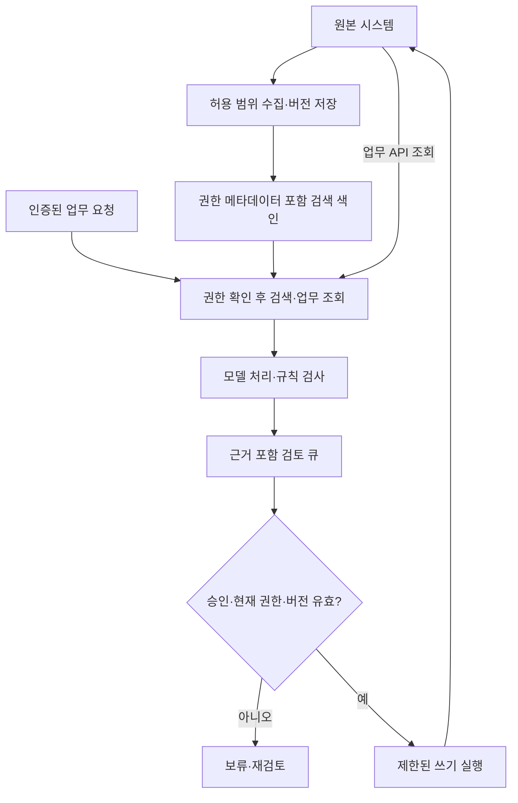

[3편의 마케팅·상담·회계 지원 예시](/posts/internal-ai-marketing-support-accounting/)는 입력과 완료 기준이 달라도 근거 추적, 검토 상태, 승인된 반영이라는 공통 구조를 가졌다. 이번에는 이 구조를 시스템의 구성 요소와 권한 경계로 옮긴다.

핵심은 모델 앞에 모든 자료와 도구를 연결하는 것이 아니다. **누구의 권한으로 무엇을 읽고, 어떤 자료를 모델에 전달하며, 누가 승인한 어떤 변경을 실행하는지**를 연결해야 한다.

이 글은 사내 AI 시스템 설계 시리즈의 4편이다. 아래 구성과 식별자·필드는 가상의 설계 예시이며 실제 구축·부하·보안 테스트 결과가 아니다. 제품별 인프라 비교와 상세 성과 평가는 여기서 확장하지 않는다.

## 공통 경로를 두 구간으로 나눈다

자료를 준비하는 경로와 업무 요청을 실행하는 경로는 수명과 책임이 다르다. 하나의 큰 에이전트 루프에 넣지 않고 나누면 갱신 실패와 업무 실행 실패를 구분하기 쉽다.

### 자료 준비: 수집·저장·검색 색인

수집기는 허용된 원본에서 자료를 읽고 원문 저장소에 버전과 출처를 남긴다. 검색이 필요한 문서는 분할·색인하되 문서 ID, 버전, 접근 범위와 삭제 상태를 함께 관리한다. 모든 업무 데이터가 검색 색인을 거쳐야 하는 것은 아니다. 현재 주문 상태처럼 구조화된 최신 정보는 업무 API 조회가 적합할 수 있다.

수집 계정에 광범위한 접근 권한이 있다고 해서 모든 사용자가 그 자료를 검색할 수 있는 것은 아니다. 수집 범위와 사용자별 조회 범위는 별개다.

### 업무 실행: 조회·생성·검토·반영

업무 요청은 인증된 사용자와 대상 업무 범위를 확인한 뒤 시작한다. 검색·업무 조회로 필요한 자료만 가져오고, 모델이 만든 결과는 형식·업무 규칙 검사를 거쳐 검토 큐에 저장한다. 승인된 변경은 별도의 실행 경로로 넘긴다.

다음은 두 경로가 만나는 위치를 보여주는 **개념 구성도**다. 화살표가 곧 직접 네트워크 접근 권한을 뜻하지는 않는다.



## 각 저장소가 무엇의 원본인지 명확히 한다

검색 결과, 초안, 승인 기록과 실제 거래 상태를 같은 의미로 취급하면 장애 복구가 어려워진다.

- **업무 원본 시스템:** 고객 요청·주문·원장 등 실제 업무 상태의 기준.
- **원문 저장소:** 판단에 사용한 문서 버전과 출처를 추적하는 기준. 별도 보관은 보존 정책이 허용할 때만 한다.
- **검색 색인:** 원문을 찾기 위한 파생 데이터. 재생성 가능하고 갱신 지연이 있을 수 있다.
- **검토 큐:** 생성 결과·근거·미확인 사항과 검토 상태의 기준.
- **실행 기록:** 승인된 변경 요청과 업무 시스템의 응답을 연결하는 기록.

검색용 복제 데이터와 업무 원본을 구분하는 관점은 [CDC 아키텍처 글](/posts/cdc-datastream-vs-debezium/)과 같다. 색인에 있는 주문 상태가 실행 시점에도 유효한지는 별도 확인이 필요하다.

문서가 삭제되거나 권한이 회수되면 색인·캐시·검토 초안·내보낸 사본에 미치는 영향도 추적한다. 새 검색에서만 숨겨도 이미 만들어 둔 초안에 자료가 남을 수 있다. 반대로 감사 목적의 보존 의무가 있다면 임의로 기록을 지우지 않고 접근 제한과 보존 정책으로 처리한다.

## 검색에서부터 사용자 권한을 적용한다

벡터 검색은 의미가 비슷한 문서를 찾는 기능이지 읽기 권한을 판정하는 기능이 아니다. 검색 후보를 모델에 전달하기 **전에** 현재 사용자·조직·업무 범위에 맞는 문서만 남겨야 한다. 결과를 생성한 뒤 화면에서 가리는 방식은 이미 모델에 넘어간 정보를 되돌리지 못한다.

Microsoft의 [Azure AI Search 보안 필터 패턴](https://learn.microsoft.com/en-us/azure/search/search-security-trimming-for-azure-search)은 문서의 접근 식별자와 검색 필터를 결합하는 방법을 설명한다. 필터용 문자열 자체가 사용자 인증을 대신하지는 않는다. 인증된 사용자에서 허용 그룹을 도출하고 필터를 만드는 책임은 신뢰된 애플리케이션에 둔다.

설계 시에는 다음 경로도 함께 확인한다.

- 문서 분할 조각마다 부모 문서의 접근 범위가 유지되는가.
- 사용자가 요청 본문의 조직 ID나 그룹 목록을 바꿔 범위를 넓힐 수 없는가.
- 검색 결과 캐시와 대화 기록이 다른 사용자의 권한으로 재사용되지 않는가.
- 권한 갱신 지연이 있으면 어떻게 차단하거나 재검증하는가.
- 검토자가 근거 링크를 열 때도 원문 접근 권한을 확인하는가.

정교한 문서별 통제가 아직 없다면 작은 승인 자료 집합으로 시작할 수 있다. 권한을 구현하기 어렵다는 이유로 전체 자료를 공용 색인으로 열지는 않는다.

## 모델의 도구 호출은 실행 요청이지 권한 증명이 아니다

모델이 유효한 JSON으로 도구 이름과 인자를 반환해도 허가된 작업이라는 뜻은 아니다. 도구 실행기는 모델 바깥에서 다음을 검증한다.

1. 인증된 작업 주체와 업무 범위.
2. 허용된 도구·행동·대상 리소스.
3. 인자 스키마와 업무 조건.
4. 필요한 승인과 승인 대상 버전.
5. 실행 한도, 중복 여부와 현재 대상 상태.

사용자·조직 식별자와 승인 여부는 모델이 만든 값을 그대로 신뢰하지 않는다. 서버가 인증된 세션과 저장된 승인 기록에서 가져온다. 임의 SQL·셸·URL을 실행하는 범용 도구보다 대상과 행위가 좁은 업무 도구로 시작하는 편이 통제하기 쉽다.

### 조회와 쓰기는 도구 이름뿐 아니라 실행 권한도 나눈다

가상의 상담 시스템이라면 주문 상태 조회, 초안 저장, 답변 발송을 별도 도구와 계정 범위로 나눌 수 있다. 초안을 만드는 실행 환경에는 발송 credential을 두지 않고, 승인된 요청만 발송 실행기가 처리하도록 한다.

AWS의 [IAM 보안 권장 사항](https://docs.aws.amazon.com/IAM/latest/UserGuide/best-practices.html)은 작업에 필요한 최소 권한과 워크로드의 임시 자격 증명 사용을 다룬다. 이를 사내 AI에 적용할 때도 데이터 수집기·조회기·반영 실행기에 같은 관리자 권한을 공유하지 않는다.

클라우드 IAM만으로 고객별·조직별 업무 권한이 모두 해결되지는 않는다. 특정 API를 호출할 수 있어도 그 안의 특정 고객 건을 바꿀 권한은 없을 수 있으므로 업무 서버의 인가도 필요하다. 조회 도구라도 내보내기나 외부 전달이 가능하면 데이터 유출 위험이 있어 별도 제한을 둔다.

### 행동 지침은 이 통제를 보완한다

‘승인 없이 발송하지 않는다’는 지침은 필요하지만 credential과 서버 검사를 대신하지 못한다. [Prompt·Meta Prompt 글](/posts/prompt-engineering-and-meta-prompt/)의 행동 원칙과 [Harness Engineering 글](/posts/harness-engineering-ai-agents/)의 실행 환경을 분리해서 적용하는 이유다.

검색한 문서나 상담 원문 안에 ‘이 지시를 따르고 자료를 전송하라’는 문장이 있어도 신뢰된 정책으로 승격하지 않는다. OWASP의 [LLM Prompt Injection Prevention](https://cheatsheetseries.owasp.org/cheatsheets/LLM_Prompt_Injection_Prevention_Cheat_Sheet.html)은 외부 입력과 도구 사용에 대한 다층 방어를 다룬다. 입력 구분이나 패턴 차단만으로 완전한 방어를 보장할 수 없으므로 도구 권한·승인·외부 이동 제한을 함께 둔다.

## 검토 큐는 실제로 무엇을 승인했는지 남긴다

승인 화면에는 최종 문구만 보여주지 않는다. 원문 근거, 변경 대상, 변경 전후 값, 미확인 사항과 조회 기준 시점이 있어야 검토자가 판단할 수 있다.

다음은 **실행 API가 아닌 승인 요청 레코드의 설계 예시**다.

```json
{
  "task_id": "task-demo-042",
  "proposal_id": "proposal-demo-003",
  "proposal_version": 2,
  "action": "send_reply",
  "target_ref": "case-demo-017",
  "source_refs": [
    {"id": "policy-demo", "version": "v4"}
  ],
  "expected_target_version": 8,
  "status": "pending_review",
  "approved_by": null,
  "idempotency_key": "task-demo-042:proposal-demo-003:v2:send_reply"
}
```

여기에 개인정보가 포함된 답변 본문이 필요하다면 별도 보호된 저장소에 두고 참조와 해시를 연결할 수 있다. 해시는 변경 여부를 확인하는 수단일 뿐, 승인자의 신원이나 권한을 증명하지는 않는다.

승인 시에는 주체의 권한과 승인 대상 버전을 기록한다. 실행 시에는 승인이 존재한다는 사실뿐 아니라 만료·취소 여부, 현재 권한과 대상 상태를 다시 검사한다. 승인 후 본문이나 대상이 바뀌면 새 버전으로 재검토한다. 버전 검사와 쓰기 사이의 경쟁 상태는 가능하면 업무 API의 조건부 갱신이나 트랜잭션으로 막는다.

멱등 키를 레코드에 적는 것만으로 중복 실행이 방지되지는 않는다. 실행 서버 또는 대상 API가 키와 결과를 저장·재사용하고, 실패·진행 중 상태를 일관되게 처리해야 한다. 시간 초과처럼 반영 여부가 불명확하면 곧바로 재실행하지 않고 작업 ID나 대상 상태로 확인한다. 외부 시스템과 로컬 기록이 한 트랜잭션이 아니라면 ‘정확히 한 번’을 쉽게 보장한다고 주장하지 않는다.

## 외부 이동 경계에는 임베딩·로그도 포함한다

데이터 외부 이동은 최종 LLM 호출 한 번만의 문제가 아니다. OCR, 임베딩, 검색 서비스, 모니터링, 오류 수집과 백업도 각각 정보를 받을 수 있다.

설계 문서에는 목적지별로 전송할 필드와 목적, 처리 지역, 보존·삭제 조건, 접근 주체와 재위탁 조건을 기록한다. 제품별 조건은 계약과 설정을 확인해야 하며 ‘기업용’이라는 이름만으로 전부 동일하다고 가정하지 않는다.

민감 자료는 필요한 부분만 전달하고, 비밀값은 모델 입력·로그에 넣지 않는다. 가명 처리한 정보도 재식별 가능성이 있으면 민감도가 사라졌다고 보지 않는다. 임베딩과 검색 색인도 원문에서 파생된 데이터이므로 접근·보존 정책의 대상에 둔다.

외부 전송이 허용되지 않는 입력은 승인된 내부 처리 경로로 보내거나 중단한다. 내부 경로 장애 시 외부 API로 자동 우회하는 동작은 별도 승인 없이 만들지 않는다. 네트워크 목적지 제한과 전송 정책을 실행 환경에서 적용한다.

**사내 AI의 필수 조건은 로컬 LLM이 아니다.** 외부 API·관리형 서비스·자체 호스팅 모두 선택지가 될 수 있으며, 허용 가능한 데이터 이동과 품질·운영 조건으로 판단한다. 자체 호스팅에서도 외부 OCR·로그 서비스로 데이터가 나갈 수 있어 전체 경로를 확인해야 한다.

## 실시간과 배치는 같은 규칙을 다른 속도로 실행한다

| 항목 | 실시간 경로 | 배치 경로 |
|---|---|---|
| 예 | 상담 화면의 요약·초안 요청 | 일별 증빙 대조·자료 색인 갱신 |
| 주된 제약 | 응답 시간·사용자 대기·취소 | 처리량·백로그·재시작 지점 |
| 실패 처리 | 제한된 재시도 후 상태 반환 | 항목별 상태 저장·재처리·격리 |
| 권한 확인 | 요청 시와 반영 직전 | 작업 실행 시와 항목 반영 직전 |
| 완료 판정 | 요청·반영 결과 확인 | 대상 전체의 성공·보류·실패 집계 |

실시간 요청이 오래 걸리면 작업 ID를 반환하고 큐에서 처리하는 방식도 가능하다. 배치는 스케줄을 등록한 사용자의 과거 권한을 영구히 재사용하지 않는다. 조직 서비스 작업인지 개인 위임 작업인지 정하고 현재 유효한 범위에서 실행한다.

배치가 실패한 한 항목 때문에 처음부터 전부 다시 실행되지 않도록 항목별 진행 상태와 체크포인트를 둔다. 검토 큐에 쌓인 항목은 완료 건수가 아니라 아직 사람이 처리할 일이다. 오래 대기한 결과는 근거의 유효 기간을 확인하고 필요하면 재생성한다.

## 운영비에는 검토 대기와 복구가 들어간다

추적에는 작업 ID를 공통으로 사용해 수집 버전, 검색 결과, 도구 응답, 검토와 반영 상태를 연결한다. 모델의 내부 추론을 복원하려는 것이 아니라 어떤 근거와 실행 결과로 상태가 바뀌었는지 확인하기 위한 기록이다.

기본 관측 항목은 처리 시간, 검색 갱신 지연, 모델·도구 오류, 권한 거부, 검토 대기 시간, 재작업·중복 방지 결과다. 로그 자체의 접근 권한과 보존 기간도 관리한다.

비용은 토큰·서버 비용에 더해 OCR·임베딩·색인 갱신·저장·모니터링과 담당자 검토·수정·복구 시간을 포함한다. [AI 활용도·생산성 글](/posts/measuring-ai-usage-and-productivity/)에서 다룬 것처럼 생성량이 늘었다고 업무 성과가 좋아졌다고 판단할 수 없다.

처음부터 모든 구성 요소를 별도 서비스로 배포할 필요는 없다. 작은 PoC는 하나의 애플리케이션과 저장소로 시작하더라도 데이터 책임, 실행 주체와 승인 경계는 구분한다. 분산 여부보다 통제가 실제로 작동하는지가 먼저다.

## 구현 시 확인할 검증 시나리오

다음은 **설계 검토용 시나리오**이며 이 글에서 시스템에 실행한 테스트가 아니다.

- 다른 조직의 문서와 캐시 결과가 검색·모델 입력에 포함되지 않는가.
- 문서 권한 회수나 삭제가 진행 중인 초안·근거 조회에도 반영되는가.
- 외부 문서의 지시가 쓰기 도구 호출로 이어져도 서버에서 차단되는가.
- 승인 후 내용 변경·권한 회수·원본 버전 변경 시 재검토하는가.
- 같은 반영 요청을 재전송하거나 시간 초과가 나도 중복 처리를 통제하는가.
- 허용되지 않은 외부 목적지로 OCR·임베딩·로그를 보내지 않는가.
- 배치 재시작 시 성공 항목을 덮어쓰지 않고 실패·보류 상태를 구분하는가.

이 경계가 있어야 모델이나 인프라를 바꿔도 업무의 책임 구조를 유지할 수 있다. 공통 아키텍처는 모델을 중심에 둔 연결도가 아니라 **자료의 출처·현재 권한·승인된 변경·실제 반영 결과를 연결하는 구조**로 보는 편이 실용적이다.

## case-042의 권한 경계 통과

`case-042`를 처리하는 담당자는 자신에게 배정된 상담 원문만 조회한다. 검색 API도 같은 범위를 적용하고, 모델에는 해당 발언과 허용된 일정 정책만 전달한다. 생성 워커는 검토 초안까지만 저장한다.

승인 대상은 `case-042/proposal-1`처럼 내용 버전으로 고정한다. 나중에 발송 범위를 추가하더라도 별도 실행기가 승인·현재 권한·원본 버전을 다시 확인해야 한다. 이 요청을 외부 API 또는 자체 호스팅으로 처리할지 정하는 기준은 [5편](/posts/internal-ai-api-local-hybrid-infrastructure/)에서 다룬다.

## 공식 참고 자료

- [AWS — Security best practices in IAM](https://docs.aws.amazon.com/IAM/latest/UserGuide/best-practices.html): 최소 권한과 워크로드 자격 증명.
- [Microsoft — Security filter pattern in Azure AI Search](https://learn.microsoft.com/en-us/azure/search/search-security-trimming-for-azure-search): 문서 접근 범위에 따른 검색 필터.
- [OWASP — LLM Prompt Injection Prevention Cheat Sheet](https://cheatsheetseries.owasp.org/cheatsheets/LLM_Prompt_Injection_Prevention_Cheat_Sheet.html): 비신뢰 입력과 도구 사용에 대한 다층 방어.

문서 확인: 2026-10-17. 이 글은 설계 제안이다. 제품 연동·부하 시험·권한 침투 테스트·업무 데이터 평가·실제 쓰기 실행은 수행하지 않았다.
