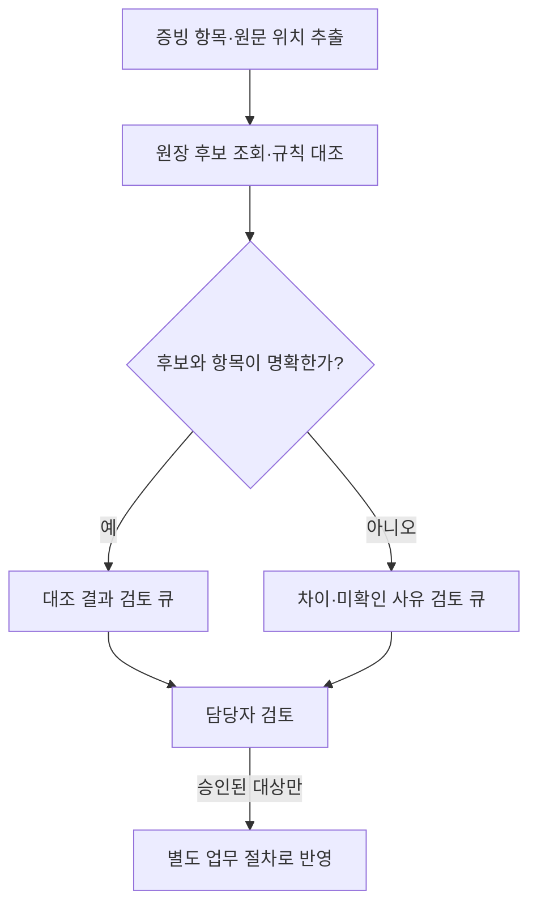

같은 LLM을 사용해도 마케팅 문구를 만들 때와 상담 기록을 정리할 때, 증빙을 대조할 때의 성공 기준은 다르다. 문장이 자연스러운 것과 업무를 제대로 끝내는 것은 같은 문제가 아니기 때문이다.

사내 AI 시스템 설계 시리즈의 3편에서는 **입력 → 처리 → 검증 → 반영**이라는 틀로 세 업무를 비교한다. 모든 처리에 LLM을 붙이거나 에이전트가 최종 결정을 내리도록 만드는 것이 목표는 아니다. 사람이 원문과 근거를 확인하고 안전하게 다음 단계로 넘어갈 수 있는 흐름을 만드는 것이 목표다.

아래 자료·식별자·금액과 처리 과정은 모두 **가상의 설계 예시**다. 실제 구축 사례나 성능 측정 결과가 아니며, 회계·세무 전문 판단을 대체하는 방법도 아니다. 현재 공개된 기존 글과 연결하되, 미게시된 앞선 편의 내용을 읽었다고 가정하지 않는다.

## 세 업무의 차이는 검증과 반영에서 드러난다

| 단계 | 마케팅 지원 | 상담 후속 처리 | 회계 지원 |
|---|---|---|---|
| 입력 | 승인된 상품 자료·브랜드 규칙·익명화 검토를 거친 질문 | 상담 원문·허용된 고객 조회·정책 버전 | 증빙 원문·대상 원장·대조 규칙 |
| 처리 | 질문 주제 묶기·문구 초안 생성 | 요청·약속·미확정 사항 추출 | 항목 추출·정규화·거래 후보 연결 |
| 검증 | 주장 근거·조건·개인정보 확인 | 화자·약속 상태·정책 일치 확인 | 금액·통화·거래 식별·중복 확인 |
| 반영 | 승인된 버전을 게시 도구로 전달 | 담당자 확인 후 기록·발송 | 담당자 검토 목록으로 저장 |

처리 단계만 보면 세 업무 모두 ‘요약하고 문서를 만드는 일’처럼 보인다. 하지만 잘못된 광고 주장은 외부 약속이 될 수 있고, 고객 요청을 회사의 확정 약속으로 바꾸면 후속 업무가 틀어진다. 증빙에서 금액을 읽었다고 올바른 거래에 연결된 것도 아니다.

따라서 범용 프롬프트 하나보다 **업무마다 다른 출력 계약과 반영 조건**이 먼저다.

## 마케팅: 질문은 소재이고, 승인 자료는 주장 근거다

### 입력을 용도별로 나눈다

가상의 상품 안내 콘텐츠를 만든다고 하자. 입력은 다음처럼 분리한다.

- **사실 근거:** 게시에 사용할 수 있도록 승인된 상품 설명, 가격·혜택·적용 기간.
- **표현 지침:** 브랜드 어조, 금지 표현, 반드시 표시할 조건.
- **고객 관심사:** 개인을 특정할 수 없도록 검토한 질문의 주제와 빈도.

질문에 ‘이 상품을 쓰면 비용이 절반으로 줄어드나요?’가 있다고 해서 ‘비용 절반 절감’이 사실이 되는 것은 아니다. 질문은 무엇을 설명할지 정하는 재료이고, 그 설명의 사실성은 승인 자료에서 확인해야 한다.

이름·연락처만 지웠다고 완전히 익명화됐다고 단정하지도 않는다. 구체적인 장소·시점·거래 내용이 결합되면 개인을 추정할 수 있다. 원문 그대로의 인용이 필요 없다면 범주화한 질문을 우선 사용하고, 원문과 게시 자료의 접근 범위를 나눈다.

### 초안과 함께 주장 목록을 만든다

첫 결과물은 문구 하나가 아니라 **초안과 검토할 주장 목록**이다.

예를 들어 ‘선정된 상품에 한해 이번 주 혜택 적용’이라는 문장을 생성했다면, 적용 상품·기간·조건 각각을 승인 자료의 위치와 연결한다. 근거가 없는 효능이나 비교 우위는 삭제하거나 확인 필요로 돌린다. 이미 종료된 혜택은 최신 승인 자료로 교체하기 전까지 게시하지 않는다.

검토자는 문장만 보는 대신 다음을 확인한다.

1. 사실 주장이 승인된 자료로 뒷받침되는가?
2. 조건이나 예외가 빠져 의미가 달라지지 않았는가?
3. 질문 원문에서 개인정보나 민감한 맥락이 섞이지 않았는가?
4. 게시 채널에 필요한 검토를 통과했는가?

승인은 해당 초안 버전에 연결한다. 승인 후 문구나 조건을 바꾸면 기존 승인을 재사용하지 않는다. 첫 PoC에서는 모델에 게시 권한을 주지 않고 검토용 초안 저장까지만 허용할 수 있다.

## 상담: 요청·약속·미확정을 서로 다른 상태로 남긴다

상담 요약에서 위험한 오류는 긴 대화를 짧게 줄이는 과정에서 **누가 무엇을 확정했는지** 바뀌는 것이다.

다음은 가상의 상담이다.

> 고객: 금요일까지 받을 수 있으면 좋겠어요.  
> 담당자: 재고와 배송 가능 여부를 확인하고 다시 안내드리겠습니다.

여기서 ‘금요일 배송 확정’이라고 기록하면 안 된다. 고객의 희망과 담당자의 후속 확인 약속은 있지만 배송일 확정은 없다.

### 상태와 원문 근거를 함께 추출한다

다음 JSON은 API 호출 결과가 아니라 **출력 형식의 설계 예시**다.

```json
{
  "case_id": "case-demo-017",
  "customer_request": {
    "text": "금요일까지 수령 희망",
    "evidence_ref": "message-01"
  },
  "confirmed_commitments": [
    {
      "text": "재고와 배송 가능 여부 확인 후 재안내",
      "actor": "support",
      "evidence_ref": "message-02"
    }
  ],
  "delivery_status": "unconfirmed",
  "missing_information": ["재고", "배송 가능일"],
  "review_status": "pending"
}
```

상대 날짜는 상담 시각과 시간대가 있어야 해석할 수 있다. 그 정보가 없다면 임의의 날짜로 바꾸지 않는다. 원문 식별자는 검토자가 실제 메시지에 접근할 수 있어야 하며, 모델이 만든 존재하지 않는 참조를 그대로 받아들이지 않는다.

구조화 출력 기능을 쓰면 필드·타입을 일정하게 만들 수 있다. 그러나 **JSON 형식이 맞는다는 사실은 약속 추출이 맞다는 뜻이 아니다.** OpenAI의 [Structured Outputs 문서](https://developers.openai.com/api/docs/guides/structured-outputs)도 구조화된 결과에 내용상 오류가 남을 수 있음을 설명한다. 거절·중단 응답은 정상 업무 결과와 분리해서 처리한다.

### 상담 완료와 후속 처리 완료를 나눈다

요약이 저장되어도 재고 확인이나 고객 안내가 끝난 것은 아니다. 다음 상태를 구분한다.

- 요약 검토 대기
- 담당자에게 확인 작업 배정
- 확인 결과를 바탕으로 답변 승인
- 발송 결과 확인
- 실패 또는 추가 확인 필요

모델이 ‘안내 완료’라고 썼다는 이유로 완료 상태를 만들지 않는다. 발송은 업무 시스템의 실제 처리 결과로 확인한다. 전송이 시간 초과됐다면 무조건 다시 보내지 말고 기존 전송 상태부터 조회해야 중복 안내를 줄일 수 있다.

예약·보상·계약 변경은 요약과 별도 권한으로 다룬다. ‘발송 전에 확인한다’는 프롬프트와 서버의 발송 권한·승인 검사는 다른 통제다. 이 구분은 [Prompt와 Meta Prompt 글](/posts/prompt-engineering-and-meta-prompt/)의 지침·권한 경계와 같다.

## 회계: 추출 성공과 거래 대조 성공을 분리한다

회계 지원의 첫 목표는 전표를 자동 확정하는 것보다 **검토 가능한 증빙·거래 후보 목록**을 만드는 것으로 잡을 수 있다.

입력은 허용된 증빙과 원장 범위, 기준 시점으로 제한한다. 문서에 적힌 금액을 읽는 단계와 그 금액이 어떤 거래를 뜻하는지 연결하는 단계를 분리한다.

### 추출값은 원문 위치로 돌아갈 수 있어야 한다

OCR 또는 문서 추출기는 거래일·거래처·통화·합계·세액 등의 후보를 만들고 페이지와 영역을 함께 남긴다. Amazon Textract의 [영수증·청구서 분석 문서](https://docs.aws.amazon.com/textract/latest/dg/analyzing-document-expense.html)는 요약 필드와 품목 정보를 추출하는 기능을 설명한다. 이것은 문서에서 데이터를 가져오는 수단이지 회계상 적정성 판정이 아니다.

한 제품을 선택하기 전에 대상 언어·문서 형식·지원 지역·데이터 처리 조건을 별도로 확인해야 한다. 서비스의 confidence 점수도 그 거래가 올바르다는 보장이나 보편적인 승인 기준으로 사용하지 않는다.

### 대조는 규칙으로 좁히고 모호함은 남긴다

설계 예시로 증빙 합계가 110,000원이고 원장에 같은 금액의 거래가 두 건 있다고 하자. 금액 일치만으로 어느 거래인지 결정할 수 없다. 거래일·거래처·주문 또는 증빙 번호 등을 추가로 비교하고, 여러 후보가 남으면 담당자 확인으로 보낸다.

- 통화와 금액 단위를 먼저 확인한다.
- 금액은 부동소수점 오차를 피할 수 있는 고정소수점 또는 통화별 최소 단위 정수로 처리한다.
- 합계·세액 대조는 적용할 규칙과 반올림 기준을 명시한 코드로 수행한다.
- 취소·수정 증빙과 중복 제출을 정상 신규 거래와 구분한다.
- 후보 없음과 후보 여러 개를 서로 다른 사유로 남긴다.

LLM에는 모호한 거래를 억지로 하나 고르도록 하지 않는다. 차이의 설명이나 검토 메모를 돕게 하더라도 대조 결과의 근거는 원문·원장·실행한 규칙에 둔다.

세액공제 가능 여부, 계정과목의 적정성, 신고 처리 같은 전문 판단은 이 흐름의 자동 승인 대상이 아니다. 담당자와 필요한 전문가의 검토가 별도로 필요하다. 아래 경로의 ‘대조 통과’ 역시 지급 승인이나 세무상 적정 판정을 뜻하지 않는다.



## 공통으로 재사용할 것은 모델보다 결과 봉투다

세 업무에 같은 프롬프트를 강제할 필요는 없다. 대신 결과를 넘기는 공통 형식은 재사용할 수 있다.

- 작업 ID와 업무 유형
- 입력 자료의 식별자·버전·기준 시점
- 생성한 초안 또는 추출·대조 결과
- 근거 위치와 미확인 사항
- 모델·지침·규칙 버전
- 검토자·승인 대상 버전·승인 시각
- 반영 결과 또는 실패 사유

여기서 기록은 모델이 주장하는 내부 추론을 저장하라는 뜻이 아니다. 검토와 복구에 필요한 입력 출처, 도구 결과와 상태 변경을 추적하자는 뜻이다. 로그에 고객 대화나 증빙 원문을 무제한으로 복사하지 않고 목적에 필요한 정보와 보존 기간을 정한다.

[Harness Engineering 글](/posts/harness-engineering-ai-agents/)에서 말한 검증·관측·종료 조건은 이런 결과 봉투와 검토 큐로 업무에 연결된다. 정상 응답뿐 아니라 오류를 다음 담당자가 이어받을 수 있어야 한다.

## 원본이 바뀌면 승인도 다시 확인한다

초안을 만드는 순간과 반영하는 순간 사이에 입력이 달라질 수 있다. 마케팅 혜택이 종료되거나 상담 요청이 취소되거나 원장 거래가 수정되는 경우다.

따라서 승인된 결과라도 반영 직전에 대상 상태와 버전을 확인한다. 기준 자료가 바뀌었다면 자동으로 덮어쓰지 않고 재검토로 돌린다. 쓰기 작업에는 중복 실행 방지와 반영 결과 확인 절차를 둔다.

[CDC 아키텍처 글](/posts/cdc-datastream-vs-debezium/)에서 구분한 최신 상태와 변경 이벤트의 차이도 여기에서 중요하다. 검색용 복제 데이터가 있다는 것만으로 반영 시점의 최신 상태가 보장되지는 않는다. 어떤 조회 결과를 판단에 썼고 실행 직전에 무엇을 다시 확인할지 정해야 한다.

## 평가는 업무별 오류와 전체 비용을 함께 본다

마케팅은 근거 없는 주장과 조건 누락, 상담은 요청을 확정 약속으로 바꾼 오류, 회계 지원은 잘못된 거래 연결을 별도로 본다. 자연스러운 문장에 높은 점수를 줘도 이 오류를 가릴 수는 없다.

첫 PoC에서는 정상·누락·충돌·중복·대상 밖 입력을 준비하고 업무 담당자가 기대 결과를 정한다. 무엇을 규칙 검사로 잡고 무엇을 사람이 확인할지 나눈다. 검토 대기로 넘긴 결과를 자동 완료 건수에 포함하지 않는다.

검토 시간·재작업·후속 정정까지 포함한 처리 시간, 모델 호출·OCR·검색·저장 비용, 규칙·자료 유지와 운영 부담을 기록한다. [AI 활용도와 생산성 글](/posts/measuring-ai-usage-and-productivity/)처럼 사용량이나 생성 건수만으로 개선을 주장하지 않는다.

외부 API와 관리형 서비스, 자체 호스팅 중 어느 방식을 쓰더라도 이 완료 기준은 필요하다. 로컬 LLM은 사내 AI의 필수 조건이 아니며, 외부 이동 가능한 데이터와 서비스 계약·보존 조건을 검토한 뒤 실행 환경을 선택한다.

## 구현 전에 확인할 테스트 사례

다음은 **구현 시 실행해야 할 검증 항목**이며, 이 글에서 실행한 테스트 결과가 아니다.

- 마케팅: 종료된 혜택, 근거 없는 효능, 개인정보가 섞인 질문이 게시 대상으로 넘어가지 않는가.
- 상담: 고객 희망이 확정 약속으로 변하지 않는가. 원문 없는 참조와 중복 발송을 막는가.
- 회계: 동일 금액의 복수 거래, 통화 차이, 수정·중복 증빙을 미확인 또는 별도 상태로 남기는가.
- 공통: 승인 후 내용이나 원본이 바뀌면 재검토하는가. 권한 없는 호출이 서버에서 거부되는가.
- 실패: 모델 거절·형식 오류·조회 실패·반영 실패를 구분하고 재시도 한도 후 이관하는가.

결국 세 업무에서 재사용할 핵심은 ‘무엇이든 처리하는 에이전트’가 아니라 **근거 있는 결과, 검토 가능한 상태, 승인된 반영**이다. 업무별 차이를 유지하면서 이 경계를 공통 시스템으로 묶는 방법은 다음 아키텍처 편에서 다룬다.

## 공식 참고 자료

- [Anthropic — Building effective agents](https://www.anthropic.com/engineering/building-effective-agents): 정해진 경로의 workflow와 동적인 agent를 구분하는 설계 참고.
- [OpenAI — Structured model outputs](https://developers.openai.com/api/docs/guides/structured-outputs): 출력 구조 제약과 내용 오류·거절 처리의 구분.
- [AWS — Analyzing Invoices and Receipts with Amazon Textract](https://docs.aws.amazon.com/textract/latest/dg/analyzing-document-expense.html): 증빙 항목 추출 기능의 참고.

문서 확인: 2026-10-17. 본문의 업무 흐름은 설계 제안이며 서비스 연동·업무 데이터 평가·실제 발송·회계 반영은 실행하지 않았다.
