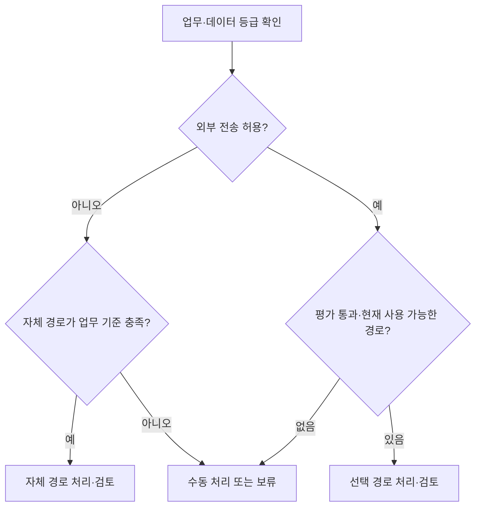

사내 AI를 위한 서버를 고를 때 가장 먼저 나오는 질문은 종종 ‘어떤 GPU를 사야 할까’다. 하지만 업무의 완료 기준과 요청량이 정해지지 않았다면 장비 사양만으로 답하기 어렵다.

**모델이 실행된다는 것, 사용자가 기다릴 수 있는 시간 안에 처리된다는 것, 검토까지 포함해 업무에 도움이 된다는 것은 서로 다른 조건이다.**

[4편의 공통 아키텍처](/posts/internal-ai-architecture-data-permission-boundaries/)에서 데이터와 권한 경계를 나눴다면, 이번에는 그 경계 안에서 실행 환경을 선택한다. 이 글은 사내 AI 시스템 설계 시리즈의 5편이다. 특정 장비나 모델의 구매 추천이 아니며, 직접 구축·부하 시험·비용 측정한 후기도 아니다. 아래 수식과 업무 조건은 설계·산정 예시로만 사용한다.

## 실행 위치와 운영 책임을 먼저 구분한다

여기서 외부 API는 사업자가 운영하는 모델을 서비스로 호출하는 방식, 로컬 LLM은 조직이 통제하는 환경에서 모델을 직접 운영하는 방식을 뜻한다. 자체 호스팅은 사무실 장비뿐 아니라 조직이 관리하는 클라우드 인스턴스에서도 가능하다. 관리형 전용 배포는 두 범주 사이에 있으며 계약과 실제 책임 범위를 확인해야 한다.

사내 AI는 사내 업무와 권한 체계에 연결된 시스템이지, 반드시 사내 장비에서만 실행되는 모델을 의미하지 않는다.

| 판단 축 | 외부 API | 자체 호스팅 LLM | 혼합 구성 |
|---|---|---|---|
| 데이터 경계 | 전송 항목·처리 지역·보존 조건 검토 | 모델 외의 OCR·로그·백업 이동도 검토 | 경로별 허용 데이터와 우회 금지 조건 필요 |
| 용량 책임 | 계약 한도·호출 제한·확장 조건 확인 | 메모리·처리량·복제·장애 복구 직접 관리 | 두 경로와 라우터의 용량 함께 관리 |
| 변경 관리 | 모델 버전·서비스 변경·종료 대응 | 모델·런타임·드라이버 변경 검증 | 경로별 버전과 결과 차이 검증 |
| 비용 구조 | 호출·부가 서비스·계약 비용 | 장비 또는 임대·전력·운영·유휴 비용 | 두 기반 비용과 통합 운영 비용 |
| 장애 대응 | 제한된 재시도·허용된 대체 경로·수동 처리 | 예비 용량·복구·대기 큐·수동 처리 | 정책을 지키는 전환과 중복 방지 |

어느 열도 자동으로 더 안전하거나 더 저렴하지 않다. 사용량이 적고 불규칙하면 자체 장비의 유휴 비용이 커질 수 있다. 반대로 외부 호출량이 많다고 해도 모델 품질이나 검토 시간이 달라지면 토큰 비용만의 비교는 의미가 줄어든다.

## 1. 데이터 제약으로 불가능한 경로부터 제외한다

품질 비교 전에 업무별로 무엇을 어디로 보낼 수 있는지 확인한다. 입력 원문뿐 아니라 검색 결과, 임베딩, 첨부 이미지와 오류 로그도 포함한다.

외부 API를 검토한다면 다음을 계약·설정·대상 기능별로 확인한다.

- 학습 이용 여부와 로그·애플리케이션 상태의 보존 범위.
- 처리·저장 지역과 재위탁, 관리자 접근 조건.
- 파일 업로드·비동기 처리·모니터링 등 부가 기능의 조건.
- 삭제 절차, 감사 자료와 장애 시 지원 범위.

이 조건은 제품과 계약에 따라 다르므로 ‘기업용이면 보존이 없다’고 일반화하지 않는다. 반대로 외부 전송이 있다는 이유만으로 모든 업무에서 사용할 수 없다고 단정하지도 않는다.

외부로 나갈 수 없는 자료는 허용된 내부 경로에서 처리하거나 사람이 맡는다. 내부 모델의 품질이 부족하다는 이유로 외부 모델에 자동 전달하는 설계는 경계를 무너뜨린다. 데이터 마스킹 역시 업무 수행에 필요한 의미를 보존하는지, 재식별 위험이 남는지 검토해야 한다.

이 판단은 라우터의 코드와 네트워크·자격 증명 통제에서 적용한다. ‘민감정보를 보내지 말라’는 모델 지침은 보완 수단이다. [Prompt·Meta Prompt 글](/posts/prompt-engineering-and-meta-prompt/)에서 구분한 지침과 실행 권한을 그대로 적용한다.

## 2. 같은 업무의 최종 결과로 품질을 비교한다

모델의 범용 벤치마크 순위보다 실제로 맡길 작업의 평가 집합이 중요하다. [3편의 업무 예시](/posts/internal-ai-marketing-support-accounting/)를 사용한다면 다음 오류를 별도로 확인한다.

- 마케팅: 승인 자료에 없는 주장이나 적용 조건 누락.
- 상담: 고객 희망을 확정 약속으로 바꾼 기록.
- 증빙 지원: 항목 오독이나 잘못된 거래 연결.

정상 입력뿐 아니라 정보 누락, 충돌, 긴 문서, 지원하지 않는 첨부, 대상 밖 요청도 평가한다. 추출 필드가 맞는지와 담당자가 검토 후 채택할 수 있는지 구분한다. 자동 완료율을 높이려고 모호한 입력을 억지로 확정하게 만들지 않는다.

외부 모델과 자체 모델을 비교할 때 모델 가중치만이 아니라 검색·프롬프트·출력 검사까지 포함한 경로를 기록한다. 가능하면 동일한 입력·근거·출력 계약으로 먼저 비교하고, 경로별 최적화를 했다면 무엇이 달랐는지 남긴다.

양자화한 모델은 원본과 별도 후보로 평가한다. Hugging Face의 [bitsandbytes 문서](https://huggingface.co/docs/transformers/quantization/bitsandbytes)는 저정밀 표현으로 메모리 사용을 줄이는 방법을 설명한다. 메모리 절감이 특정 업무의 품질 유지나 처리 속도 향상을 자동으로 보장하지는 않는다.

## 3. 모델 메모리와 서비스 처리량을 따로 계산한다

가중치 메모리의 단순 근사식은 다음과 같다.

```text
가중치 저장량의 이론적 근사
= 파라미터 수 × 파라미터당 비트 수 ÷ 8
```

예를 들어 가상의 80억 파라미터를 모두 4비트로 표현하면 계산상 약 40억 바이트다. 이는 **가중치 본체만의 단순 산술 예시**이며 특정 모델의 실제 로딩 메모리나 필요 GPU 사양이 아니다. 양자화 메타데이터, 일부 고정밀 레이어와 런타임 비용 등이 더 필요하다.

추론 중에는 KV cache, 활성값·작업 버퍼, 실행 엔진의 예약 메모리도 사용한다. 긴 입력과 출력, 동시 요청이 늘면 필요한 여유가 달라진다. CPU로 일부를 내리는 구성은 메모리 부족을 피하는 데 도움이 될 수 있지만 전송과 연산 비용이 지연에 영향을 줄 수 있다.

따라서 다음 두 질문을 분리한다.

1. 이 모델·정밀도·문맥 길이를 설정한 런타임에서 안정적으로 로딩할 수 있는가?
2. 실제 요청 분포와 동시성에서 지연·오류·처리량 목표를 만족하는가?

vLLM의 [최적화 문서](https://docs.vllm.ai/en/latest/configuration/optimization/)는 KV cache 부족에 따른 요청 선점·재계산이 지연에 영향을 줄 수 있음을 설명한다. 동시 요청 수, 배치 토큰 예산과 병렬화 설정을 바꾸면 메모리와 처리 성능의 균형도 달라진다. 문서의 설정을 하드웨어와 모델이 다른 환경에 그대로 복사하지 않는다.

모델이 한 번 응답했다는 사실만으로 업무 시간대의 서비스를 감당한다고 결론 내릴 수 없다.

## 4. 지연은 첫 토큰과 업무 완료 시간을 나눠 본다

상담 화면은 응답을 빨리 보여주는 것이 중요하지만, 증빙 대조는 정해진 마감까지 처리하는 것이 더 중요할 수 있다. 같은 평균 속도 수치로 두 업무를 평가하지 않는다.

실시간 경로는 다음을 함께 기록한다.

- 대기열 시간과 첫 토큰까지의 시간.
- 전체 출력과 형식 검사 완료 시간.
- 조회·검색·도구 호출을 포함한 요청 완료 시간.
- p50·p95 등 지연 분포와 오류·시간 초과 비율.
- 검토를 거쳐 실제 업무가 끝날 때까지의 시간.

첫 토큰이 빨라도 마지막 결과를 파싱하거나 도구 호출을 기다려야 하는 업무라면 완료 지연이 길 수 있다. 시스템의 총 tokens/s가 높아도 사용자 한 명의 대기 시간이 짧다는 뜻은 아니다. vLLM의 [Production Metrics](https://docs.vllm.ai/en/latest/usage/metrics/)는 대기 시간, 첫 토큰 지연과 전체 요청 지연 등을 구분해 관측하는 참고가 된다.

용량 계획의 출발점으로 평균 동시 요청 수를 도착률과 체류 시간의 곱으로 근사할 수 있다. 예를 들어 가상의 평균 도착률이 초당 0.5건, 해당 경로 체류 시간이 6초라면 평균 진행 중 요청은 약 3건이다. 안정 상태의 평균을 설명하는 예시일 뿐 **최대 동시성이나 장비 필요 대수를 산정한 결과는 아니다.** 몰리는 시간대, 긴 입력·출력과 재시도를 넣어 별도 부하 시험을 해야 한다.

외부 API도 제한 없는 용량이 아니다. 계정·모델·지역별 호출 한도와 대기·오류를 확인하고, 자체 호스팅과 동일하게 요청 분포를 적용한다.

## 5. 실시간과 배치를 자원 정책으로 분리한다

상담 초안과 야간 대량 요약이 같은 추론 자원을 사용하면 배치가 실시간 요청의 대기 시간을 늘릴 수 있다. 큐 이름만 나누는 것으로 격리가 완성되지는 않는다.

실시간에는 짧은 시간 제한, 입력·출력 길이 상한과 유입 제한을 둔다. 배치에는 마감 시각, 항목별 체크포인트, 제한된 재시도와 재시작 절차를 둔다. 공유 자원을 쓴다면 우선순위·동시 실행 한도·예약 용량으로 서로 미치는 영향을 검증한다. 필요하다면 별도 인스턴스나 배포로 나눈다.

배치 효율을 높이려고 요청을 모으면 처리량은 좋아질 수 있지만 개별 작업의 대기 시간이 길어질 수 있다. 실시간과 배치의 목표를 구분한 뒤 배치 크기와 실행 시간을 조정한다. 유휴 시간에 배치를 돌린다는 계획도 실제로 그 시간이 비어 있는지 관측해야 한다.

## 6. 혼합 구성은 경로를 늘린 만큼 검증도 늘어난다

혼합 구성의 설계 예로, 외부 전송이 허용되지 않는 입력은 자체 경로로 제한하고, 허용된 업무 중 품질 평가를 통과한 작업만 외부 API로 처리할 수 있다. 어느 쪽에서도 조건을 만족하지 못하면 사람이 처리한다.



이 그림은 정책 분기의 설계 예시이며, 실행해 검증한 라우터가 아니다. 모델이 자기 답변의 자신감을 높게 표시했다는 이유만으로 처리 경로를 확정하지 않는다. 업무 유형과 검증된 기준으로 시작하고 경로 선택 오류도 평가한다.

같은 API 형태를 제공해도 모델별 도구 호출·출력 형식·문맥 처리·거절 동작이 완전히 같지는 않다. 어댑터를 두고 업무 계약에 맞는지 검사하며, 어떤 경로·모델·지침 버전이 결과를 만들었는지 남긴다.

혼합 구성은 이중 운영과 장애 원인 분석, 평가 조합을 늘린다. 처음부터 복잡하게 도입하기보다 단일 경로로 시작해서 데이터 제약이나 명확한 비용·품질 차이가 있을 때 추가하는 편이 검토하기 쉽다.

## 7. 총비용은 같은 기간과 같은 완료 기준으로 비교한다

외부 API는 입력·출력 호출과 재시도 비용 외에 OCR·임베딩·검색·저장·네트워크·계약 지원 비용을 본다. 자체 호스팅은 장비 상각 또는 임대, 전력·냉각, 예비 용량·장애 교체, 운영 인력과 보안 업데이트 비용을 포함한다. 혼합 구성은 공통 비용을 이중 집계하지 않되 라우터와 두 경로 유지 비용을 추가한다.

인건비는 모델 서버 운영자뿐 아니라 자료 갱신·검토·수정·후속 오류 복구 시간까지 포함한다.

```text
기간 총비용
= 인프라·호출·부가 서비스 비용
+ 개발·운영·검토·재작업 인건비
+ 해당 기간에 배분한 도입·전환 비용

품질 기준을 충족한 완료 건당 비용
= 기간 총비용 ÷ 같은 기간의 품질 기준 충족 완료 건수
```

분모가 0이면 건당 비용을 계산할 수 없고, 완료 건수의 품질을 어떻게 판정했는지도 밝혀야 한다. 생성 성공 건수나 검토 대기 건수를 완료 건수에 섞지 않는다. 구매 가격 전액과 월 API 요금을 직접 비교하지 말고 같은 평가 기간으로 맞춘다.

[AI 활용도·생산성 글](/posts/measuring-ai-usage-and-productivity/)처럼 시간 절감도 검토·재작업을 포함한다. 장비 가격이나 최신 단가를 제시하지 않는 이유는 이 글이 구매 견적이 아니라 산정 구조를 다루기 때문이다. 실제 결정 시에는 날짜·통화·세금·사용량 가정이 있는 견적을 별도로 남겨야 한다.

## 8. 장애 시 기본 업무가 남아 있어야 한다

모델을 호출할 수 없어도 직원이 원본 시스템에서 고객 문의를 읽고, 승인 자료를 찾아 답변하고, 증빙을 검토하는 경로는 유지한다. AI 기능의 장애가 주문 조회나 원장 확인까지 막지 않도록 의존성을 제한한다.

- **과부하:** 유입 제한과 큐 상한을 적용하고 예상 지연 또는 수동 경로를 안내한다.
- **일시 장애:** 시간·횟수·비용 한도 내 재시도하고 회복되지 않으면 보류·이관한다.
- **자체 모델 장애:** 허용된 예비 경로나 복구 절차를 사용한다. 자료를 무단 외부 전송하지 않는다.
- **API 장애:** 사전 평가와 정책 검토를 통과한 대체 경로만 사용한다.
- **쓰기 결과 불명확:** 모델을 바꿔 다시 실행하기 전에 대상 시스템의 실제 반영 상태를 확인한다.

모델 경로를 바꿨다고 이전 승인이 자동으로 유효한 것도 아니다. 결과 내용이 바뀌면 재검토해야 한다. 이런 실행·복구 경계는 [Harness Engineering 글](/posts/harness-engineering-ai-agents/)에서 다룬 제한된 권한과 종료 조건에 해당한다.

## 선택 결과는 작은 검증 기록으로 남긴다

첫 PoC에서는 다음을 한 문서에 남기면 선택의 이유를 다시 확인할 수 있다.

1. 업무·데이터 범위와 허용하지 않는 오류.
2. 모델 ID·버전·정밀도·런타임·하드웨어 또는 서비스 조건.
3. 입력·출력 길이 분포, 동시성·도착률과 실시간·배치 목표.
4. 업무 품질·지연 분포·오류·검토 시간·총비용의 측정 방법.
5. 장애·한도·장기 문맥·권한 경계의 검증 결과와 미검증 항목.
6. 운영 책임자, 변경·복구 방법과 재평가 시점.

이 글에서는 위 부하 시험·서비스 연동·비용 산정과 업무 데이터 평가를 실행하지 않았다. 제시한 메모리·동시성 계산도 구매나 용량 보장의 근거가 아니다.

선택 순서는 **허용되는 데이터 경로 → 업무 품질 → 피크 부하와 지연 → 운영 가능성 → 총비용**으로 잡을 수 있다. 로컬의 우월함이나 외부 API의 편의성보다, 필요한 업무를 검토 가능한 품질로 지속 운영할 수 있는지가 중요하다.

## 공식 참고 자료

- [Hugging Face — bitsandbytes](https://huggingface.co/docs/transformers/quantization/bitsandbytes): 양자화와 메모리 절감 방식.
- [vLLM — Optimization and Tuning](https://docs.vllm.ai/en/latest/configuration/optimization/): KV cache·동시성·배치·병렬화에 따른 추론 최적화.
- [vLLM — Production Metrics](https://docs.vllm.ai/en/latest/usage/metrics/): 대기·첫 토큰·전체 요청 지연과 처리 상태 관측.

공식 문서 확인: 2026-10-18. 문서의 최신 설정을 특정 배포 버전의 기본값으로 가정하지 않으며, 실제 PoC에서는 설치 버전과 설정을 고정해 검증한다.
