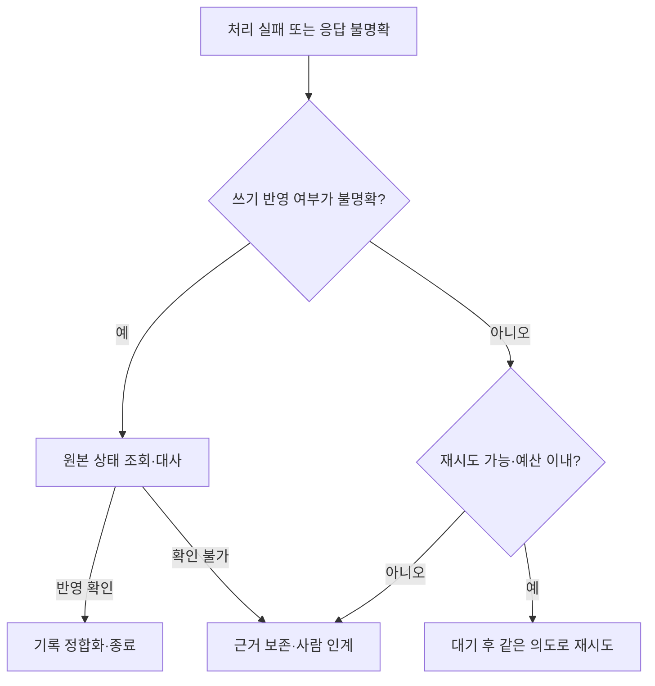

[5편의 인프라 선택](/posts/internal-ai-api-local-hybrid-infrastructure/)에서 업무 품질과 용량을 확인했다면, 운영에서는 다른 질문이 남는다.

**실패한 작업을 어떻게 이어받고, 성공했다고 표시된 결과가 실제로 맞는지 어떻게 알아낼 것인가?**

모델 호출이 정상 종료되어도 고객 요청을 잘못 요약할 수 있다. 답변 발송이 시간 초과되어도 실제 발송은 끝났을 수 있다. 오류를 모두 재시도로 해결하거나 HTTP 성공을 업무 성공으로 집계하면 두 문제를 동시에 놓친다.

사내 AI 시스템 설계 시리즈의 6편에서는 복구·평가·성과 측정을 다룬다. 아래 상태·숫자·운영 절차는 모두 **가상의 설계 예시**다. 실제 구축·측정·장애 대응 경험이 아니며, 예제를 실행한 결과도 아니다.

## 처리 성공과 내용 정확도를 다른 축으로 기록한다

작업에 성공·실패 필드 하나만 두지 않는다. 최소한 실행 상태와 품질 판정을 분리한다.

- **실행 상태:** 접수, 처리 중, 검토 대기, 승인, 반영 중, 반영 완료, 결과 불명확, 실패·이관.
- **품질 판정:** 미평가, 기준 충족, 수정 필요, 중대한 오류.

‘반영 완료·미평가’와 ‘반영 완료·중대한 오류’가 모두 가능하다. 후자는 호출 장애가 아니라 이미 반영한 결과를 바로잡아야 하는 업무 사고다. 검토 큐에 들어간 결과는 처리 과정의 진전이지만 업무 완료는 아니다.

집계할 때는 기간·대상·분모를 명시한다. 모델 호출 성공률, 정해진 기한 내 업무 완료율, 검토 표본의 정확도는 서로 다른 지표다. 같은 작업의 재시도를 여러 성공 건으로 세지 않고, 아직 진행 중인 작업과 이관 건수도 보여준다.

[3편의 업무 흐름](/posts/internal-ai-marketing-support-accounting/)처럼 마케팅 주장 오류, 상담 약속 상태 오류, 증빙 거래 연결 오류는 업무별 기준으로 확인해야 한다.

## 먼저 중복 실행을 통제한다

큐 재전달, 사용자의 중복 클릭, 워커 재시작으로 같은 작업이 다시 실행될 수 있다. 모델 호출의 중복 비용보다 더 위험한 것은 외부 발송·원장 변경 같은 부작용의 중복이다.

설계 예시로 다음 식별자를 분리한다.

- 작업 ID: 하나의 업무 요청.
- 시도 ID: 해당 작업을 처리한 개별 실행.
- 제안 버전: 검토·승인 대상 내용.
- 반영 요청 키: 같은 의도의 반영을 식별하는 값.

같은 반영을 재시도할 때는 같은 키를 유지한다. 내용을 바꾼 새 제안에 과거 키를 재사용하지 않고, 같은 키에 다른 인자가 들어오면 충돌로 처리한다. 대상 범위와 키의 보존 기간도 정한다.

AWS의 [멱등 API 설계 글](https://aws.amazon.com/builders-library/making-retries-safe-with-idempotent-APIs/)은 호출자가 제공하는 요청 식별자와 서버의 중복 처리 계약을 설명한다. 요청에 키를 붙이는 것만으로 충분하지 않다. 실행 서버가 처리 중·완료 상태와 결과를 저장하고 동시에 들어온 동일 요청을 일관되게 처리해야 한다.

업무 원본과 실행 기록이 하나의 트랜잭션이 아니라면, 반영은 됐지만 기록이 실패하는 구간이 남는다. 이를 무조건 ‘정확히 한 번’ 실행으로 표현하지 않는다. 작업 식별자로 반영 결과를 조회하거나 대사하는 경로를 두고, 확인할 수 없다면 결과 불명확 상태로 사람이 판단하게 한다.

## 오류 유형에 따라 재시도와 인계를 나눈다

| 오류 | 기본 대응 | 피할 동작 |
|---|---|---|
| 일시적인 조회 실패·호출 제한 | 전체 기한 안에서 제한된 재시도 | 즉시 무한 반복 |
| 입력 누락·지원하지 않는 문서 | 보완 요청 또는 검토 큐 | 같은 입력 재호출로 비용만 증가 |
| 권한 거부·승인 만료 | 중단 후 권한·승인 재확인 | 더 강한 계정으로 자동 우회 |
| 형식·업무 규칙 검사 실패 | 원인 확인, 허용 범위에서 제한된 수정 | 통과할 때까지 생성 반복 |
| 쓰기 시간 초과·연결 단절 | 실제 반영 상태 조회·대사 | 실패로 단정하고 다시 실행 |
| 내용상 중대한 오류 | 해당 자동 반영 중지·영향 조사 | 정상 응답이라는 이유로 방치 |

재시도 정책에는 횟수뿐 아니라 전체 경과 시간, 호출 비용과 업무 기한의 상한이 필요하다. SDK와 애플리케이션, 워커가 각각 재시도하면 호출 수가 곱해질 수 있으므로 책임 계층을 정한다.

AWS의 [Timeouts, retries, and backoff with jitter](https://aws.amazon.com/builders-library/timeouts-retries-and-backoff-with-jitter/)는 시간 제한과 재시도가 부하를 키우는 문제, backoff와 jitter의 역할을 다룬다. 재시도 간격을 늘리고 분산해도 영구적인 입력 오류나 권한 문제가 해결되는 것은 아니다.

다음은 **복구 분기의 설계 예시**다.



대사 결과 미반영이 확실한 경우에도 기존 승인·현재 권한·입력 버전을 확인한 뒤 재실행한다. 복구가 [4편의 권한 경계](/posts/internal-ai-architecture-data-permission-boundaries/)를 우회하는 별도 통로가 되어서는 안 된다. ‘안전하게 재시도하라’는 지침은 필요하지만 실행기의 권한·예산 제한을 대신하지 않는다.

## 실패 큐는 종착지가 아니라 담당 업무다

실패 큐에 옮기면 메인 처리는 계속할 수 있지만, 해당 업무가 끝난 것은 아니다. 오류가 쌓이기만 하면 나중에 한꺼번에 복구해야 할 운영 부채가 된다.

실패 항목에는 작업 ID, 단계, 오류 분류, 시도 횟수, 마지막 성공 지점, 참조 자료 버전, 반영 여부와 다음 조치를 남긴다. 개인정보 원문이나 credential을 오류 메시지에 복사하지 않는다.

담당자·처리 기한·알림 기준을 정하고, 큐 길이뿐 아니라 가장 오래된 항목의 대기 시간과 유입·해결 속도를 본다. 원인을 고친 뒤에도 전체를 즉시 재전달하지 않는다. 소수 항목으로 확인하고 속도를 제한하며, 권한·승인·데이터 유효성을 다시 검증한다.

Amazon SQS의 [DLQ 문서](https://docs.aws.amazon.com/AWSSimpleQueueService/latest/SQSDeveloperGuide/sqs-dead-letter-queues.html)는 반복 처리 실패한 메시지를 격리하고 조사하는 구성을 설명한다. 제품별 보존·재전달 조건을 확인해야 하며, 엄격한 순서가 중요한 처리에서는 격리한 항목 뒤의 작업을 계속 진행해도 되는지도 판단해야 한다.

사람 인계 화면에는 ‘실패’ 표시만 두지 않는다. 무엇을 하려 했고, 어디까지 확인됐으며, 어떤 행동을 하면 중복 위험이 있는지 보여준다. 담당자의 처리 결과도 상태 기록에 연결해야 재발 방지와 평가 자료로 사용할 수 있다.

## 버전 관리의 단위는 모델만이 아니다

결과가 바뀌는 원인은 모델 외에도 많다.

- 모델 ID·버전·생성 설정.
- 프롬프트와 공통 지침 버전.
- 검색 색인·원문·정책 문서 버전.
- OCR·정규화·업무 규칙과 도구 스키마.
- 라우팅·승인 정책과 실행 코드.

작업별로 실제 사용한 조합을 남긴다. 권한 검사를 과거 버전으로 고정한다는 뜻은 아니다. 과거 판단을 추적할 자료와 현재 실행 시 적용할 권한은 구분한다.

변경은 가능한 범위에서 분리해서 평가하고 되돌릴 수 있는 배포 단위로 만든다. 프롬프트를 바꾼 뒤 정상 예제 몇 개만 보고 전체 적용하지 않는다. 권한·출력 계약·금지 행동의 회귀 테스트도 수행한다.

롤백은 미래 실행을 되돌리는 조치이지 이미 잘못 보낸 답변을 취소하는 조치는 아니다. 영향받은 작업을 찾고 정정·취소 가능 여부를 별도로 확인해야 한다. [Harness Engineering 글](/posts/harness-engineering-ai-agents/)에서 말한 환경과 검증 루프를 운영 변경에도 적용한다.

## 평가 데이터는 쉬운 예제와 실패 사례를 함께 담는다

업무 담당자가 기대 결과와 허용 오차, 중단 조건을 먼저 정한다. 평가는 최소한 다음 범주를 포함한다.

1. 실제 업무 분포를 대표하는 일반 사례.
2. 정보 누락·충돌·긴 입력·지원 범위 밖 사례.
3. 과거에 발견한 오류와 경계 사례.
4. 권한 밖 자료·비신뢰 입력·승인 없는 실행 시도.

일반적인 품질 추정용 집합과 의도적으로 어려운 회귀 집합을 구분한다. 어려운 사례를 많이 넣은 점수를 실제 업무 정확도처럼 제시하지 않는다. 반대로 정상 사례만 넣어 위험한 오류를 감추지도 않는다.

프롬프트를 다듬는 개발 자료와 최종 평가 자료를 나누고, 같은 대화·문서에서 나온 유사 항목이 양쪽에 섞이지 않도록 한다. 운영에서 수집한 자료는 이용 목적·권한·보존 조건을 확인한 뒤 사용한다.

OpenAI의 [Evaluation best practices](https://developers.openai.com/api/docs/guides/evaluation-best-practices)는 작업별 평가, 대표·경계 사례와 지속 평가를 다룬다. 자동 평가기를 사용하더라도 사람이 판정한 표본과 비교해 기준을 보정한다. 결과를 만든 모델이 스스로 ‘정답’이라고 평가한 것만으로 통과시키지 않는다.

## 자동 확정 오탐은 전체 정확도 뒤에 숨기지 않는다

여기서 자동 확정 오탐은 **사람에게 넘겨야 하거나 틀린 결과를 시스템이 올바른 것으로 자동 확정한 경우**를 뜻한다. 업무상 치명적인 오류는 전체 점수와 별도 집계한다.

가상의 평가에서 1,000건 중 100건을 자동 확정했고, 그 100건을 전수 검토해 5건의 잘못된 확정을 발견했다고 하자. 자동 확정 범위는 10%, 자동 확정 오류 비율은 5/100인 5%다. 이를 전체 1,000건 기준의 0.5%만으로 보고하면 자동 확정 경로의 위험을 작게 보이게 할 수 있다.

반대로 검토 큐로 넘긴 나머지 900건을 모두 오답으로 세는 것도 부적절하다. 자동화 범위, 자동 확정 경로의 품질, 사람 검토 후 최종 품질을 함께 보고 업무 위험에 맞게 판단한다. 이 숫자는 **계산 설명용 가상 수치**이며 운영 목표나 허용 기준이 아니다.

운영 중에는 자동 확정 결과도 표본 검토한다.

- 무작위 표본으로 대표성을 확보한다.
- 새로운 문서 유형·모델 변경·고위험 업무는 별도 층으로 더 살핀다.
- 위험 사례를 더 뽑았다면 층별 결과를 구분하고, 단순 평균을 전체 오류율로 제시하지 않는다.
- 표본 크기·기간·추출 방법과 판정 기준을 남긴다.

작은 표본에서 오류가 없었다고 실제 오류율이 0이라고 결론 내리지 않는다. 금전·대외 약속처럼 영향이 큰 작업은 사후 표본 검토만으로 승인 절차를 대체하지 않는다. 위험한 오탐이 발견되면 해당 자동 확정 범위를 축소하거나 중지하고 영향 조사부터 한다.

## 순절감 시간은 사람의 검토와 뒤늦은 수정까지 포함한다

[AI 활용도·생산성 글](/posts/measuring-ai-usage-and-productivity/)처럼 사용량보다 최종 업무 결과를 본다. 같은 유형의 작업과 같은 품질 기준으로 기존 방식의 기준선을 기록한다.

```text
건당 순절감 노동시간
= 기존 방식의 작업 시간
- (입력 준비 + 검토 + 수정 + 후속 재작업 + 인계에 든 사람의 시간)

건당 운영비
= 해당 기간의 비용 ÷ 같은 기준으로 완료한 업무 건수
```

사람이 손을 쓰는 노동시간과 대기 포함 완료 소요 시간은 따로 기록한다. 모델 응답을 기다리는 동안 다른 일을 할 수 있다면 그 시간을 전부 노동시간으로 더하지 않지만, 고객 응답 지연을 평가할 때는 대기 시간을 포함한다.

예를 들어 기존 12분, AI 입력 준비 1분·검토 3분·수정 2분·후속 재작업 평균 1분이라면 노동시간 순절감은 5분이다. 모델 대기 시간이 별도로 2분 있었다면 완료 소요 시간은 실행 순서와 병렬 작업 여부를 확인해 계산한다. 역시 **실측이 아닌 산식 예시**다.

비용에는 모델·OCR·검색·저장·모니터링, 인프라와 유지 인력, 담당자의 검토·재작업 비용을 포함한다. [5편](/posts/internal-ai-api-local-hybrid-infrastructure/)의 총비용과 같은 기간·범위를 사용하고, 업무별 인건비와 시스템 공통비를 이중 집계하지 않는다.

정정이 며칠 뒤 발생할 수 있으므로 작업 접수 기간과 후속 관측 기간도 명시한다. 쉬운 작업만 AI에 배정한 뒤 어려운 수동 작업과 비교해서 효과를 과장하지 않는다.

## 작은 업무에서 확장하고 멈출 조건도 둔다

처음에는 조회·초안·검토 목록처럼 부작용이 제한된 업무부터 시작할 수 있다. 오프라인 평가를 통과한 뒤 원본 업무에 영향을 주지 않는 병행 관찰, 담당자 검토를 거치는 제한 운영 순으로 확장한다. 병행 관찰에서도 실제 자료를 사용한다면 접근·외부 전송·로그 통제는 필요하다.

확대 조건은 완료 품질, 중대한 오류, 검토 대기, 순절감 시간과 총비용을 함께 충족하는지다. 유입량이 늘어도 검토자가 감당할 수 있는지 확인한다.

축소·중단 조건도 미리 합의한다. 권한 위반, 근거 없는 대외 약속, 자동 확정 경로의 중대한 오류, 실패 큐의 장기 적체처럼 위험도가 높은 사건은 평균 성능이 좋아도 별도 대응한다.

외부 API·자체 호스팅·혼합 구성 모두 이 운영 기준이 필요하다. 로컬 LLM이라는 이유만으로 오류 복구와 평가가 쉬워지는 것은 아니다.

## 운영 전에 실행할 검증 목록

다음은 구현 시 검증할 항목이며, 이 글에서 실제 시스템에 수행한 테스트가 아니다.

- 동일 요청의 동시 전달과 워커 재시작에도 쓰기가 중복되지 않는가.
- 쓰기 성공 뒤 응답·기록이 유실돼도 반영 결과를 확인할 수 있는가.
- 재시도 예산 소진·영구 오류·권한 거부가 올바르게 인계되는가.
- 실패 큐 재처리 전에 승인·권한·입력 버전을 다시 검사하는가.
- 모델·지침·규칙 변경이 고정된 평가 집합과 금지 행동 검사를 통과하는가.
- 자동 확정 오탐과 대표 표본 결과를 별도로 추적하는가.
- 검토·후속 재작업과 공통 운영비를 포함해 확장 효과를 계산하는가.

운영 가능한 AI는 오류가 없는 시스템이라기보다 **오류를 알아차리고, 부작용을 통제하며, 다음 담당자가 이어받을 수 있는 시스템**에 가깝다. 그 구조 위에서 품질과 순효과를 확인하고 작은 범위를 점진적으로 넓혀간다.

## 공식 참고 자료

- [AWS — Making retries safe with idempotent APIs](https://aws.amazon.com/builders-library/making-retries-safe-with-idempotent-APIs/): 요청 식별자와 중복 부작용 통제.
- [AWS — Timeouts, retries, and backoff with jitter](https://aws.amazon.com/builders-library/timeouts-retries-and-backoff-with-jitter/): 시간 제한·재시도·부하 분산.
- [Amazon SQS — Using dead-letter queues](https://docs.aws.amazon.com/AWSSimpleQueueService/latest/SQSDeveloperGuide/sqs-dead-letter-queues.html): 실패 격리·분석과 재처리 시 고려 사항.
- [OpenAI — Evaluation best practices](https://developers.openai.com/api/docs/guides/evaluation-best-practices): 작업별 평가와 대표·경계 사례, 지속 평가.

문서 확인: 2026-10-18. 본문은 설계 제안이며 실제 복구 시험·보안 검증·업무 데이터 평가·성과 측정은 수행하지 않았다.
