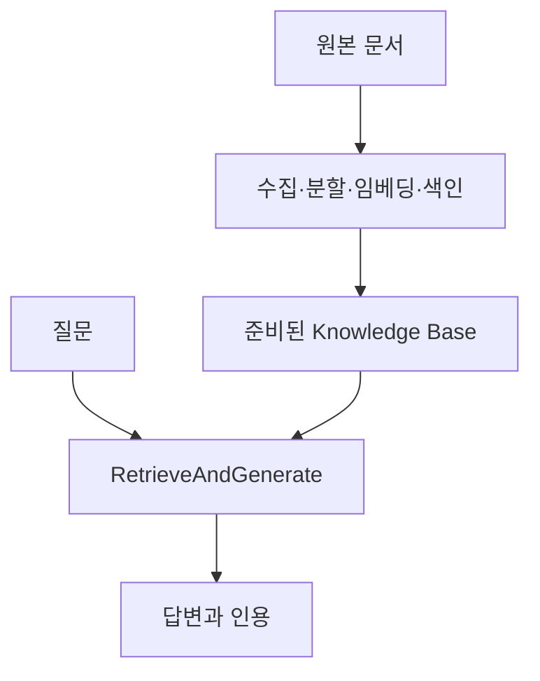

[RAG 입문 글](/posts/rag-retrieval-grounded-generation/)에서는 자료를 검색해 LLM의 답변 근거로 제공하는 구조를 살펴봤다. 이번에는 Amazon Bedrock Knowledge Bases 실습 노트북의 흐름을 따라, 검색과 생성을 한 번에 호출하는 방법과 확인할 기록을 정리한다.

이 글은 제공된 `Task-1.ipynb`의 코드와 저장된 출력을 검토해 재구성했다. 클라우드 실습을 새로 실행하지 않았으며, 아래 코드는 설명을 위해 새로 작성한 호출 예시다. 원본의 계정·버킷·Knowledge Base 식별자는 포함하지 않았다.

## 준비와 질문 처리를 구분한다

원본 실습은 Knowledge Base, 데이터 소스, OpenSearch Serverless 색인이 이미 준비된 환경을 전제로 한다. 노트북을 열었다고 이 자원들이 자동으로 만들어지는 것은 아니다.

문서 수집·분할·임베딩·색인 생성은 사전 준비 과정이다. 질문을 보낼 때마다 `RetrieveAndGenerate`가 모든 문서를 처음부터 분할하는 것은 아니다.



여기서 “한 번의 API 호출”은 준비된 자료에서 검색하고 생성하는 요청을 말한다. 원본 자료의 최신성, 수집 성공 여부와 권한 설정은 별도로 확인해야 한다.

이 글은 원본과 같은 전통적인 Knowledge Bases 구성을 대상으로 한다. 공식 API 문서의 별도 `managed knowledge bases` 유형에는 `RetrieveAndGenerate`를 사용할 수 없다는 제한도 있으므로, 새 구성을 만들 때는 해당 유형과 지원 API를 확인해야 한다.

## 최소 호출에서 고정할 값

원본 코드의 생성 모델은 `amazon.nova-lite-v1:0`이다. 이는 실습 기록에 사용된 ID이며, 모든 리전에서 현재 바로 호출할 수 있다는 보장은 아니다.

다음 예시는 이용 가능한 모델 또는 추론 프로파일 ARN과 Knowledge Base ID를 환경 설정으로 받는다. API 형태를 설명하는 예제이며 자원 생성·수집·권한 부여는 포함하지 않는다. 실행하면 검색과 생성 비용이 발생할 수 있다.

```python
import os
import boto3

client = boto3.client(
    "bedrock-agent-runtime",
    region_name=os.environ["AWS_REGION"],
)

def ask(question, number_of_results=3):
    return client.retrieve_and_generate(
        input={"text": question},
        retrieveAndGenerateConfiguration={
            "type": "KNOWLEDGE_BASE",
            "knowledgeBaseConfiguration": {
                "knowledgeBaseId": os.environ["BEDROCK_KB_ID"],
                "modelArn": os.environ["BEDROCK_MODEL_ARN"],
                "retrievalConfiguration": {
                    "vectorSearchConfiguration": {
                        "numberOfResults": number_of_results
                    }
                },
            },
        },
    )
```

원본은 Knowledge Base 목록에서 첫 항목을 가져온다. 실습에서는 간단하지만 여러 KB가 있는 환경에서는 의도한 자료를 고른다는 보장이 없다. 대상 ID를 명시적으로 고정하고, 요청 기록에도 남기는 편이 안전하다.

## 검색 개수를 늘렸다고 품질이 입증되지는 않는다

원본에는 같은 목록형 질문에 검색 개수를 1과 3으로 바꾼 저장 출력이 있다. 두 응답에 나타난 항목의 범위가 달라진다. 이는 검색 설정 변경이 답변에 영향을 줄 수 있다는 관찰이다.

하지만 “3개가 항상 더 좋다”는 결론은 아니다. 정답 항목의 누락과 잘못된 추가를 비교하지 않았고, 반복 실행의 변동도 분리하지 않았기 때문이다.

가상의 도서관 규정 목록을 비교한다면 다음 항목을 기록할 수 있다.

| 기록 | 확인하는 이유 |
|---|---|
| 질문과 모델·프롬프트 버전 | 검색 개수 외 조건을 고정 |
| 반환된 근거의 ID와 순서 | 어떤 자료가 추가됐는지 확인 |
| 필수 규정의 포함 여부 | 관련 없는 분량 증가와 구분 |
| 근거 없는 규정의 추가 | 더 긴 답변을 좋은 답변으로 착각하지 않기 |
| 지연과 토큰 사용량 | 품질 변화와 비용을 함께 보기 |

`numberOfResults`는 문서 파일 수가 아니라 검색할 소스 청크 수와 관련된 설정이다. 실제 반환 개수는 요청한 상한보다 적을 수 있으며, 계층형 청킹에서는 같은 부모의 자식 청크가 부모로 대체되는 점도 고려해야 한다.

## citations는 전체 검색 로그와 다르다

원본의 출력 함수는 응답의 `citations` 아래 `retrievedReferences`에서 텍스트를 모아 화면에 표시한다. 이것은 **응답에 연결된 인용 근거**다. 이를 생성 모델이 본 모든 검색 결과의 완전한 목록이라고 단정하면 안 된다.

```python
def cited_texts(response):
    return [
        ref["content"]["text"]
        for citation in response.get("citations", [])
        for ref in citation.get("retrievedReferences", [])
        if "text" in ref.get("content", {})
    ]
```

동일 근거가 여러 인용에 연결돼 반복될 수 있다. 중복을 정리하더라도 어떤 답변 구절이 어느 근거에 연결됐는지 원본 관계는 남겨야 한다.

검색 단계의 결과를 직접 검사하거나 평가 입력을 통제하려면 다음 편의 `Retrieve` 분리 구성이 유용하다. 별도로 검색한 결과를 이전 통합 호출의 정확한 문맥이라고 간주하는 것은 피한다.

## 출력 형식을 바꿀 때 인용도 확인한다

원본 실습에는 프랑스어 응답과 JSON 응답을 요구하는 프롬프트 예제가 있다. 이는 모델을 다시 학습하지 않고 요청과 출력 형식을 바꾸는 프롬프트 엔지니어링이다. 해당 셀에는 저장된 실행 결과가 없어, 여기서는 성공한 실험으로 소개하지 않는다.

Knowledge Bases 프롬프트에는 검색 결과용 `$search_results$`와 인용 형식에 관여하는 `$output_format_instructions$` 같은 자리표시자가 사용된다. 인용 지시를 제거한 상태에서 결과 형식만 바꾸면 인용 동작도 영향을 받을 수 있다. 사용 모델과 템플릿의 지원 조건을 확인해야 한다.

JSON으로 요청했을 때는 구문 파싱, 필수 필드, 근거 연결을 따로 검사한다. JSON 형식이 맞다는 것과 내용이 맞다는 것은 별개의 검증이다.

이번 실습의 핵심은 통합 호출의 편리함과 관찰 범위를 함께 이해하는 것이다. 다음 글에서는 [검색과 생성을 분리하고 같은 근거를 평가에 보존하는 방법](/posts/bedrock-rag-retrieve-generation-records/)을 다룬다.

## 참고 자료

- 검토 자료: 제공된 Task-1 노트북의 코드와 저장 출력. 원본 첨부 파일은 재배포하지 않음.
- [AWS RetrieveAndGenerate API](https://docs.aws.amazon.com/bedrock/latest/APIReference/API_agent-runtime_RetrieveAndGenerate.html)
- [AWS 검색·생성 설정](https://docs.aws.amazon.com/bedrock/latest/userguide/kb-test-config.html)
