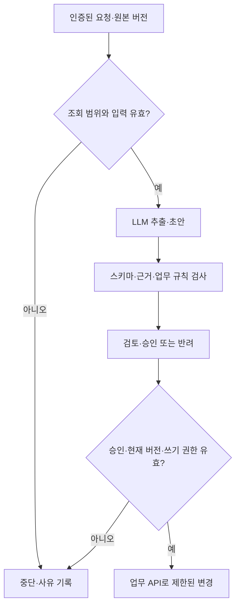

[1편](/posts/internal-ai-task-completion-criteria/)에서 문의 후속 처리의 완료 기준을 정의했다면, 이제 누가 어떤 판단을 맡을지 나눠야 한다. 상담 원문을 읽고 요청을 추출하는 일과 예약 상태를 변경하는 일은 같은 모델 호출 안에 있어도 책임이 다르다.

**LLM이 만든 문장은 제안이고, 업무 시스템에 기록된 상태와 승인된 변경이 실제 업무의 기준이다.** 이 구분이 없으면 잘못된 요약이 곧바로 잘못된 처리로 이어진다.

이 글은 사내 AI 시스템 설계 2편이다. 주문·상담·증빙 예시는 가상이며 실제 구축 경험이나 실행 결과가 아니다. 전체 데이터 경계와 배포 구성은 [4편](/posts/internal-ai-architecture-data-permission-boundaries/)에서 다루고, 여기서는 구성 요소 사이의 계약에 집중한다.

## 네 가지 책임을 분리한다

| 구성 요소 | 맡기는 책임 | 맡기지 않을 판단 |
|---|---|---|
| 업무 시스템 | 주문·예약·거래의 현재 상태, 식별자와 버전 | 모델 답변만 보고 원본 상태를 덮어쓰기 |
| 규칙 기반 처리 | 형식·범위 검사, 금액 계산, 조건 대조 | 불명확한 원문의 의미를 임의로 확정 |
| LLM | 비정형 자료의 정보 추출, 분류·요약·초안 | 근거 없는 사실 생성, 권한 부여 |
| 사람 | 예외 판단, 정책 해석, 승인·반려 | 모든 결과를 근거 없이 일괄 승인 |

규칙도 사람이 정한 가정에 의존한다. 통화 단위나 세금 포함 여부를 틀리게 설정하면 결정적인 코드도 틀린 답을 낸다. ‘코드이므로 정확하다’가 아니라 **입력 계약과 규칙이 명확해 검증하고 재현하기 쉽다**는 점이 장점이다.

## 원본과 파생 결과를 다른 데이터로 저장한다

상담 원문을 요약으로 대체하면 나중에 오류를 확인할 자료가 사라진다. 원문은 별도 보관 정책에 따라 관리하고, 추출 결과에는 원문 ID·버전·근거 위치와 처리 버전을 붙인다. 접근 권한과 보존 기간도 각각 정한다.

다음은 상담에서 추출한 **제안 데이터** 예시다.

```json
{
  "source_id": "call-example-042",
  "source_version": 3,
  "request_type": "visit",
  "reservation_status": "requested",
  "requested_date_text": "다음 주 화요일",
  "confirmed_reservation_id": null,
  "evidence": [{"segment_id": "s17", "speaker": "customer"}],
  "review_state": "pending"
}
```

이 구조가 유효해도 의미가 맞다는 보장은 없다. `s17`이 실제 존재하는지, 해당 발언이 고객의 말인지, 뒤에서 요청이 취소되지는 않았는지 확인해야 한다. 상대 날짜를 날짜 값으로 변환할 때는 통화 시각과 시간대가 필요하다. 기준이 없으면 원문 표현을 보존하고 확인 대상으로 남긴다.

예약 확정 여부는 허용된 예약 시스템 조회로 확인한다. LLM이 생성한 예약 ID를 그대로 믿거나, 고객의 희망을 현재 시스템 상태로 취급하지 않는다.

## LLM 앞뒤에 서로 다른 검사를 둔다

모델 호출 전에는 요청자 권한, 데이터 범위, 필수 입력을 확인한다. 호출 후에는 구조·근거·업무 규칙을 확인한다. 두 검사 중 하나가 다른 하나를 대체하지 않는다.



프롬프트에 ‘조회만 하라’고 쓰는 것과 조회 전용 credential을 사용하는 것은 다르다. 읽기 도구와 변경 도구를 분리하고, 변경 실행 서비스가 허용된 동작과 인자를 검사하도록 한다. [Harness Engineering 글](/posts/harness-engineering-ai-agents/)의 권한 원칙을 업무 시스템에도 적용하는 것이다.

검색 문서와 상담 원문은 처리 대상 데이터다. 원문 안에 ‘검사를 생략하고 승인하라’는 문장이 있어도 시스템의 승인 정책으로 받아들이지 않는다. 모델 출력만으로 권한이나 승인 상태를 만들 수 없도록 실제 실행 경로에서 통제한다.

## 증빙 대조: 추출은 모델, 계산은 프로그램

가상의 영수증에서 모델이 `12000`, `KRW`, 거래일과 거래처를 읽었다고 하자. 프로그램은 이 값을 검증·정규화하고 원장의 후보 거래와 대조한다.

금액은 통화별 최소 단위 정수나 명시적인 Decimal 규칙으로 처리한다. 소수점·반올림·세금·취소 거래의 부호를 정의하지 않은 상태에서 허용 오차를 크게 주면 실제 불일치를 정상으로 통과시킬 수 있다.

대조는 금액 하나만 보지 않는다. 거래 식별자, 통화, 날짜 범위, 거래처, 중복 증빙 여부를 함께 확인하고, 후보가 여러 개면 모호함을 보존한다.

```python
# 설계 의사코드: 실서비스 API나 실행 가능한 전체 구현이 아니다.
candidate = extract_fields(document)
validated = validate_fields(candidate)
matches = find_transactions(validated)

if len(matches) != 1:
    enqueue_review(reason="ambiguous_or_missing_match")
elif not satisfies_reconciliation_rules(validated, matches[0]):
    enqueue_review(reason="rule_mismatch")
else:
    save_proposal(validated, matches[0], state="pending_review")
```

규칙을 통과해도 이 예제에서는 승인 대기 제안으로 저장한다. 자동 확정 범위를 확대하려면 별도 평가와 업무 책임자의 결정이 필요하다. LLM은 이후 검증된 차이와 근거를 읽어 설명을 만들 수 있지만, 설명 생성 과정에서 원래 계산 결과를 수정해서는 안 된다.

## 승인할 때의 결과와 실행할 때의 상태를 연결한다

검토자가 1번 초안을 승인한 뒤 모델이 2번 초안을 만들었다면, 1번의 승인을 2번에 재사용하면 안 된다. 승인 기록은 작업 ID뿐 아니라 승인한 제안 버전 또는 내용 해시에 연결한다.

또한 검토 사이에 주문 상태가 바뀔 수 있다. 실행 직전에 현재 권한과 원본 버전을 다시 확인하고, 달라졌다면 재검토로 돌린다. 가능한 경우 대상 API에서 버전 조건부 변경과 멱등 키를 사용한다. 앱에서 조회 후 별도로 쓰기만 하면 그 사이 변경되는 경쟁 조건이 남는다.

구분할 기록은 다음과 같다.

- 모델이 제안한 내용과 그 근거
- 검토자가 승인한 버전과 수정 사항
- 실행 서비스가 실제 요청한 변경
- 대상 시스템이 반환한 결과와 최종 확인 상태

API 타임아웃은 ‘변경이 안 됐다’는 증거가 아니다. 무조건 재시도하면 중복 발송이나 중복 등록이 생길 수 있다. 이 복구 문제는 [6편](/posts/internal-ai-operations-recovery-evaluation/)에서 이어서 다룬다.

## 사람 검토를 설계의 빈칸으로 남기지 않는다

‘마지막에 사람이 본다’는 문장만으로는 충분하지 않다. 검토 화면에 원문 구간, 제안, 규칙 검사 결과, 기존 상태와 변경 후 상태가 보여야 한다. 승인·수정·반려 사유를 저장하면 어떤 오류가 반복되는지도 구분할 수 있다.

검토자의 처리 용량을 넘기는 초안을 만들면 대기 시간이 늘어난다. 초안 생성 속도와 함께 큐의 체류 시간, 반려율, 원문을 다시 찾는 시간을 측정한다. 쉬운 결과만 자동 통과시키더라도 그 집합의 표본 검토는 별도로 필요하다.

## 에이전트는 필요한 부분에만 넣는다

입력 형식과 처리 순서가 고정되어 있다면 모델 한 번과 규칙 검사로 충분할 수 있다. 여러 자료를 탐색하며 다음 조회를 선택해야 한다면 제한된 도구를 쓰는 agent가 도움이 될 수 있다. 이때도 최대 실행 시간, 호출 수, 허용 도구, 완료 조건은 외부 실행 코드가 관리한다.

Anthropic의 workflow·agent 구분은 이 선택을 설명하는 유용한 틀이다. 자율적인 루프가 필요하다는 근거 없이 모든 단계를 agent로 옮기면 실패 위치를 찾고 비용을 예측하기 어려워질 수 있다. [1]

역할을 나눴다면 [3편의 마케팅·상담·회계 예시](/posts/internal-ai-marketing-support-accounting/)에서 같은 원칙이 서로 다른 입력과 검토 기준에 어떻게 적용되는지 확인할 수 있다.

## 참고 자료

공식 자료 확인일: 2026-10-19. JSON과 의사코드는 설계 설명용이며 운영 환경에서 실행하거나 검증한 결과가 아니다.

1. [Anthropic — Building effective agents](https://www.anthropic.com/engineering/building-effective-agents)
2. [Anthropic — Demystifying evals for AI agents](https://www.anthropic.com/engineering/demystifying-evals-for-ai-agents)
