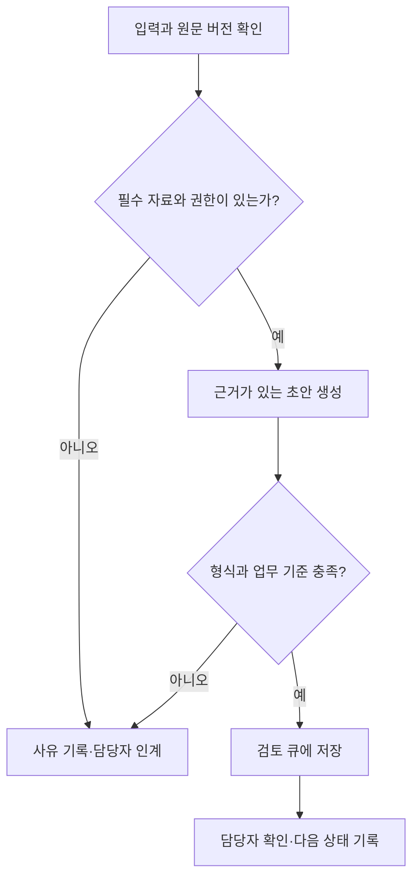

‘사내 자료를 읽는 AI’를 만들겠다는 목표만으로는 어디까지 구현해야 하는지 판단하기 어렵다. 문서를 검색하고 답변을 생성하는 데 성공해도 담당자의 후속 업무가 줄지 않을 수 있다. 반대로 모델 없이 입력 양식과 조회 API를 정리하는 것만으로 반복 작업의 상당 부분을 해결할 수도 있다.

사내 AI 시스템 설계의 출발점은 **어떤 입력을 받아 어떤 업무 상태를 바꾸고, 무엇을 확인하면 완료라고 부를 것인가**다. 서버 위치와 모델 선택은 그 조건을 만족시키기 위한 후속 결정이다.

이 시리즈는 직접 구축한 경험담이 아니라 설계 방법을 다룬다. 아래 고객 문의·증빙 대조와 숫자는 모두 가상의 예시다. 특정 기업의 운영 성과나 실측 결과로 해석하지 않는다.

## 부서 이름 대신 작업 단위를 고른다

‘상담 자동화’는 너무 넓다. 문의 분류, 정책 검색, 답변 초안, 환불 승인, 발송은 입력과 실패 비용이 다르다. 첫 PoC에서는 그중 하나를 선택한다.

예를 들어 ‘상담 원문에서 고객 요청과 직원의 약속을 구분해 후속 업무 초안을 만든다’는 범위라면 입력·출력·검토자를 정할 수 있다. 반면 ‘고객 만족도를 높인다’는 목표만으로는 결과물의 합격 여부를 정하기 어렵다.

처음 후보를 비교할 때는 다음 질문을 함께 본다.

| 질문 | 검토할 근거 | 범위를 줄여야 하는 신호 |
|---|---|---|
| 반복되는가? | 주간 처리 건수와 소요 시간 | 드물고 매번 판단 방식이 다름 |
| 입력을 확보할 수 있는가? | 원문·식별자·접근 권한 | 원문이 없거나 담당자 기억에 의존 |
| 결과를 검증할 수 있는가? | 정답 기준·검토자·증빙 | 자연스러워 보인다는 평가만 가능 |
| 오류를 되돌릴 수 있는가? | 초안 저장·보류·취소 경로 | 즉시 외부 약속이나 금전 변경으로 이어짐 |
| 운영할 사람이 있는가? | 검토·정책 갱신·장애 담당자 | 시연 이후 담당자가 없음 |

빈도만 높은 업무보다 **검증 가능하고 실패를 격리할 수 있는 반복 업무**가 첫 실험에 적합하다. 이것은 보편적인 점수 공식이 아니라 후보를 좁히기 위한 판단 기준이다.

## 입력·출력·완료 증거를 한 장에 적는다

가상의 문의 후속 처리 PoC를 다음처럼 정의할 수 있다.

```yaml
task: consultation_followup_draft
input:
  - 상담 원문과 원문 버전
  - 상담 식별자
  - 담당자가 조회할 수 있는 정책 문서
output:
  - 고객 요청
  - 직원이 확정한 약속
  - 아직 확인이 필요한 사항
  - 후속 조치 후보와 원문 근거
out_of_scope:
  - 예약 확정
  - 고객에게 메시지 발송
  - 환불 또는 장부 변경
completion:
  - 검토 가능한 초안 저장
  - 원문 근거 연결
  - 담당자와 검토 상태 기록
```

이 문서는 도구 설정 파일이 아니라 업무 범위를 합의하기 위한 예시다. 여기서 PoC의 산출물은 ‘검토 가능한 초안’이며, 고객 요청 자체가 해결됐다는 뜻은 아니다. 서비스 지표에는 `초안 생성 완료`와 `후속 업무 처리 완료`를 따로 기록해야 한다.

‘다음 주 화요일에 방문하고 싶어요’는 희망이다. 직원의 확정 답변이나 예약 시스템 기록이 없다면 예약 완료로 바꾸지 않는다. 담당자나 기한이 원문에 없을 때는 빈 값과 확인 사유를 남기고, 그럴듯한 이름이나 날짜로 채우지 않는다.

증빙 대조도 같은 방식으로 범위를 좁힌다. ‘회계 업무를 자동화한다’보다 ‘특정 양식의 증빙에서 거래일·통화·금액을 추출해 거래 후보와 비교하고, 불일치 목록을 만든다’가 검증하기 쉽다. 숫자가 같다는 이유만으로 같은 거래로 확정하거나 세무 판단까지 완료했다고 간주하지 않는다.

## 성공 조건에 보류와 인계도 포함한다

모든 입력에서 답을 내도록 요구하면 불명확한 자료까지 강제로 처리하게 된다. 입력이 잘렸거나 정책 문서에 근거가 없다면 보류가 올바른 결과일 수 있다.



다만 보류를 많이 하면 품질 지표가 좋아지는 문제도 생긴다. 전체 입력 대비 처리·보류·실패 비율을 함께 보고, 자동으로 처리한 부분의 정확도만 보고하지 않는다. ‘보류된 업무를 누가 언제 확인하는가’가 빠지면 AI 처리 단계 밖에 새로운 적체가 생긴다.

## 모델 호출 성공과 업무 성공을 나눠 평가한다

평가 기준은 프롬프트를 고치기 전에 정한다. 정상 사례 외에 취소, 조건부 약속, 정보 누락, 상충하는 발언을 포함한다. 사람이 기준을 만들 때 의견이 갈리는 사례는 별도 토론을 거쳐 판정 규칙을 남긴다.

| 입력 상황 | 기대 결과 | 중대한 오류 예시 |
|---|---|---|
| 고객이 예약을 희망함 | 희망 상태로 추출 | 확정 예약으로 기록 |
| 직원이 확인 후 연락하겠다고 말함 | 확인·연락 약속을 분리 | 원문에 없는 처리 기한 생성 |
| 고객이 앞선 요청을 취소함 | 취소 발언과 대상 연결 | 취소 이전 요청만 업무로 생성 |
| 원문 일부가 누락됨 | 보류와 누락 사유 | 누락 구간을 추정해 확정 |

스키마를 만족하는 JSON을 반환하는지, 원문 근거를 정확히 가리키는지, 업무 상태를 올바르게 판단하는지를 분리한다. 모델이 스스로 높은 확신을 표시하는 것은 정답 증거가 아니다.

Anthropic의 평가 가이드도 실행 과정과 최종 결과를 구분해 평가하는 관점을 설명한다. 이 글의 판정표는 그 문서를 복제한 것이 아니라 문의 업무에 적용한 설계 예시다. 실제 평가에서는 프롬프트 개선에 사용한 사례와 최종 확인용 사례를 분리하고, 모델·프롬프트·정책 버전을 기록한다. [1]

## 먼저 기존 처리 시간을 측정한다

AI 호출에 10초가 걸렸다고 10분짜리 업무가 10초로 줄었다고 말할 수는 없다. 자료 준비, 검토, 수정, 업무 시스템 반영이 남아 있다.

가령 100건을 사람이 처리할 때 총 600분이 필요했다고 가정하자. AI 지원 후 자료 준비 50분, 검토 250분, 수정 100분, 수동 인계 처리 80분이 들었다면 사람의 작업 시간 절감은 120분이다. 호출 대기 시간과 전체 완료까지의 경과 시간은 별도 지표로 기록한다. 이 숫자는 계산 방법을 보여주기 위한 가정이다.

비교할 때 업무 난이도와 입력 구성이 비슷해야 한다. 쉬운 사례만 AI에 넣고 기존 전체 평균과 비교하면 과장된다. 단발성 PoC에서 줄어든 작업 시간을 월간 절감액으로 그대로 환산하지 않고, 운영·정책 수정·재작업 비용도 확인한다. 기존 [AI 활용도·생산성 글](/posts/measuring-ai-usage-and-productivity/)과 같은 원칙이다.

## PoC의 끝은 데모가 아니라 다음 결정이다

첫 실험은 제한된 입력 양식, 소수의 검토자, 고정된 정책 범위로 시작할 수 있다. 초기에는 외부 반영 없이 기존 처리와 나란히 결과를 비교하고, 확인된 문제를 수정한 뒤 검토 큐에 연결한다.

확장 기준과 중단 기준은 실험 전에 합의한다. 예를 들어 중대한 상태 오분류가 나오면 반영 범위를 넓히지 않고 원인부터 분석한다. 검토 시간이 줄지 않는다면 모델만 바꾸기 전에 입력 품질과 검토 화면을 살핀다. 작은 표본에서 오류가 없었다고 실제 오류율이 0이라고 결론 내리지 않는다.

Anthropic은 미리 정해진 코드 경로를 따르는 workflow와 모델이 실행 경로를 결정하는 agent를 구분한다. 고정된 문의 추출·검토 업무라면 먼저 단순한 workflow로 평가하고, 실제로 동적 탐색이 필요한 부분에만 자율성을 늘릴 수 있다. [2]

완료 기준을 정했다면 [2편의 시스템·규칙·LLM 역할 분리](/posts/internal-ai-system-rules-llm-roles/)에서 각 단계의 책임을 나눈다. 이 시리즈의 [3편](/posts/internal-ai-marketing-support-accounting/)은 업무별 예제, [4편](/posts/internal-ai-architecture-data-permission-boundaries/)은 아키텍처, [5편](/posts/internal-ai-api-local-hybrid-infrastructure/)은 실행 환경, [6편](/posts/internal-ai-operations-recovery-evaluation/)은 복구와 성과 측정으로 이어진다.

## 참고 자료

공식 자료 확인일: 2026-10-19. 이 글의 업무 흐름과 평가표는 설계 제안이며 실제 PoC를 수행한 결과는 아니다.

1. [Anthropic — Demystifying evals for AI agents](https://www.anthropic.com/engineering/demystifying-evals-for-ai-agents)
2. [Anthropic — Building effective agents](https://www.anthropic.com/engineering/building-effective-agents)
