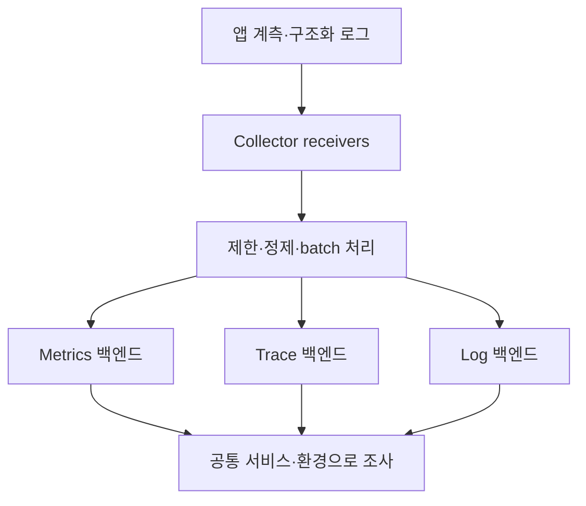

주문 API가 느려졌다는 알림을 받았다고 하자. CPU는 정상인데 고객은 결제를 기다린다. 로그에는 오류가 없고, 평균 응답 시간도 크게 변하지 않았다. 이때 필요한 것은 로그를 무조건 더 많이 남기는 일이 아니라 **영향의 범위, 느린 경로, 그 순간의 사건을 연결할 수 있는 관측 데이터**다.

Metrics·Traces·Logs는 같은 현상을 다른 단위로 기록한다. 세 종류의 저장소를 설치했다고 Observability가 완성되는 것은 아니다. 어떤 질문에 답할지 정하고, 서비스·환경·버전·요청의 연결 정보를 일관되게 남겨야 한다.

아래 주문 서비스와 설정은 가상의 설계 예시다. 실제 장애 후기나 성능 측정 결과가 아니며, Collector 구성은 실행 검증하지 않았다.

## 신호마다 답하는 질문이 다르다

| 신호 | 기록 단위 | 잘 답하는 질문 | 주의할 한계 |
|---|---|---|---|
| Metrics | 시간 구간의 집계·측정값 | 얼마나 많은 요청이 느리거나 실패했나? | 개별 요청의 사정은 집계에서 사라짐 |
| Traces | 요청에 연결된 span의 관계와 시간 | 어느 서비스·작업에서 시간이 걸렸나? | 계측·전파·샘플링에서 누락될 수 있음 |
| Logs | 특정 시점의 사건과 속성 | 당시 어떤 상태·오류·판단이 있었나? | 구조와 연결 키가 없으면 검색 비용이 커짐 |

OpenTelemetry는 이런 신호를 계측·수집·처리·내보내는 체계를 제공한다. 장기 저장, 검색 화면, 경보 정책까지 모두 대신하는 단일 모니터링 제품은 아니다. SDK·자동 계측과 Collector, 저장·분석 백엔드의 역할을 구분한다. [1]

## Metrics: 전체 영향부터 좁힌다

주문 API에서는 요청량, 오류 비율, 지연 분포를 먼저 볼 수 있다. 요청 수를 Counter로, 처리 시간을 Histogram으로 기록하고 작업 큐 길이처럼 현재 상태를 나타내는 값도 관측한다. 정확한 instrument와 집계 방식은 선택한 SDK·백엔드의 의미를 확인한다. [2]

평균만으로는 일부 사용자의 긴 지연을 놓칠 수 있다. p95·p99와 요청 수를 함께 보고, 트래픽이 적은 구간에서 분위수가 얼마나 흔들리는지도 확인한다. 인스턴스별 p95를 평균 내서 전체 서비스의 p95라고 부르면 안 된다. 집계 가능한 Histogram 분포 등으로 전체를 계산해야 한다.

라벨에는 요청마다 달라지는 값을 넣지 않는다. 예를 들어 실제 URL `/orders/93821` 대신 경로 템플릿 `/orders/{id}`를 사용한다. 사용자 ID, 주문 ID, trace ID를 일반적인 metric 라벨로 넣으면 고유 시계열 수가 계속 늘어난다.

가령 서비스 5개, 경로 20개, 결과 종류 5개면 최대 500개 조합을 생각할 수 있다. 여기에 고유 사용자 10만 명을 곱하면 비용 모델이 완전히 달라진다. 실제 시계열 수는 관측된 조합과 Histogram 표현 방식 등에 따라 달라지지만, 무제한 값이 위험하다는 원리는 같다. Prometheus의 계측 가이드도 라벨 cardinality를 주의해서 다룬다. [3]

## Traces: 느린 요청의 경로를 본다

Trace는 span들을 연결한다. 주문 API의 서버 span 아래에 DB 조회나 결제 서비스 호출 span이 연결되면 어떤 의존 작업이 지연됐는지 좁힐 수 있다. span은 시작·종료 시각과 속성, 상태 등을 가진다. [4]

하지만 전체 응답 시간이 하위 span 시간의 단순 합과 같지는 않다. 두 호출이 병렬이면 시간이 겹치고, 계측하지 않은 대기·직렬화·스케줄링 구간도 남는다. 긴 DB span을 찾았더라도 쿼리 계획, connection pool 대기, DB 부하를 추가로 확인해야 원인을 설명할 수 있다.

서비스를 넘을 때 trace context가 전파되어야 관계가 유지된다. HTTP에서는 사용하는 계측 라이브러리가 헤더를 주입·추출하는지 확인하고, 메시지 큐에서는 생산·소비 경계의 context와 비동기 관계를 점검한다. 중간 서비스가 context를 버리면 하나의 업무가 끊어진 trace들로 보일 수 있다. [5]

trace ID가 인증 정보는 아니다. 외부에서 들어온 context를 신뢰 경계와 무관하게 내부 권한으로 사용하지 않으며, baggage에 개인정보나 토큰을 넣어 downstream으로 퍼뜨리지 않는다.

## Logs: 원인을 판단할 사건을 남긴다

`처리 실패`라는 문자열보다 사건 이름과 제한된 속성이 있는 구조화 로그가 유용하다. 다음은 애플리케이션 JSON 로그의 예시이며 OTLP 전송 형식 자체는 아니다.

```json
{
  "timestamp": "2026-10-19T01:40:00Z",
  "severity": "WARN",
  "service": "order-api",
  "environment": "staging",
  "event": "payment_timeout",
  "trace_id": "4bf92f3577b34da6a3ce929d0e0e4736",
  "span_id": "00f067aa0ba902b7",
  "retryable": true,
  "timeout_ms": 1500
}
```

지원되는 로깅 연동을 설정하면 활성 trace·span의 ID를 로그와 연결할 수 있다. 실제로 필드가 주입되고 수집·저장 단계에서 보존되는지 확인해야 하며, 모든 언어와 로깅 조합이 설정 없이 동일하게 동작한다고 가정하지 않는다. [6]

요청 본문 전체를 남기는 것보다 장애 판단에 필요한 필드를 정한다. 인증 토큰, 결제 정보, 고객 원문을 무분별하게 저장하면 로그 저장소가 별도의 민감정보 저장소가 된다. 마스킹은 백엔드뿐 아니라 애플리케이션의 출력 단계부터 검토한다.

업무 감사 기록과 진단 로그도 분리한다. 샘플링·짧은 보존 기간을 적용하는 진단 데이터가 중요한 변경 이력의 유일한 근거가 되면 안 된다.

## 세 신호를 연결하는 공통 키

리소스에는 서비스 이름과 배포 환경, 서비스 버전을 일관되게 붙인다. Trace와 Logs에는 요청 관계를 연결할 ID가 필요하다. Metric에서 개별 trace로 이동하려면 백엔드와 계측이 지원하는 exemplar 등을 사용할 수 있지만, trace ID를 모든 metric 라벨에 추가하는 방식은 피한다.

가상의 장애 조사 순서는 다음과 같다.

1. 주문 경로의 p99와 오류율 상승을 Metrics에서 확인한다.
2. 영향을 받은 배포 버전·환경과 시간 범위를 좁힌다.
3. 보존된 느린 Trace에서 결제 호출 대기가 긴지 살핀다.
4. 같은 trace ID의 Logs에서 타임아웃과 재시도 사건을 찾는다.
5. 의존 서비스 상태와 최근 변경을 대조해 가설을 검증한다.

배포 직후라는 시간적 연관만으로 원인을 확정하지 않는다. 또한 해당 trace가 없으면 샘플링·전파·수집 실패 가능성도 살핀다. ‘기록이 없다’와 ‘사건이 없었다’는 다른 판단이다.

## Collector는 수집 경로이지 보관함이 아니다

Collector의 파이프라인은 receiver, processor, exporter로 구성한다. 구성 요소를 선언한 것만으로 활성화되지 않고 `service.pipelines`에 연결해야 한다. processor의 순서도 처리 순서에 영향을 준다. [7]



다음은 로컬에서 OTLP HTTP 입력을 받아 debug exporter로 확인하는 **최소 설정 예시**다. 운영용 저장·전송 구성은 아니다. 선택한 Collector 배포판에 `otlp`, `memory_limiter`, `batch`, `debug` 구성 요소가 포함되어 있는지 확인하고 이미지 버전을 고정해야 한다.

```yaml
receivers:
  otlp:
    protocols:
      http:
        endpoint: 127.0.0.1:4318
processors:
  memory_limiter:
    check_interval: 1s
    limit_mib: 256
    spike_limit_mib: 64
  batch: {}
exporters:
  debug:
    verbosity: basic
service:
  pipelines:
    traces:
      receivers: [otlp]
      processors: [memory_limiter, batch]
      exporters: [debug]
    metrics:
      receivers: [otlp]
      processors: [memory_limiter, batch]
      exporters: [debug]
    logs:
      receivers: [otlp]
      processors: [memory_limiter, batch]
      exporters: [debug]
```

메모리 값은 예시다. 컨테이너 메모리 한도와 실제 부하에 맞춰 조정한다. `memory_limiter`는 통상 파이프라인 앞에 두며, 한도에 도달했을 때 데이터 거부와 backpressure가 발생할 수 있다. 무손실 저장을 보장하는 기능이 아니다. [8]

loopback 주소는 같은 네트워크 namespace의 앱만 접근할 수 있다. 다른 컨테이너나 호스트에서 수집하려면 endpoint와 네트워크·인증·TLS를 별도로 설계한다. SDK에서 OTLP HTTP exporter와 주소를 설정해도, 기존 파일 로그가 저절로 OTLP로 바뀌지는 않는다. 로깅 bridge나 별도 수집 경로가 필요하다.

## Sampling과 수집 장애까지 관측한다

Head sampling은 trace 시작 단계에서 보존 여부를 결정한다. Tail sampling은 모인 span을 보고 지연·오류 등의 조건으로 선택할 수 있지만, 버퍼와 대기 시간, 같은 trace를 모으는 라우팅이 필요하다. 오류 trace를 모두 보존하도록 의도해도 수집 전에 유실된 데이터까지 복구하지는 못한다. [9]

운영에서는 Collector의 거부·드롭·export 실패와 큐 적체도 확인한다. 백엔드 장애가 애플리케이션 요청 경로를 막지 않도록 SDK와 exporter의 큐·재시도·폐기 정책을 정하고, 유실 가능성을 문서화한다. batch 처리만으로 디스크 내구성이 생기지 않는다.

처음 도입한다면 주요 요청 경로 하나에서 서비스 식별자, 지연 Histogram, 핵심 span, trace와 연결되는 오류 로그부터 확인할 수 있다. 그 데이터로 실제 질문에 답할 수 있는지 확인한 뒤 범위를 늘리는 편이 비용과 운영 책임을 파악하기 쉽다.

보안 탐지는 같은 로그를 사용할 수 있어도 탐지 규칙과 조사 절차가 별도로 필요하다. 관련 내용은 [Detection as Code](/posts/detection-as-code-siem-rules-git/)에서 이어서 볼 수 있다.

## 직접 연결해 보기: HTTP 요청 → Span → 같은 ID의 로그

2026-10-22에 Node.js 24.19.0에서 실행 확인한 최소 예제다. SDK 버전은 `@opentelemetry/sdk-node 0.57.2`, `sdk-trace-base 1.30.1`, `api 1.9.0`으로 고정했다. 최신 버전 안내가 아니라 아래 결과의 재현 조건이다.

[전체 코드·잠금 파일·실행 출력](https://github.com/choi-jiwoong/choi-jiwoong.github.io/tree/main/examples/observability-node)에서 파일을 내려받고 해당 디렉터리에서 실행한다.

```bash
npm ci
node app.cjs
# 다른 터미널에서 실행
curl http://127.0.0.1:3000/orders/demo
```

핵심은 요청 처리 안에서 Span을 열고, 그 컨텍스트의 ID를 로그에 넣는 것이다.

```javascript
tracer.startActiveSpan('GET /orders/demo', (span) => {
  try {
    const { traceId, spanId } = span.spanContext();
    console.log(JSON.stringify({
      event: 'order_received', trace_id: traceId, span_id: spanId
    }));
    // 응답에도 traceId를 포함해 요청과 대조한다.
  } finally {
    span.end();
  }
});
```

실제 실행에서 HTTP 응답의 `trace_id`, JSON 로그의 `trace_id`, ConsoleSpanExporter 출력의 `traceId`가 모두 `949fb047a2704d9d59cb76de0cc37bee`로 일치했다. 재실행하면 ID는 바뀌지만 세 값의 일치는 유지되어야 한다.

데모는 매 요청을 내보내도록 `AlwaysOnSampler`를 명시하고 자원 자동 탐지는 끈다. 환경의 샘플링 비율이 낮으면 로그에는 ID가 있어도 해당 Trace가 저장되지 않을 수 있기 때문이다. 운영에서는 저장 비용과 조사 필요에 맞춰 샘플링 정책을 따로 정한다.

이 코드는 수동 Span과 표준 출력 로그의 상관관계를 확인한다. HTTP 자동 계측, 서비스 사이의 컨텍스트 전파, OTLP 로그 전송을 구현한 예제는 아니다. Collector와 저장 백엔드 연결은 앞의 설계를 별도로 적용하고 검증해야 한다.

## 참고 자료

공식 문서 확인일: 2026-10-19. 설정의 YAML 구조를 검사했으며 Collector 실행·부하·백엔드 연동은 검증하지 않았다.

1. [OpenTelemetry — Signals](https://opentelemetry.io/docs/concepts/signals/)
2. [OpenTelemetry — Metrics](https://opentelemetry.io/docs/concepts/signals/metrics/)
3. [Prometheus — Instrumentation](https://prometheus.io/docs/practices/instrumentation/)
4. [OpenTelemetry — Traces](https://opentelemetry.io/docs/concepts/signals/traces/)
5. [OpenTelemetry — Context propagation](https://opentelemetry.io/docs/concepts/context-propagation/)
6. [OpenTelemetry — Logs](https://opentelemetry.io/docs/concepts/signals/logs/)
7. [OpenTelemetry — Collector configuration](https://opentelemetry.io/docs/collector/configuration/)
8. [OpenTelemetry Collector — Memory Limiter Processor](https://github.com/open-telemetry/opentelemetry-collector/blob/main/processor/memorylimiterprocessor/README.md)
9. [OpenTelemetry — Sampling](https://opentelemetry.io/docs/concepts/sampling/)
