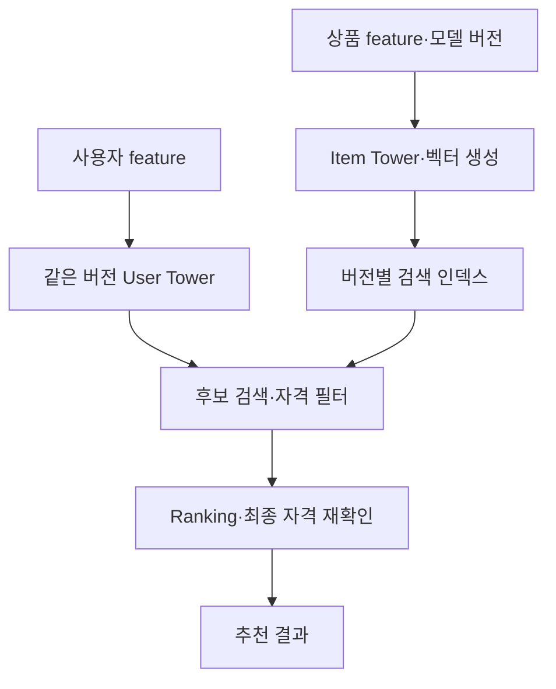

[Two-Tower 글](/posts/mf-vs-two-tower-recommendation-system/)에서는 사용자와 상품을 같은 벡터 공간에 표현하는 방법을 살펴봤다. 상품 벡터를 만들었다고 추천 요청마다 전체 상품을 빠르게 비교할 수 있는 것은 아니다. 다음 문제는 **제한된 시간 안에 좋은 후보를 얼마나 놓치지 않고 찾는가**다.

ANN은 Approximate Nearest Neighbor, 즉 근사 최근접 이웃 검색이다. 추천 문맥에서는 거리뿐 아니라 내적처럼 학습에 사용한 점수에 맞춰 상위 후보를 찾는다. Vector Search 전체가 ANN인 것은 아니며, 작은 후보 집합에서는 exact search도 유효한 선택이다.

아래 수치와 구성은 설계 예시다. 실제 추천 서비스의 성능 보고서가 아니며, Faiss·OpenSearch 실행과 부하 검증 결과를 제시하지 않는다.

## 모델과 인덱스의 역할을 구분한다

User Tower는 요청 시점의 사용자 벡터를 만들고, Item Tower는 상품 벡터를 만든다. 검색 인덱스는 그 상품 벡터 중 점수가 높은 후보를 찾는다. 이후 Ranking 모델이 더 많은 feature로 후보 순서를 정한다.



Retrieval에서 빠진 상품은 뒤의 Ranker가 복구할 수 없다. 후보 수를 늘리면 더 많은 관련 상품을 포함할 수 있지만, feature 조회와 Ranking 비용도 늘어난다. 따라서 검색 인덱스의 지연만 최적화하지 않고 전체 추천 요청의 시간 예산을 나눠야 한다.

## 먼저 점수 함수를 맞춘다

벡터 차원이 같아도 학습 목표와 검색 점수가 다르면 다른 후보가 나온다. inner product는 벡터 크기의 영향을 받고, cosine similarity는 방향의 유사성을 본다. cosine 검색을 inner product 인덱스로 구현하려면 상품·질의 벡터를 모두 L2 정규화한다. 0 벡터와 비정상 값은 별도 처리해야 한다. [1]

하지만 학습한 내적 모델을 임의로 정규화하면 순위가 달라질 수 있다. ‘벡터 검색은 보통 cosine을 쓰니까’라는 이유만으로 바꾸지 않는다. 모델 버전, 전처리, 차원, 정규화, 검색 metric을 하나의 배포 계약으로 관리한다.

상품이 100만 개이고 차원이 128이라면 float32 벡터 자체는 약 512MB다. 이는 `1,000,000 × 128 × 4`의 십진 단위 계산이며, ID·그래프·메타데이터·복제·프로세스 메모리는 제외한 값이다. 벡터 원본이 메모리에 들어간다는 사실만으로 목표 동시 요청량과 지연을 만족한다고 판단할 수는 없다.

## Exact baseline이 있어야 근사 오차를 잴 수 있다

Exact search는 정의한 점수로 대상 벡터를 모두 비교한다. 데이터가 작거나 검색 대상이 필터로 크게 줄어든다면 실용적일 수 있다. ANN을 쓰더라도 대표 질의 일부에 대해 exact 결과를 구해 근사 손실을 평가하는 기준으로 둔다.

Faiss에서는 `IndexFlatIP`나 `IndexFlatL2`로 baseline을 구성할 수 있다. Faiss의 L2 반환 값은 제곱 거리라는 점도 점수 해석에 포함한다. [1][2]

## HNSW와 IVF는 탐색 범위를 줄이는 방법이 다르다

| 방식 | 탐색 원리 | 주요 조절값 | 함께 측정할 비용 |
|---|---|---|---|
| Flat exact | 전체 후보의 점수 계산 | batch 크기·실행 자원 | 벡터 수와 차원에 따른 계산량 |
| HNSW | 여러 층의 근접 그래프 탐색 | M, efConstruction, efSearch | 그래프 메모리·구축 시간·질의 지연 |
| IVF | 대표 중심으로 나눈 리스트 중 일부 탐색 | nlist, nprobe | 학습·리스트 분포·탐색 후보 수 |

HNSW의 `M`은 그래프 연결 수에 관련되고, `efConstruction`은 구축 시 탐색 폭, `efSearch`는 질의 시 탐색 폭을 조절한다. 탐색 폭을 늘리면 보통 exact 결과에 가까워지는 대신 비용이 늘지만, 실제 효과는 데이터와 구현에 따라 측정해야 한다.

IVF는 대표 데이터로 coarse quantizer를 학습해 벡터를 리스트에 배치한다. `nprobe`는 질의 때 살펴보는 리스트 수다. `nprobe`만 키우는 대신 학습 데이터가 운영 분포를 대표하는지, 특정 리스트가 과도하게 큰지도 확인한다. [2][3]

IVF와 압축은 같은 말이 아니다. `IVFFlat`은 선택한 리스트 안에서 원래 벡터를 비교하고, `IVFPQ`처럼 Product Quantization을 조합하면 메모리와 추가 근사 오차를 함께 고려해야 한다. 인덱스의 종류와 압축 방식을 따로 기록한다.

## 두 종류의 Recall을 섞지 않는다

**ANN Recall@K**는 같은 벡터·metric·후보 집합의 exact Top-K 중 얼마나 되찾았는지를 나타낼 수 있다.

`ANN Recall@K = |ANN TopK ∩ Exact TopK| / K`

이는 사용자가 좋아하는 상품을 찾았다는 의미가 아니다. Exact 결과 자체가 사용자의 선호와 맞지 않을 수 있다. 반면 추천 품질 평가의 Recall@K는 사용자의 관련 아이템 집합을 분모로 삼는다.

```python
exact = {"A", "B", "C", "D"}
ann = {"A", "B", "E", "F"}
relevant = {"B", "F", "G"}
k = 4

assert len(exact) == k and len(ann) <= k
ann_recall = len(ann & exact) / k
recommendation_recall = len(ann & relevant) / len(relevant)
print(f"ANN Recall@4={ann_recall:.3f}")
print(f"Recommendation Recall@4={recommendation_recall:.3f}")
```

이 예제의 출력은 각각 `0.500`, `0.667`이다. 집합은 계산을 설명하기 위한 가상 결과이며 ANN을 실행한 결과가 아니다. 실제 benchmark에서는 중복 ID를 제거하고, exact Top-K 경계의 동점 처리와 K개 미만인 후보 집합의 분모 정책도 정한다.

보고서에는 ANN Recall 외에 사용자 관련도 기준의 Retrieval Recall, 지연의 p50·p95·p99, 처리량, 메모리, 구축 시간과 갱신 지연을 함께 남긴다. 같은 질의·동시성·필터 조건에서 비교해야 한다. 추천 지표의 자세한 해석은 [Recall·Precision·NDCG 글](/posts/recommender-evaluation-recall-precision-ndcg/)에서 이어진다.

## Faiss로 exact와 HNSW를 비교하는 골격

다음은 Python에서 `numpy`와 `faiss`를 사용하는 API 구성 예시다. 이 환경에서는 Faiss를 실행하지 않았으므로 특정 Recall이나 지연 수치를 주장하지 않는다. 실험할 때 설치한 패키지 버전·CPU·스레드 수와 실제 상품 벡터를 기록해야 한다.

```python
import numpy as np
import faiss

rng = np.random.default_rng(42)
items = rng.normal(size=(10000, 64)).astype("float32")
queries = rng.normal(size=(100, 64)).astype("float32")
# 이 예제는 cosine 검색이므로 양쪽을 정규화한다.
faiss.normalize_L2(items)
faiss.normalize_L2(queries)
k = 10

exact = faiss.IndexFlatIP(64)
exact.add(items)
_, truth = exact.search(queries, k)

ann = faiss.IndexHNSWFlat(64, 32, faiss.METRIC_INNER_PRODUCT)
ann.hnsw.efConstruction = 100
ann.hnsw.efSearch = 64
ann.add(items)
_, found = ann.search(queries, k)

recall = np.mean([
    len(set(a[a >= 0]) & set(t[t >= 0])) / k
    for a, t in zip(found, truth)
])
print(f"ANN Recall@{k}={recall:.4f}")
```

여기서 반환 ID는 추가한 배열의 행 번호다. 운영에서는 상품 ID 매핑을 인덱스와 함께 버전 관리한다. 난수 벡터 실험은 API와 평가 흐름을 확인하는 용도이며 실제 데이터 분포·필터·갱신 비용을 대표하지 않는다. Faiss의 기본 데이터 형태와 인덱스 API는 공식 예제를 참고한다. [2][4]

## 판매 가능 조건은 검색 설계에 포함한다

가장 가까운 100개를 가져온 뒤 품절·지역 제한으로 90개를 제거하면 최종 후보는 10개만 남는다. 처음부터 1,000개를 가져오는 방법은 도움이 될 수 있지만 충분한 후보를 항상 보장하지 않으며 비용도 늘어난다.

OpenSearch는 검색 내부의 efficient filtering과 검색 후 post-filtering 등을 구분한다. 지원 엔진·방법·버전에 따라 실행 방식이 달라지므로 `filter`가 있다는 이유만으로 모두 같은 검색이라고 생각하면 안 된다. Post-filter는 필터 후 결과가 K보다 작아질 수 있다. [5][6]

벤치마크는 필터 없는 전체 검색뿐 아니라 실제 지역·카테고리·판매 상태 조합으로 수행한다. 비교 기준인 exact 결과도 동일한 자격 집합에서 구해야 한다. 자격을 통과하는 전체 상품이 K보다 적으면 K개를 반환할 수 없다는 사실도 별도로 표시한다.

인덱스의 재고 상태가 지연될 수 있으므로 최종 노출·구매 경계에서는 원본 상태를 다시 확인한다. 접근 권한 필터는 추천 품질을 높이기 위한 선택 옵션이 아니라 별도 강제 조건으로 다룬다.

## 모델 교체는 인덱스 교체와 묶는다

새 User Tower와 이전 Item Tower의 벡터를 섞으면 차원이 같아도 점수의 의미가 깨질 수 있다. 새 모델로 상품 벡터를 생성하고 별도 인덱스를 만든 뒤, 평가와 제한된 트래픽 검증을 거쳐 사용자 모델과 인덱스 포인터를 함께 전환한다.

전환 전후에는 상품 추가·수정·삭제가 계속 들어온다. 스냅샷 이후 변경을 새 인덱스에 따라잡게 하고, 삭제와 판매 중단이 반영됐는지 확인해야 한다. 복구하려면 이전 모델과 인덱스뿐 아니라 ID 매핑과 전처리 계약도 보존한다.

Faiss는 검색 라이브러리이고 OpenSearch는 검색 서비스 운영 기능을 제공하는 시스템이다. Faiss를 사용하면 서비스 API·분산·갱신·복구를 별도로 설계할 수 있고, OpenSearch를 선택해도 shard·replica·refresh·인덱싱 부하의 책임은 남는다. 제품 이름보다 갱신 요구와 운영 인력, 평가 결과를 기준으로 선택한다.

실제 도입은 exact baseline에서 시작해, 목표 지연을 충족하지 못하는 범위를 확인하고, HNSW나 IVF의 탐색 폭을 조절해 비교할 수 있다. 검색 오차와 사용자 관련도, 필터 후 후보 수를 각각 기록해야 모델 문제와 인덱스 문제를 구분할 수 있다.

## 참고 자료

공식 자료 확인일: 2026-10-19. 집합 기반 Recall 계산은 실행 확인했으며 Faiss·OpenSearch 실행과 성능 측정은 하지 않았다. `latest` 문서는 변할 수 있으므로 실제 배포 버전의 엔진·필터 지원을 다시 확인한다.

1. [Faiss — MetricType and distances](https://github.com/facebookresearch/faiss/wiki/MetricType-and-distances)
2. [Faiss — Faiss indexes](https://github.com/facebookresearch/faiss/wiki/Faiss-indexes)
3. [Faiss — Guidelines to choose an index](https://github.com/facebookresearch/faiss/wiki/Guidelines-to-choose-an-index)
4. [Faiss — Getting started](https://github.com/facebookresearch/faiss/wiki/Getting-started)
5. [OpenSearch — Efficient k-NN filtering](https://docs.opensearch.org/latest/vector-search/filter-search-knn/efficient-knn-filtering/)
6. [OpenSearch — Post-filtering](https://docs.opensearch.org/latest/vector-search/filter-search-knn/post-filtering/)
