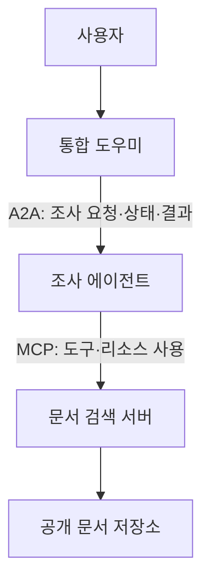

AI 에이전트가 자료를 검색하고 다른 에이전트에게 일을 맡기는 모습을 보면 둘 다 “외부에 요청하는 것”처럼 보인다. 하지만 어떤 요청을 표준화하려는지에 따라 필요한 인터페이스가 달라진다.

**MCP(Model Context Protocol)는 AI 애플리케이션에 도구와 문맥을 연결하는 데, A2A(Agent2Agent)는 독립적인 에이전트 사이의 작업과 정보 교환에 초점을 둔다.** [A2A 공식 문서](https://a2a-protocol.org/latest/topics/a2a-and-mcp/)도 두 프로토콜을 서로 보완하는 관계로 설명한다.

이번 글은 실제 서비스 구축 후기가 아니라 구조를 설명하는 글이다. 예시는 모두 가상의 공개 자료 조사 서비스이며, 특정 SDK 버전의 실행 코드나 성능 측정은 포함하지 않는다.

## MCP는 어떤 기능을 사용할 수 있는지 연결한다

MCP에서는 AI 애플리케이션인 호스트가 클라이언트를 통해 서버와 통신한다. 서버는 도구, 리소스, 프롬프트 같은 기능을 제공한다. [MCP 아키텍처 문서](https://modelcontextprotocol.io/docs/2026-07-28/learn/architecture)는 이 역할을 구분하며, MCP가 애플리케이션 내부의 LLM 사용 방식까지 정하는 것은 아니라고 설명한다.

가상의 자료 조사 도우미에는 다음 기능을 연결할 수 있다.

| 기능 예시 | 역할 |
|---|---|
| 공개 문서 검색 도구 | 검색어를 받아 문서 후보 반환 |
| 문서 본문 리소스 | 요약에 필요한 원문 제공 |
| 요약 요청 프롬프트 | 반복해서 사용하는 요청 양식 제공 |

도구를 호출하는 방법을 연결했다고 어떤 문서를 믿을지, 몇 번 검색할지, 결과를 언제 사용자에게 보여줄지까지 결정되는 것은 아니다. 그 판단과 제어는 애플리케이션의 설계에 남는다.

또한 MCP 서버가 반드시 단순한 함수만 실행하는 것은 아니다. 내부에서 복잡한 처리를 할 수도 있다. 핵심은 구현의 복잡도보다 외부에 어떤 기능과 계약을 노출하느냐에 있다.

## A2A는 다른 에이전트에게 요청을 전달한다

같은 도우미가 외부의 자료 조사 에이전트에게 “공개 문서를 비교하고 근거가 포함된 요약을 만들어 달라”고 요청한다고 하자. 호출자는 상대가 내부에서 어떤 모델이나 도구를 사용하는지 모두 알 필요가 없다.

A2A의 주요 개념은 다음과 같다. 자세한 정의는 [공식 핵심 개념 문서](https://a2a-protocol.org/latest/topics/key-concepts/)에서 확인할 수 있다.

| 개념 | 이해할 때의 관점 |
|---|---|
| Agent Card | 에이전트가 제공하는 능력과 접속·인증 관련 정보를 알리는 설명 |
| Message | 요청과 응답 과정에서 주고받는 내용 |
| Task | 작업의 진행과 상태를 추적하는 단위 |
| Artifact | 작업으로 만들어진 결과물 |

모든 응답이 반드시 장기 실행 작업인 것은 아니다. 상황에 따라 메시지로 응답할 수도 있고, 상태를 추적하는 작업으로 이어질 수도 있다. A2A를 단순히 “오래 걸리는 API”라고만 이해하면 에이전트 간 상호작용이라는 목적을 놓친다.

## 두 프로토콜이 함께 쓰이는 모습

아래는 가능한 설계 예시다. 사용자는 통합 도우미에 공개 문서 비교를 요청한다. 도우미는 별도의 조사 에이전트에 작업을 맡기고, 조사 에이전트는 자신의 도구로 원문을 확인한다.

이 그림에서 A2A는 통합 도우미와 조사 에이전트 사이의 교환에 사용된다. MCP는 조사 에이전트가 검색과 원문 접근 기능을 사용하는 구간에 쓰인다.

반드시 이 구조를 따라야 하는 것은 아니다. 통합 도우미가 MCP 서버를 직접 사용할 수도 있고, 조사 에이전트가 내부에서 일반 HTTP API를 사용할 수도 있다. 두 프로토콜을 모두 도입하는 것이 목표는 아니다.

## 단순한 기능 호출과 작업 위임을 구분한다

설계할 때는 “MCP와 A2A 중 무엇이 더 최신인가?”보다 아래 질문이 도움이 된다.

| 설계 질문 | 검토할 방향 |
|---|---|
| 정해진 입력으로 검색·조회 기능을 사용하면 충분한가? | MCP 도구나 기존 API 연결 |
| 별도로 운영되는 에이전트와 요청·추가 정보·결과를 교환해야 하는가? | A2A 연결 |
| 다른 클라이언트나 외부 에이전트와 호환할 필요가 없는가? | 내부 함수와 단순한 서비스 호출도 검토 |
| 두 연결이 모두 필요한가? | 에이전트 사이에는 A2A, 내부 도구에는 MCP를 조합하는 구조 검토 |

이는 이 글에서 제안하는 선택 기준이며 프로토콜이 강제하는 규칙은 아니다. MCP 도구 뒤에 에이전트를 감쌀 수도 있다. 다만 그렇게 노출할 때 상태 추적이나 추가 입력 교환을 어떤 인터페이스로 표현할지 결정해야 한다.

## 프로토콜이 연결돼도 권한은 별도로 확인한다

Agent Card에 “문서를 조사할 수 있다”고 적혀 있다는 사실과 특정 문서를 읽을 권한이 있다는 사실은 다르다. 마찬가지로 도구 목록에 어떤 기능이 보인다고 모든 호출자가 그 기능의 모든 데이터를 사용할 수 있는 것은 아니다.

이 가상 서비스에서는 다음 책임을 나누는 편이 좋다.

- 통합 도우미는 사용자 요청의 범위와 전달할 데이터를 결정한다.
- 조사 에이전트는 수락한 작업의 범위와 접근 권한을 확인한다.
- 문서 서버는 실제 데이터 접근 시 호출자의 권한을 검증한다.
- 사용자에게 결과를 전달하는 쪽은 근거와 완료 조건을 확인한다.

특히 한 서비스가 가진 자격 증명을 다른 서비스에 그대로 넘기는 방식부터 시작하지 않아야 한다. 누구의 권한으로 어떤 대상에 접근하는지, 요청을 위임받은 서비스가 어느 범위까지 행동할 수 있는지 정해야 한다. 구체적인 인증 구현은 선택한 프로토콜 버전과 배포 환경에 맞춰 별도로 설계한다.

## 실패와 완료도 애플리케이션의 의미로 정의한다

통신이 성공했다고 사용자의 일이 끝난 것은 아니다. 조사 에이전트가 결과물을 반환했더라도 출처가 누락됐거나 요청한 문서 일부를 확인하지 못했을 수 있다.

이 예시라면 완료 조건을 “비교 대상 문서, 각 주장에 대한 출처, 확인하지 못한 범위를 함께 전달한다”로 정할 수 있다. 중간에 요청이 끊겼을 때 같은 작업을 새로 시작할지, 기존 작업을 조회할지, 취소 요청 후 실제 처리가 멈췄는지 확인하는 정책도 필요하다.

반복 호출이 외부 변경을 일으키는 서비스라면 중복 방지와 재시도 경계가 더 중요해진다. 프로토콜에 상태 표현이 있더라도 각 작업의 부작용이 자동으로 안전해지는 것은 아니다.

## 연결의 평가와 결과의 평가를 분리한다

[LLM-as-Judge 글](/posts/ai-search-keyword-model-benchmark-luna/)에서 다룬 평가는 여기서 생성된 요약의 충실성을 검토하는 데 사용할 수 있다. 하지만 그 점수만으로 MCP나 A2A 연결 전체가 올바르게 동작한다고 볼 수는 없다.

요약이 정확한지와 권한 없는 문서를 읽지 않았는지는 서로 다른 질문이다. 생성 결과는 평가 기준과 사람 검토로 확인하고, 접근 거부·오류 처리·중복 호출 같은 동작은 시스템 테스트와 기록으로 확인해야 한다.

MCP와 A2A를 이해할 때는 어떤 경계를 연결하는지부터 그려보면 좋다. 필요한 기능을 가져오는 경계인지, 독립적으로 운영되는 상대와 작업을 교환하는 경계인지 정리하면 도입할 프로토콜과 애플리케이션에 남는 책임이 더 분명해진다.

## 참고 자료

- [MCP Architecture overview — 2026-07-28 문서](https://modelcontextprotocol.io/docs/2026-07-28/learn/architecture)
- [A2A and MCP](https://a2a-protocol.org/latest/topics/a2a-and-mcp/)
- [A2A Core Concepts](https://a2a-protocol.org/latest/topics/key-concepts/)

공식 문서는 2026년 10월 28일 확인했다. 버전별 메시지 형식과 SDK 호출법은 이 개념 설명과 구분해 확인해야 한다.
